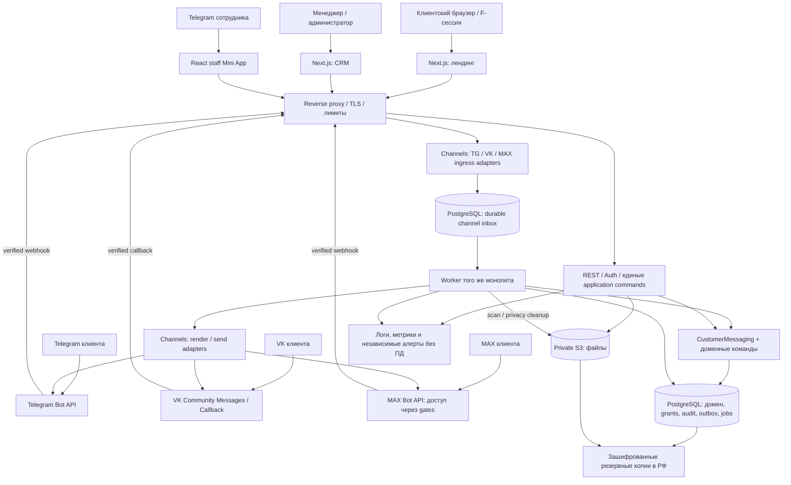
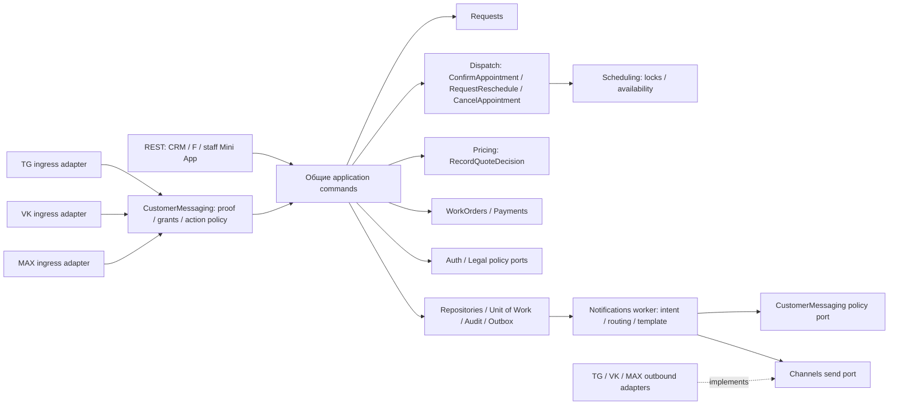

# Архитектура системы выездного ремонта

**Ревизия R3.2 (решения владельца, география одной компании и уточнение стека). Этап:** 0 — проектирование. Ранее обозначенная R2.1 является ревизией, проверенной как R3; исторические R1/R2 и имя WF-R2 не переименовываются. **Дата обследования:** 19.11.2026.
**Статус:** проект для независимой проверки. Факты/решения владельца и AS-MAX-01 зафиксированы в [DECISIONS §18/§20](DECISIONS.md); остальные инженерные детали остаются предложениями. Разрешения на реализацию нет.

Источник требований — [ТЗ v1.0](../ТЗ.md), новое требование клиентских каналов Telegram/VK/MAX и аудит Claude A-01–L-03. Дополнительный источник — [прайс](../Прайс.txt), пока не утверждённый как машинный каталог. Связанные документы: [БД](DATABASE.md), [API](API.md), [дорожная карта](ROADMAP.md), [решения и вопросы](DECISIONS.md). R2 уточняет проект до создания кода/миграций; исходные требования и история обследования сохраняются. Любые нижеописанные варианты стека, ACL, workflow, jobs и развёртывания остаются предложениями до явного owner approval.

## 1. Границы и состояние проекта

Рабочая папка: `C:\LocalAI\fixlevelup`. До обследования в ней были только четыре файла:

| Материал | Результат обследования |
|---|---|
| [ТЗ](../ТЗ.md) | Прочитаны все 1079 строк, разделы 1–21 |
| [Прайс](../Прайс.txt) | Прочитан; четыре категории, диапазоны, дубликат телевизионной позиции; нет кодов, длительностей и правил выбора точной цены |
| [Логотип](../fixlevelup_logo.jpg) | Наличие подтверждено; визуальный просмотр инструментом недоступен текущей модели |
| [Референс](../референс.png) | Наличие подтверждено; визуальная оценка не выполнена, макеты не согласованы |

Исходного кода, package manifests, lock-файлов, миграций, тестов, Docker-конфигурации и существующей документации не обнаружено. Скрытые элементы верхнего уровня проверены. Исходные материалы не изменены и не удалены. Git первоначально отсутствовал; в ходе этапа 0 инициализирован локальный репозиторий с веткой `main`, добавлена [политика исключений](../.gitignore). Удалённый репозиторий и первый коммит не настроены; author identity настроена локально; **публичное использование личного email не утверждено**, global Git намеренно не настраивается — см. [решения](DECISIONS.md#12-служебные-изменения-окружения). Публикация никуда не выполнялась.

### Окружение (наблюдения, не целевые версии всех зависимостей)

| Инструмент | Проверено | Вывод |
|---|---|---|
| Node.js | `v24.22.3` | Доступен локально |
| npm | `11.19.1` | Доступен локально |
| pnpm | Не найден в PATH | Не устанавливался; выбор/закрепление версии — этап 1 |
| Corepack | `0.36.0` | Доступен, активация менеджера пакетов не выполнялась |
| Docker CLI | `29.2.1`, build `a5c7197` | Доступен |
| Docker Compose | `v5.0.2` | Команда версии работает |
| Docker Engine | Docker Desktop `4.61.0` (219004), Engine `29.2.1`, `linux/amd64` | Доступен и отвечает: `docker version`/`docker info` возвращают сервер, запущены 6 контейнеров. Прежняя запись «доступ отклонён» была артефактом confined-режима: DSH запрещает открытие именованных каналов, поэтому `npipe:////./pipe/dockerDesktopLinuxEngine` даёт `permission denied` даже при живом демоне. Проверка Engine выполняется вне песочницы — см. [решения](DECISIONS.md#12-служебные-изменения-окружения) |
| Git | `2.53.0.windows.1` | Работает; имя/почта identity настроены локально (значение email в документацию не включается), global не менялся; коммитов нет. Публичный author/committer address требует отдельного утверждения, техническая настройка не означает согласие на публикацию |
| psql | Не найден в PATH | Предполагается клиент внутри контейнера; БД не создавалась |
| Python | Найдены WindowsApps aliases | Работоспособность интерпретатора не подтверждена и для проекта не требуется |

Команды проверки: `Get-Command`, `node --version`, `npm --version`, `docker --version`, `docker compose version`, `docker version --format '{{json .}}'`, `git --version`, `git rev-parse`, `git status`, `git config --get user.name/user.email`. Ошибки Git до `git init` означали отсутствие репозитория, а не повреждение. Исправление прав Windows с разрешения пользователя описано в [решениях](DECISIONS.md#12-служебные-изменения-окружения).

Не выполнялись: установка зависимостей, создание приложения, подключение Telegram, миграции, запуск тестов/сборки, создание инфраструктуры. Ни одна функция не объявляется реализованной.

## 2. Зафиксированные границы версии 1

Одна компания/мастерская, 5–10 штатных мастеров; в v1 один настроенный ACTIVE/primary город и режим SINGLE_CITY без выбора города клиентом. Модель с первых доменных миграций допускает будущие города этой же компании (§2.1); независимые организации/tenants не добавляются. Публичный лендинг, CRM и клиентские боты Telegram/VK/MAX используют один backend и одну транзакционную PostgreSQL. Сотрудники сохраняют Telegram Mini App; staff Mini Apps/авторизация в VK/MAX не добавляются. У всех клиентских каналов единые заявки, визиты, сметы и бизнес-команды. Менеджер окончательно назначает мастера и закрывает заказ. Мастер не задаёт произвольные цены. Оплата происходит клиентом непосредственно мастеру; система регистрирует отметку, но не принимает деньги.

Telegram, VK и MAX — **три равноправных целевых** способа подтверждения/уведомлений: одинаковые domain commands/проверки/критерии, без зашитого предпочтения Telegram для клиента. Владелец — **самозанятый, резидент РФ**, оба факта подтверждены. Регистрация MAX, платформенная верификация, создание/модерация бота и получение token отложены. **AS-MAX-01 принят для архитектуры и разработки** общего core, admin UI, adapter, binding port и изолированных contract tests по официальному API; отдельное разрешение начать код по-прежнему нужно. Отсутствие MAX connection/token не блокирует P01 и другие модули. Допущение не делает неподключённый MAX real-ready: до реального использования необходимы регистрация/credentials, техническая готовность, успешный live acceptance и нужная фаза клиентского E (§10.2/§10.4). Совместимость фактической платформенной конфигурации с use case проверяется при live-подключении без повторного обсуждения договорных разрешений; owner supersession — [DECISIONS §20](DECISIONS.md#20-решения-владельца-r32).

Не добавляются в v1: личный кабинет клиента с паролем, эквайринг, касса/ОФД, зарплаты/бухгалтерия, склад, GPS, GIS/полигоны/карты, маршрутная оптимизация, запуск второго города и его UI, маркетплейс, автоматическое получение отзывов Авито. Исключение из ПО не отменяет фискальные обязанности бизнеса.

### 2.1. География одной компании и исторический городской контекст

Каноническая модель, поля и same-city FK — [DATABASE §3.8](DATABASE.md#38-география-одной-компании-основа-будущих-городов-r32); контракт API — [API §3.1](API.md#31-городской-контекст-и-инварианты). `service_cities` — стабильные идентичности городов, `service_city_versions` — immutable имя/отображение, IANA timezone, местные контакты и часы диспетчерской. V1 readiness требует ровно один ACTIVE/primary при SINGLE_CITY; постоянного SQL-ограничения «всегда максимум один город» нет. Значения задаёт владелец; скрытого Moscow/browser timezone default нет.

- **Intake и история:** trusted site context фиксирует `intake_city_id` и immutable city version в F-сессии. Callback и полная заявка с момента commit имеют NOT NULL `city_id/intake_city_version_id`, даже без адреса; клиент v1 не выбирает и не подменяет city ID. Город заявки lifetime stable. Ошибка города исправляется явной staff cancel/correct policy и новой linked request с audit/повторной проверкой grants/consent, не PATCH старой city. Address snapshot хранит city/area versions, скопированные display strings/timezone, optional district и результат manual coverage. Appointment и plan имеют тот же request city через composite FK; переименование города/зоны не переписывает историю.
- **Покрытие:** существующая `service_areas` получает `city_id`, а `service_area_versions` сохраняют immutable описание/ручные критерии адресов. Optional реальные `administrative_districts` принадлежат городу. `service_area_district_coverage` — city-scoped M:N между **версией зоны** и районами с FULL/PARTIAL; район и mapping только подсказки, не доказательство адресного IN_ZONE. При overlap менеджер фиксирует одну фактическую service zone с evidence. GIS/полигоны/маршруты не требуются.
- **Мастера и расписание:** `technician_city_memberships` и существующая `technician_service_areas` содержат city, период действия и историю; assignment требует одновременно действующих city membership и zone grant. Смены хранят city/timezone snapshot; presence/employment глобальны, исключения имеют явный GLOBAL либо CITY scope. Общий resource lock по **tech ID без city** и UTC capacity учитывают reservations и schedules всех городов, глобальную недоступность и пересечения. Revoke membership берёт тот же lock и вызывает явный manager replan/attention. Межгородская дорога до второго города решается ручными scheduling blocks, без выдуманной travel модели.
- **Деньги:** общие стабильные catalog items и semantic price_rules остаются company-wide. Денежные price/rule versions и public estimates имеют `city_id NOT NULL`; exclusion keys включают `(city,item/rule,period)`. Нет global/city price fallback: отсутствует цена города — PRICE_NOT_CONFIGURED. Quote city равен request city, tariff/time context берётся из текущего согласованного plan timezone snapshot (до плана — явный intake city context). Принятые суммы/строки/округление immutable; новые настройки/цены их не пересчитывают.
- **Один источник настроек:** business settings содержат company legal identity, глобальные security/upload/retention/channel policies и primary city reference; местные timezone/контакты/office hours принадлежат только city versions. Существующие content blocks/revisions получают COMPANY/CITY scope и provenance; отдельной city_content таблицы нет. Callback interval reference entries имеют только CITY scope и timezone intake city, без company fallback. Уведомления используют plan timezone, до плана — request intake snapshot; due_at/actuals UTC. Аналитика явно указывает выбранный city/timezone/basis; агрегирование разных городов и границы общих периодов уточняются перед вторым городом. Общие TG/VK/MAX bots/templates и A–E каталог не дублируются по городам.

P01 содержит только документацию портов и synthetic FK/snapshot proof, **без geography domain tables/данных**. P03 создаёт geography/settings/coverage/membership structure; P04 — city prices; P05 — request city/F context; P09A/B — city schedules/assignment с глобальной capacity. Активация второго города, public routes/selector, staff city filters/UI и cross-city travel policy — последующий scope при уже готовой схеме. G01–G07 из [DATABASE §3.8](DATABASE.md#38-география-одной-компании-основа-будущих-городов-r32) входят вложенными assertions в существующие X/N/DoD; исходные 25 и полная 69-ID матрица сохраняются.

## 3. Предлагаемый стек

| Слой | Предложение | Причина / условие |
|---|---|---|
| Язык | TypeScript **6.0.3**, strict | Кандидат вместо автоматического latest stable7.0.2: совместимость compiler API ecosystem ещё требует build proof |
| Runtime | Node.js **24.22.3 LTS** | Локально доступен; более новый LTS26.13.1 не выбирается автоматически |
| Монорепозиторий | **pnpm12.21.0** stable, workspaces | Native cross-platform binaries проверяются в Preflight B; API/worker, web и staff Mini App, без отдельного приложения на каждый клиентский бот |
| Сайт + CRM | **Next16.4.6 + React19.3.1** | SSR/SEO и защищённые CRM layouts; Next bundler отдельно от Vite |
| Mini App | **React19.3.1 + Vite8.3.8** | Отдельная мобильная сборка; Telegram SDK как адаптер |
| Backend | **Nest12.5.1**, REST `/api/v1`, OpenAPI | Один модульный монолит, общие application commands |
| БД | **PostgreSQL18.7 + Prisma7.10.1** stable | Транзакции; reviewed SQL для exclusion/partial constraints; Prisma8 RC не baseline |
| Файлы | Приватное S3-совместимое хранилище в РФ | API авторизует доступ; dev implementation/license/image candidate и точный SDK — [Preflight B](PREFLIGHT_P01.md#b-стек-и-версии--полный-exact-baseline-r32) |
| Фоновые задачи | PostgreSQL inbox/outbox/intents/deliveries/jobs + worker того же backend-пакета | Без Redis, брокера и отдельных сервисов Telegram/VK/MAX; собственная idempotency бизнес-команд |
| Тесты | **Vitest5.1.1 — единый основной runner backend/frontend/common**, Supertest для HTTP, Testing Library для UI, Playwright для browsers/E2E | Реальный PostgreSQL той же major-версии; точные supporting packages/browser image — Preflight B |
| Lint | **ESLint10.15.0**, **typescript-eslint8.73.0**, standalone **@next/eslint-plugin-next16.4.6** | Standalone plugin выбран вместо eslint-config-next: хотя сам config допускает ESLint10, транзитивные plugin peers≤9 требуют отдельного proof; ESLint9 уже EOL |
| Доставка | Docker Compose, reverse proxy с TLS, CI | Раздельные dev/staging/prod; основная БД/файлы/бэкапы в РФ |

Это **кандидаты**, не доказанная совместная сборка и не разрешение установить зависимости. Точный inventory, официальная source matrix, engines/peers/license/security review и контейнерные digests ведутся в [Preflight P01 §B](PREFLIGHT_P01.md#b-стек-и-версии--полный-exact-baseline-r32); он является источником exact supporting package versions. Стабильные версии закрепляются в lock-файле, `packageManager`, `engines` и CI после отдельного разрешения; prerelease не baseline. Для единого Vitest5/Vite8 runner выбран официальный Nest12.5.1 подход: Oxc transform с legacy decorators+metadata; metadata support partial, поэтому обязательны реальные Nest DI/decorator integration/build proofs и независимый `tsc --noEmit`. Oxc transform сам не typecheck. SWC остаётся записанной альтернативой только при отдельном выборе после результатов proof.

Первичная проверка официального PostgreSQL подтвердила range/exclusion constraints. Исторические platform references и уровни проверки сохраняются в [DECISIONS §14](DECISIONS.md#14-официальное-исследование-клиентских-платформ); актуальные owner facts/supersession — [DECISIONS §20](DECISIONS.md#20-решения-владельца-r32). Технические API/schema/config compatibility проверки выполняются перед live соответствующего адаптера; повторное исследование договорных разрешений MAX не является условием архитектуры/разработки.

## 4. Схема компонентов



Узлы PostgreSQL на схеме — одна физическая БД, показанная по ответственности. API и worker — два процесса одного приложения, одна модель и один релиз; worker не автономный микросервис. Webhook adapter аутентифицирует источник и сохраняет inbox, а worker исполняет общую application command. REST из исходной F-сессии завершает binding той же общей командой. Веб-приложения не имеют PostgreSQL credentials и не используют Prisma. Next.js server routes могут обслуживать SSR/прокси, но не повторяют pricing, права или state machine. Токены/секреты провайдеров не передаются в frontend.

## 5. Предлагаемая структура репозитория

Ниже **целевая**, пока не созданная структура (кроме текущих документов и Git):

```text
apps/
  api/src/
    modules/{auth,customers,requests,catalog,pricing,scheduling,dispatch,
             work-orders,payments,customer-messaging,channels,notifications,
             content,analytics,audit,files,legal,settings}/
    modules/channels/infrastructure/{telegram,vk,max}/
    modules/auth/infrastructure/staff-telegram/
    bootstrap/                 # API и worker entrypoints одного пакета
  web/                         # публичный лендинг + /crm, разные layouts
  miniapp/                     # интерфейс штатного мастера
packages/
  api-client/                  # генерируется из OpenAPI, без бизнес-вычислений
  ui/                          # общие доступные UI-примитивы
  tooling/                     # TS/lint/test конфигурации
prisma/
  schema.prisma
  migrations/                  # SQL версионируется вместе с Prisma
infra/
  compose/                     # dev/staging/prod профили
  proxy/
  backup/                      # скрипты без секретов, восстановление
  monitoring/
tests/
  integration/
  e2e/
  performance/
docs/
  ARCHITECTURE.md
  DATABASE.md
  API.md
  ROADMAP.md
  DECISIONS.md
  # далее: OpenAPI, макеты, runbooks, threat model, test evidence
```

ТЗ и исходные бизнес-материалы сохраняются на месте. Переименование/перенос — отдельное согласование. README, CHANGELOG, `.env.example`, package manifests появятся на этапе 1, не маскируются пустыми «реализациями» на этапе 0.

## 6. Backend: слои и зависимости

Внутри каждого модуля: `transport` (REST/provider DTO) → `application` (команды, проверки, транзакции) → `domain` (инварианты) → интерфейсы repository/clock/integration. Prisma, S3 и Telegram/VK/MAX adapters реализуют порты в infrastructure; domain не импортирует SDK провайдера. Общими являются transaction context, идентификация actor, ошибки, часы, idempotency и событие outbox; не бесконтрольный shared service.

| Модуль-владелец | Ответственность | Зависимости use case |
|---|---|---|
| Auth | сотрудники, CRM/staff Mini App sessions, capability policies, staff Telegram identity/invitations | Audit, Settings; staff links не дают customer grants |
| Customers / Legal | контакты, адреса, consent evidence, legal documents, privacy cases/jobs | Auth, Files; phone не unique identity |
| Catalog | техника, бренды, симптомы, работы и запчасти | Audit |
| Pricing | city-scoped версии цен/правил без global fallback, calculation trace, накопительные immutable сметы/решения, adjustment approval | Catalog, Auth, Settings/Geography; клиентский principal через CustomerMessaging policy port |
| Requests | агрегат заявки, stable city/intake snapshot, WF-R2, история, request channel preference pointer | Customers, Legal, Auth, Settings/Geography context port; минимальные read ports Pricing/Dispatch/WorkOrders |
| Scheduling | city/timezone смены, GLOBAL/CITY исключения, глобальное presence, coverage/capacity sweep across cities, единый tech resource lock | Catalog, Settings/Geography membership/zone read ports |
| Dispatch | same-city stable appointments, immutable plan/timezone/reservations, confirmations, change requests, назначение/перенос/stop | Scheduling, Requests, Auth, Settings/Geography qualification port; CustomerMessaging policy port |
| WorkOrders | диагностика, нестандартные позиции, отчёт с одной approved quote version, гарантия | Requests, Pricing, Files |
| Payments | append-only receipt/reversal/refund с allocations, баланс, closure reconciliation | Pricing, Requests, Auth |
| CustomerMessaging | customer↔account links, request grants, challenges/claims, permission epochs, primary/fallback policy, conversation/actions | Customers, Requests, Legal, Channels ports; вызывает Dispatch/Pricing application commands |
| Channels | connections/accounts/private endpoints, provider permission evidence, durable inbox и normalization, render/send adapters | Provider DTO → общий command input; без собственной state machine заявки/сметы/визита |
| Notifications | outbox → intents → deliveries/attempts, versioned templates/routing, reminders, CRM alerts | Доменные события, Auth, CustomerMessaging routing/policy и Channels send ports |
| Geography (подмодуль существующего Settings, тот же владелец) | cities/immutable local versions, существующие zones+versions, optional districts/M:N coverage, city/zone memberships; trusted intake context и same-city qualification ports | Auth, Audit; P03 structure, P09 membership UI; без микросервиса/tenant registry |
| Content / Settings | COMPANY/CITY контент, отзывы Авито, company legal/security/retention/primary-city settings и launch readiness; offer catalog A — Settings, C-tech/C-live/D и scheduler — Channels | Geography local settings port, Catalog, Legal, Audit; без дублирования city timezone/контактов/часов |
| Analytics | read-only проекции/агрегаты с city/timezone/basis/asOf | чтение Requests/Dispatch/Pricing/Payments/WorkOrders |
| Audit / Files | журнал и private file lifecycle с конкретными FK owners | Общая инфраструктура, без обхода доменных прав |



Стрелки отражают направление вызова/контракта, а infrastructure зависит от объявленных портов. Общие команды `ConfirmAppointment`, `RequestReschedule`, `CancelAppointment`, `RecordQuoteDecision` получают нормализованный actor, grant/permission epoch, request, subject version и собственный command key. Каждый provider adapter лишь переводит verified event/action token в эти входные данные. Копий pricing, dispatch и workflow по ботам нет; staff Mini App вызывает те же доменные операции по staff policy.

Запись таблицы возможна только через её модуль-владелец. Межмодульный сценарий координируется application service и единым Unit of Work; не цепочкой HTTP между локальными модулями. Guards читают минимальные данные через порты, не вызывают друг друга рекурсивно. После commit внешние действия выполняет worker. Analytics не изменяет оперативные сущности. Таблицы/инварианты и точные транзакционные протоколы — [DATABASE §3–5](DATABASE.md); зависимости реализации — [ROADMAP](ROADMAP.md): P07 core+TG/VK/MAX adapters, P09A availability (этап 1), P09B dispatch (этап 2), P11A quote API параллельно P10, затем P11B интерфейсы. Это предложения порядка, не начатые работы.

## 7. Сквозные сценарии и транзакционные границы

1. **Callback:** сервер разрешает trusted F `intake_city_id/version`, валидирует согласие/версию документа, явное разрешение звонка, контакт и лимиты → в одной транзакции создаёт клиента (без автоматического объединения по телефону), заявку `CALLBACK_REQUIRED` с NOT NULL city/intake version, snapshots при наличии, событие, audit, outbox менеджеру и idempotency result. Ответ только после commit; номер телефона сам по себе не phone allow.
2. **Без звонка:** поля/выбранные фото до применимого согласия находятся в памяти формы. R2 предлагает узкое раннее согласие **перед полной серверной проверкой адреса шага 3**, с минимальным адресным purpose/TTL/evidence в изолированной F-сессии; до него availability/price preview используют лишь категорию/район. Если владелец выберет альтернативу без раннего согласия, адрес до финального шага не передаётся, coverage/manual district показывается предварительным, а не «проверенным». В шаге 7 — отдельное полное consent evidence в F-сессии → upload/scan выбранных файлов с квотами → окончательный submit заявки с READY file IDs → link challenge: `WAITING_TELEGRAM_LINK` для TG, `WAITING_CHANNEL_LINK` для VK/MAX. До server acknowledgment нет успеха, до двухстороннего proof нет обычного dispatch. Binding создаёт request grant + явные service opt-in/primary preference → `MANAGER_REVIEW` только при проверенной platform permission. Оба consent scopes/TTL/порядок Q02 и расширения WF-R2 требуют согласования; код TG сохраняет точный исходный сценарий №3.
3. **Привязка:** исходная F-сессия создаёт provider/connection-scoped challenge → verified private webhook заявляет candidate endpoint → F показывает минимальную candidate identity и pairing challenge → клиент подтверждает именно из исходной F-сессии → atomic consume + customer link + request grant + preference/consent evidence. Bearer deep link, Start, кнопка в том же боте или совпавший телефон отдельно не авторизуют заявку. Кандидату до F-confirm не раскрываются номер, адрес или смета. Токены random, hash-at-rest, одноразовые, с TTL/квотами; повторная выдача отзывает незавершённый challenge. Потеря F-сессии/перенос связи — отдельное восстановление с доказательством Q17, без автоматического grant. Для MAX протокол проектируется и разрабатывается по принятому AS-MAX-01; при позднем live binding проверяются actual configuration/protocol compatibility и технические B–C/E (§10.2), без нового legal evidence gate.
4. **Назначение/перенос:** READ COMMITTED + transaction advisory locks всех затрагиваемых мастеров в фиксированном key order **до** request/appointment row locks → перечитать смены, coverage, category/skills, присутствие, capacity и пересечения с буферами → immutable plan version+reservation, release старой reservation, отзыв old actions/confirmation/tech ack → история, audit, outbox. Shift/exception/deactivate/presence mutations берут тот же resource lock. Изменился набор target resources — rollback/bounded retry, не добор locks в другом порядке. Capacity>1 считает sweep одновременной загрузки с `[)` границами, не count(overlaps). При конфликте `409`, старая бронь сохраняется.
5. **Клиентские действия:** общая `ConfirmAppointment` относится только к current plan version; `RequestReschedule` создаёт запрос менеджеру, не новую бронь; `CancelAppointment` явно отменяет визит, не всю заявку. До departure отмена первичного визита освобождает reservation и возвращает заявку в `WAITING_ASSIGNMENT`; отмена будущего возвратного визита при `WAITING_PARTS/PAUSED` сохраняет эту стадию и создаёт attention. После departure создаются durable stop request/`STOP_REQUESTED` и receipt «принято, ожидает подтверждения», дальнейшие действия — по WF-R2. Нельзя обещать мгновенную остановку начатого выезда. Каждый канал повторно проверяет request grant/epoch/current subject version под тем же доменным lock; конкурирующие кнопки разных каналов имеют один бизнес-результат.
6. **Смета:** мастер выбирает approved позиции → backend вычисляет → manager review/adjustment limits, admin approval сверх лимита → send конкретной immutable полной накопительной версии → общая `RecordQuoteDecision` с `APPROVE/DECLINE/QUESTION`. Ремонт только после текущего APPROVE. QUESTION оставляет SENT и открывает диалог; отказ/expiry не означают согласия или автоматической отмены. Новая версия включает прежние выполненные работы и требует повторного согласия; предыдущий approved quote остаётся финансовым основанием до принятия замены. APPROVE проверяет expires_at по времени БД под тем же lock даже при задержке expiry job; job лишь материализует EXPIRED/alert. Уже APPROVED не истекает.
7. **Отчёт/платёж/закрытие:** одна report revision ссылается на одну approved quote version, а stable request_work_item lineage связывает объёмы между ревизиями смет/визитами; только effective report revisions участвуют в сумме выполненного. Submit атомарно завершает visit и освобождает остаток reservation; возврат физической работы требует нового confirmed visit, а не переоткрывает FINISHED. Платёж — отдельный receipt; исправление reversal+новый receipt, возврат с allocation к исходным receipt; цена от факта оплаты не меняется. Менеджер проверяет report/quote/ledger, сохраняет единственную closure snapshot. После close — append-only amendment/ledger correction с причиной; повторные работы — linked request, без переписывания старого итога.
8. **Входящее событие и повторы:** проверить connection/secret/schema/sender → durable inbox + transport dedupe commit → provider ACK → worker lease → normalized command → актуальные grant/epoch/версия → домен+audit+outbox+inbox result атомарно. Provider event ID не заменяет собственный command key/idempotency+If-Match; источник события может повторяться, а два провайдера могут прислать одну бизнес-операцию. Callback UX answer имеет отдельный короткий deadline и сообщает очередь/фактический результат честно; ACK webhook не означает успешный перенос/оплату.

Все внешние вызовы выполняются после commit, вне доменной транзакции. Ошибка отправки не откатывает заявку. Outbox expansion и worker имеют fenced lease generation; зависший процесс не завершает задачу поверх нового lease. После сетевого сбоя возможен повтор внешнего сообщения; exactly-once delivery не обещается. Общие команды предотвращают повтор бизнес-эффекта; деньги дополнительно имеют долговечные command IDs/tombstones.

## 8. Роли и ограничения данных

| Capability / область | Посетитель | Клиент TG/VK/MAX | Мастер | Менеджер | Администратор |
|---|---|---|---|---|---|
| Публичные контент/формы/окна | Да | Да | Да | Да | Да |
| Заявки | Только безопасный receipt своей формы | Только request grants | Только актуальные назначения и ограниченная история | Все в мастерской | Все |
| Адрес/телефон | Нет публичного lookup | Свои, в допустимом канале | Только назначение и согласованное окно доступа | По capability `customer.pii.read` | По служебной необходимости |
| Назначения/закрытие | Нет | Нет | Подтвердить/отказаться, не назначать/закрывать | Да | Да |
| Смета | Только предварительный ориентир | Решение по своей версии | Каталог, без цены и скидок | Проверка/корректировки в лимите | Прайс/полномочия/сверхлимит |
| Оплата | Нет | Получить информацию | Записать получение по своему заказу | Проверка/коррекция с причиной | Аналогично с аудитом |
| Пользователи/аудит | Нет | Нет | Не общий журнал | Ограниченные capability | Управление, не правка аудита |

Таблица — обзор областей, точный предлагаемый capability baseline и моменты проверки определяются [DECISIONS §13](DECISIONS.md), а не разными defaults по UI/ботам. Роль задаёт baseline, capability — отдельные права (`pricing.manage`, `pricing.adjust`, `staff.manage`, `audit.read`), versioned policy — лимиты, scope и период. Назначение capability не позволяет сотруднику расширить собственные полномочия; сверхлимитное price adjustment требует отдельного подтверждения. Нет придуманного «отдела» в первой версии одной компании: «в пределах отдела» из ТЗ уточняется как область мастерской с redaction; структура отделов не добавляется.

Backend проверяет role + capability + ownership + активность сотрудника + состояние/время доступа на каждом запросе и снова перед транзакционным write/исполнением отложенной команды. Снимок разрешений в старой session/кнопке не выдаёт бессрочное право. DTO адресуются роли: скрыть поле в UI недостаточно. История мастера после close/reassign — обезличенная сводка, не постоянный доступ к телефону, адресу и вложениям клиента. Окно доступа требует решения Q12. Клиентский principal использует отдельные request grants, не staff capability; grant одной заявки не открывает прежние/новые заказы customer.

### Авторизация

- CRM: Argon2id, server-side sessions, cookie `HttpOnly/Secure/SameSite`, CSRF для cookie-mutating endpoints, allowlist origins, logout/revoke. Смена пароля/блокировка отзывает сессии. Начальный администратор — одноразовая локальная процедура без открытой регистрации и дефолтного пароля.
- Mini App: передать raw `initData` по TLS в auth exchange, проверить официальный алгоритм подписи, `auth_date`, допустимый future skew, активную заранее созданную учётную запись. `initDataUnsafe` не доверять. Выдать короткую отзываемую серверную сессию, токен держать в памяти; повторную выдачу по одному initData ограничивать session policy. Окончательные TTL задаются до реализации Auth.
- Клиент TG/VK/MAX: verified private provider sender + двухсторонний F-session proof + active request grant; action token ограничен endpoint/request/subject version/epoch/TTL. Сам verified webhook доказывает источник и аккаунт, не владение заявкой. Телефон, публичный номер, display name и bearer link не авторизация; групповой чат не клиентский principal. Staff Telegram links/invitations существуют отдельно, клиентская привязка не создаёт сотрудника и наоборот.
- F-сессия: secret hash на сервере, cookie/CSRF context, TTL/revoke и изоляция по форме; bind-confirm доступен лишь исходной сессии. Candidate identity не содержит деталей заявки. Подтверждение пользователем чужого candidate остаётся риском социальной инженерии: нужны ясный UX/pairing, квоты, recovery evidence и revoke старого permission epoch, а не обещание абсолютной защиты.

## 9. Статусы и расписание

Все исходные статусы ТЗ, guards и полное **предложение WF-R2** — в [DATABASE §7](DATABASE.md#7-state-machine-заявки). Сохраняется `WAITING_TELEGRAM_LINK` для исходного TG-сценария; `WAITING_CHANNEL_LINK` добавлен для VK/MAX. Предложенный `PAUSED` для stop/replan после начатого выезда требует Q19; бизнес-статусы не утверждаются наличием таблицы. Нет произвольного PATCH status. Статус оплаты независим; подтверждение клиента, tech ack, quote/report lifecycle и доступность не кодируются десятками комбинаций статуса заявки.

Различать предпочтительное окно клиента, подтверждённое окно прибытия, плановую занятость мастера с буферами и фактические события. `appointments` хранит stable UUID визита; перенос/переназначение **до departure** сохраняет UUID и создаёт новую immutable `appointment_versions`+reservation. Старые адрес/window/technician и releases остаются в истории, confirmations и tech ack на новую версию не копируются. При смене адреса/тарифного контекста обязательны те же locks/recheck/новая версия и quote revalidation; обычный PATCH адреса не обходной путь. После departure план и actuals не переписываются: stop/replan workflow, при новом выезде — новый appointment с predecessor. В R2 предложен один текущий выездной визит на заявку и последовательная история; параллельные мастера не добавляются без Q05.

Публичный availability показывает возможные окна, не бронирует их и не обещает express SLA. Назначает менеджер после повторной проверки под locks. Capacity настраивается, обычно 1, но не фиксируется в 1 ради упрощения. Все writers графика/исключений/присутствия/активности используют один протокол [DATABASE §4–5](DATABASE.md). `WAITING_PARTS` освобождает завершённый визит, не блокирует календарь неделями; возврат — отдельный confirmed appointment и проверка сметы. `REVISIT_REQUIRED` сохраняется с предложенными входами/выходами и linked child request; CLOSED не переоткрывается. Платная диагностика/отмена/пауза имеют явные report/debt guards WF-R2 и открытые owner decisions, не скрытые переходы.

## 10. Клиентские каналы, уведомления и общение

### 10.1. Раздельные identity, ACL и разрешения

Общий CustomerMessaging/Channels core использует модель [DATABASE §3.1/3.5](DATABASE.md), а не три копии «bot customer»:

- `channel_connections` — конкретный bot/community, среда, API version, доступ/модерация и secret references; `channel_accounts` — provider-scoped external subject; `channel_endpoints` — private peer этого аккаунта в connection. Внешние IDs — opaque strings без потери точности, namespaces TG/VK/MAX не совпадают. Connection access state — не доказательство прав на все цели сообщений.
- `customer_channel_links` — доказанная связь customer↔account, **не** доступ ко всей истории; `request_channel_grants` — отдельное право endpoint на конкретную заявку. Каждый добавляемый мессенджер проходит независимый proof, не наследует права от телефона/username/другого endpoint.
- `channel_permission_events` раздельно фиксируют PLATFORM allow/deny и APP_OPT_IN по purpose SERVICE/MARKETING; `consent_records` — legal basis/document version/evidence. Account/link/grant, разрешение платформы писать, правовое основание, opt-in и целевое preference — разные понятия. Первое входящее сообщение не означает согласие на маркетинг; marketing в v1 по умолчанию отсутствует.
- У заявки immutable preference version: primary grant, **явно разрешённые** ordered fallback grants и purpose scopes. Нет fanout всем customer links и нет fallback «на любой доступный аккаунт». Смена primary сохраняет semantic intent ID и прежние SENT deliveries; у OPEN intent новая routing_generation, старые PENDING routes invalidated, а не duplicate intent с тем же unique key; старые кнопки проверяют текущие grant/epoch/subject version. Если два канала получили одну кнопку, domain lock+command key предотвращает двойной эффект.
- Недоставка/deny создаёт channel-attention/CRM alert. Режим MESSENGER_NO_CALL сохраняется: отказ TG/VK/MAX не разрешает звонок. PHONE task возможен только после явного актуального `phone_permission_event` и смены policy клиентом; система сама не звонит. Разрешения/согласия можно отозвать, изменяя epoch и инвалидируя pending actions/routes. Permission events могут приходить вне порядка: поздний старый ALLOWED не отменяет DENIED и не восстанавливает opt-in. Неизвестный порядок без server sequence — UNKNOWN/attention, recheck платформы и новый доказанный user action; sensitive send fail closed, не сортировка по timestamp всех каналов.

### 10.2. Адаптеры и официальные ограничения

Это проектные ограничения на основе официальных материалов, **не отчёт о подключённых ботах**. Исторические research references/уровни доказательств — [DECISIONS §14](DECISIONS.md#14-официальное-исследование-клиентских-платформ), текущие owner decisions — [DECISIONS §20](DECISIONS.md#20-решения-владельца-r32). Перед реальным staging проверяется technical configuration/API compatibility. Для MAX purpose/binding premise принят по AS-MAX-01; повторного legal исследования нет. Техническая документация сама не создаёт registration/credentials/live PASS.

| Адаптер | Вход, ответ и idempotency | Подключение, payload и границы разрешений |
|---|---|---|
| Telegram | Проверять `X-Telegram-Bot-Api-Secret-Token` для configured connection; durable dedupe по connection+`update_id`. Callback query answer отделён от результата доменной команды | BotFather выдаёт bot token; бот не начинает личный диалог первым, нужен user Start/message. Start payload ≤64 base64url chars, `callback_data` 1–64 **байта**: только opaque token, без PII/адреса/суммы. Эти факты подтверждены официальным поисковым индексом, прямой fetch основных страниц не удался; полный текст/алгоритм staff Mini App validation перепроверить перед реализацией. [Bots](https://core.telegram.org/bots), [features](https://core.telegram.org/bots/features), [Bot API](https://core.telegram.org/bots/api) |
| VK | Проверять Callback `secret`+ожидаемый `group_id`+schema/API version; transport dedupe по top-level `event_id`. После durable save возвращать HTTP 200 с `ok`; onboarding `confirmation` — отдельная процедура. Для `message_event` ответ callback использует **`object.event_id`**, а не top-level dedupe ID; deadline до 1 минуты | Community Messages + community token, private dialogue. Первое входящее открывает ответы до deny, но не marketing permission; разрешение проверяется через events и `messages.isMessagesFromGroupAllowed`. Кнопка даёт action token, не статус/цену из клиента. Применимость актуальных условий месячной API-квоты/оплаты и business verification к конкретному сообществу/сценарию не подтверждена: не обещать бесплатный доступ или окончательный лимит. [Bots](https://dev.vk.com/ru/api/bots/getting-started), [messages](https://dev.vk.com/ru/api/community-messages/getting-started), [Callback](https://dev.vk.com/ru/api/callback/getting-started), [events](https://dev.vk.com/ru/api/community-events/json-schema), [rules](https://dev.vk.com/ru/bots-rules), [allow method](https://dev.vk.com/ru/method/messages.isMessagesFromGroupAllowed), [keyboard](https://dev.vk.com/ru/api/bots/development/keyboard) |
| MAX | HTTPS webhook только 443, валидная CA chain/CN/SAN, обязательный в проекте `X-Max-Bot-Api-Secret`; durable save и HTTP 200 в течение 30 секунд. По `POST /subscriptions`: до 10 повторов, автоматическая отписка после 8 часов без успешного ответа. Общего `update_id` нет: provider event key по типу (`message.body.mid` для message_created, `callback.callback_id`+actor/private peer для message_callback) + HMAC canonical event(type/timestamp/peer/actor/payload ref) для иных событий и edited/removed revisions; дополнительно собственные command keys. Один mid без типа/revision не должен поглотить последующее редактирование. Fingerprint может склеить неразличимые lifecycle дубли: он допустим для idempotent permission projection, не идентификатор финансовой команды; алгоритм/коллизии проверяются fixtures. Не считать timestamp глобальным уникальным ID | Текущий base `https://platform-api2.max.ru`, token только `Authorization` header, не query. Trust store включает требуемые доверенные CA, в т.ч. Минцифры, без отключения TLS/hostname checks. Start payload ≤128 chars — лишь технический предел, не разрешение на binding. Проверять и HTTP status, и `success/code` тела ответа. [API](https://dev.max.ru/docs-api/), [subscriptions](https://dev.max.ru/docs-api/methods/POST/subscriptions/), [prepare](https://dev.max.ru/docs/chatbots/bots-coding/prepare/) |

**MAX — принятое AS-MAX-01 для архитектуры и разработки; подключение отложено.** Владелец подтвердил самозанятость и резидентство РФ. [Регистрация/верификация](https://dev.max.ru/docs/maxbusiness/connection/), [создание/модерация](https://dev.max.ru/docs/chatbots/bots-create/create/) и получение token выполняются позднее. Историческое исследование [требований §1.5](https://dev.max.ru/docs/legal/requirements/) и [prepare/deep links](https://dev.max.ru/docs/chatbots/bots-coding/prepare/) сохраняется в [DECISIONS §14](DECISIONS.md#14-официальное-исследование-клиентских-платформ); текущую трактовку задаёт прямое owner supersession [DECISIONS §20](DECISIONS.md#20-решения-владельца-r32). Повторное исследование/запрос юридических разрешений MAX не требуется для архитектуры, P01, core, admin UI, adapter, binding и иных отдельно разрешённых модулей.

До реального MAX использования проверяются фактические регистрация/верификация/модерация, credentials, техническая readiness и совместимость настроенной платформы/API/protocol с use case; после этого проводится контролируемый live acceptance с нужной фазой E. Неподключённый MAX не публикуется как готовый. Generic D status сохраняется в общей модели A–E, но текущий AS-MAX-01 не превращается в новый запрос договора/legal evidence. Изолированные fixtures/contract tests не обращаются к MAX, не создают live PASS и не публикуют канал; обнаруженная позже техническая несовместимость решается явным adapter/protocol ADR.

### 10.3. Доставка и очереди

- Outbox создаётся атомарно с доменом; expansion создаёт уникальный `notification_intent` по business event/recipient/purpose, затем deliveries только по разрешённым routes. Intent, доставка и внешняя попытка — разные сущности. `SENT` означает принятие провайдером, не прочтение, client confirmation или approval.
- Worker использует `SKIP LOCKED`, fenced lease generation, восстановления leases и bounded retries с jitter/provider backoff (в т.ч. Telegram `retry_after`). Сохраняются отдельные attempts, error code/latency/uncertain outcome, provider message ID и версии template/routing. Постоянные deny/block/исчерпание retries — CRM alert+attention, не потеря сообщения молча. Ручной retry требует capability и audit.
- Перед каждой отправкой повторно проверить connection access/platform-purpose gate, legal/opt-in, active grant/permission epoch, current preference и semantic entity version. Старое напоминание об отменённом визите/старой смете становится OBSOLETE. После revoke уже принятый платформой текст нельзя гарантированно отозвать; in-flight send/revoke race — остаточный риск, delete/edit best effort с audit.
- Versioned templates имеют allowlist полей, channel rendering, review и capability на изменение; произвольных скриптов CRM нет. Сотруднику в Telegram — номер/тип события/авторизованная Mini App ссылка без адреса/телефона; клиенту — только необходимые данные своей заявки. Tokens, signed URLs, raw initData и текст ПД не попадают в логи/metrics labels.
- `scheduled_jobs` — durable reminders, quote/link expiry, tech ack attention, cleanup/retention с concrete subject+semantic version, не in-memory таймеры. Ack timeout по умолчанию только alert; автоматическое снятие требует отдельно утверждённой policy/transition. Phone-only получает CRM task с актуальным phone allow, а не messenger send.
- «Нужен вопрос»/«Связаться с менеджером»: минимальная переписка клиент↔CRM через `conversation_messages`, отдельно от INTERNAL/TECHNICIAN comments. Scope, office hours, assignee/escalation и тексты утверждает Q11; client comment не рассылается всем автоматически. CRM queue/alert сохраняется, даже когда менеджер offline; SLA не выдумывается.

### 10.4. Настройки → Клиентские каналы и способы подтверждения

Раздел CRM показывает **все три** равноправных способа, включая будущие без подключения. Для каждого: черновик/опубликованная policy version, переключатель «Предлагать новым заявкам», выбранное connection (может отсутствовать в черновике), environment, наличие credentials только как redacted status, technical health+checkedAt, разрешённые цели/protocol evidence, live acceptance, причины недоступности и scope действия. Кнопка настройки не регистрирует аккаунт/бота и не выполняет send.

| Уровень | Источник и смысл | Может ли admin toggle заменить? |
|---|---|---|
| **A** | `customer_channel_option_versions.offer_enabled`, опубликованная версия каталога способов для новых заявок | Меняется только A; не credentials/consent |
| **B** | Реальное environment-specific connection: bot/community ID, активная credential reference, регистрация/модерация где нужны | Нет; пустой будущий connection допустим лишь для планирования |
| **C-tech** | Вычисленные актуальные CONFIG/CREDENTIAL/WEBHOOK/TLS/ADAPTER checks для current configuration/credential versions | Нет; только результаты проверяющего сервиса, не options PATCH |
| **C-live** | Фактический успешный live acceptance с evidence/версией среды/протокола; **C = C-tech ∧ C-live** для public/release | Нет; offline fixture или admin toggle не создают live PASS |
| **D** | Generic operational purpose/protocol compatibility status и его provenance; обычные evidence records сохраняются | Нет; для MAX действует принятый AS-MAX-01/owner supersession §20, без нового legal evidence demand; допущение не создаёт B/C-live/E |
| **E** | Право на коммуникацию: независимые request grant, platform allow, service opt-in, legal basis + текущие revoke epochs | Нет; platform allow не «согласие клиента», ни A, ни B–D не создаёт opt-in за пользователя |

**Разные predicates:** `OfferableForNewRequest = A AND B AND C-tech AND C-live AND D(requiredCapabilities(purpose), ownerDecisionContext)` (далее C — сокращение C-tech∧C-live для public/release). E нельзя требовать от анонимного посетителя до привязки: выбор канала пока намерение. `CanBind/CanSend/CanAct` для конкретной заявки дополнительно проверяет E в нужной части (первичный claim не требует уже выданного grant). `REQUEST_CONFIRMATION` — фиксированный purpose bundle: SERVICE + INTERACTIVE + разрешённый binding capability; произвольный query purpose не ослабляет bundle. Все неизвестные/истёкшие runtime readiness/customer facts — fail closed. D вычисляется с provenance актуального owner decision: для MAX AS-MAX-01 принят на architecture/development; на позднем live этапе фиксируется compatibility фактической конфигурации, без повторного legal/contract обсуждения. Чтобы не создать круг «live test требует уже пройденный live test», отдельный управляемый staging acceptance запускается без A/public offer после фактических B, **C-tech**, D и необходимой фазы E согласованного тестового участника; предварительный C-live не требуется, по отдельному operational разрешению. Только успешный реальный результат создаёт acceptance evidence; это не public/send bypass и не действие текущего этапа.

Сохранить черновик будущего MAX с `offer_enabled=true` можно: UI явно «намерение, не опубликовано», public его не видит. **Publish enabled** требует B–D и live acceptance; иначе 409 с конкретными blockers, прежняя published policy остаётся. Выключение A разрешено без здорового подключения. Неизменённые FINALIZED entries других способов переносятся в новый catalog без повторного enable, но public всегда фильтрует актуальную B–D: отказ другого неизменённого подключения не блокирует это выключение. При последующем отказе/просрочке B–D опубликованное A остаётся историческим намерением, effective offer автоматически исчезает; причина видна **только CRM**, public список не содержит unavailable rows. Доступность повторно проверяется при submit, не только при GET; устаревший выбор → безопасная ошибка выбора, не silent switch.

Клиент выбирает **ровно один** разрешённый способ при intake. Неизменяемая версия `request_channel_preferences` сохраняет selected_provider/option/catalog revision **до** binding; primary grant появляется после proof. Ordered fallback по R2 остаётся отдельным последующим явным решением, не вторым обязательным способом в форме. Менять A/публиковать новые общие версии можно для новых заявок без массового UPDATE старых preferences/grants/consents. Уже сохранённая заявка использует snapshot и может закончить незавершённый bind после A-off, если B–D по-прежнему valid. E и B–D проверяются перед каждым реальным действием независимо от старого snapshot.

Обычный A-off не останавливает доставку старым клиентам; **операционное suspend connection** — отдельная команда с reason/правом `channels.connections.manage`, блокирует real operations всех затронутых заявок, создаёт alerts, но не переписывает выбранный provider/consent и не включает телефон. Переключение старого заказа — явный request command с доказанным выбором клиента+новой preference revision. Новое подключение того же provider не подменяет endpoint старой заявки автоматически.

Права: `channels.options.read` (A, M scoped read), `channels.options.manage` и `channels.options.publish` (A), отдельно connections/evidence. Backend пишет audit для draft edit/publish/A-off, выбранных scope/версий/reason; optimistic If-Match+idempotency защищают конкурентные публикации. Admin CRUD не принимает поля ready/verified/consent как произвольные overrides. Уточнения P08A engineering/P08B live и условные MAX dependencies — [ROADMAP §2](ROADMAP.md#2-исправленные-зависимости); P07-ADM — не жёсткий engineering blocker сайта, реальный каталог и минимум1 опубликованный готовый канал нужны при no-call release. API — [API §11.7](API.md#117-управление-способами-подтверждения), поля/связи — [DATABASE §3.6](DATABASE.md#36-каталог-способов-подтверждения-ae), тесты N01–N12 — [ROADMAP §7](ROADMAP.md#7-сценарии-административного-управления-n01n12).

S1 переносится в **требования P07-ADM**, не реализуется сейчас: общий scheduler CONFIG/CREDENTIAL/WEBHOOK/TLS/ADAPTER checks создаёт authorized runs; `RecordChannelReadinessCheck` принимает результаты только trusted checker с evidence_ref/current config/credential version. `RecordLiveAcceptance` — trusted test-recorder фактического staging run/report, не options.publish и не `{ready:true}`. Отдельный reviewer с `channels.evidence.attest` фиксирует D source/purpose/protocol/validity и owner-decision provenance (для TG/VK reviewed terms/use case; для MAX текущий AS-MAX-01 и позднюю actual config/protocol compatibility, без нового запроса юридического разрешения). Права run/record/attest/publish разделены, UNKNOWN/expired fail-closed; probes только после operational разрешения и provider-host allowlist/SSRF guard. Полный будущий контракт [API §11.8](API.md#118-требования-s1-к-будущим-evidence-командам-p07-adm) и [DB §3.7](DATABASE.md#37-требования-p07-adm-к-происхождению-c-tech-c-live-и-d-s1).

**Все каналы A-off:** нулевой набор технически обрабатывается безопасно (items:[], нет no-call submit/автозвонка), но намеренный callback-only production режим — **открытое бизнес-решение Q24**, не подразумеваемое следствие F14. До Q24 проект рекомендует блокировать снятие последнего messenger offer в рабочем no-call release без отдельного release approval; аварийное real connection suspend никогда не блокируется этим ограничением. Точные UX/guard tests входят в P07-ADM/P08A/B, а не P01. Даже при Q24 нельзя назвать callback-only выпуск выполнением no-call требования ТЗ.

## 11. Файлы, персональные данные и настройки

Публичная загрузка разрешена только в ограниченной form/request-сессии с квотами после нужного consent evidence. Стадии: `UPLOADING → QUARANTINED → READY/REJECTED → DELETED`. Проверяются фактический тип/сигнатура, MIME, размер, число и владелец; запрещено исполняемое содержимое, SVG/HTML не выдаются inline как доверенные. Предлагаются антивирус и удаление EXIF фотографий; timeout/fail сканера оставляет карантин+alert, не READY. Для видео — отдельная квота/проверка, без обязательного тяжёлого транскодирования без оценки. Связи request/diagnostic/report/message↔file имеют конкретные FK, не небезопасный polymorphic owner; чужой owner/request отклоняется также БД.

S3 private; файлы не доступны по постоянной публичной ссылке. Backend проверяет право перед каждой кратковременной выдачей URL/stream. Для особенно чувствительных вложений или мгновенного отзыва — backend stream; время жизни ранее выданного URL ограничивает мгновенность отзыва и согласуется. Сироты/незавершённые загрузки очищаются по политике. Бэкап БД не заменяет бэкап объектов.

Consent evidence хранит immutable документ/версию/checksum, цель/основание, GIVEN/REVOKED, время, источник и инициатора; не `consent=true`. До submit субъект — F-сессия, после submit доказательство связывается с customer/request, не перезаписывается. Политика, согласие обработки ПД, opt-in сервисных сообщений, platform allow и marketing — разные документы/события; marketing по умолчанию отсутствует. Начальные сбор/основные БД, S3, бэкапы и журналы с ПД — в РФ до юридического заключения. Передача третьим лицам/трансграничность, retention и фискальные обязанности имеют company privacy/legal policy, не выводимую из РФ-хоста. Принятый owner AS-MAX-01/§20 не открывается повторным вопросом о договорах MAX; реальные connection/technical/live/E условия остаются операционными. Raw inbox/переписка/контакты шифруются at rest; field-level encryption/blind indexes — отдельный threat review до P05, не выдаваемое за прямую норму закона требование.

Архивирование не равно бессрочное хранение. `privacy_cases` задают проверенного субъекта, основание/hold/deadline, утверждённый scope/assignee/retention-policy version; `privacy_jobs` выполняют checkpoints с fenced lease, retries, безопасным отчётом и audit. Объекты очистки: незавершённые F/challenges/uploads; submitted waiting_link заявки/customer без иного основания; encrypted inbox payload с сохранением минимальных dedupe tombstones; idempotency cache отдельно от долговечных financial command IDs; messages/контактные и адресные snapshots/files по policy. Финансовые факты и необходимые обезличенные события не уничтожаются без оснований, legal hold запрещает удаление нужного evidence. Неизменяемый audit не содержит полных адресов/телефонов/секретов в before/after.

Удаление ПД распространяется на backups через утверждённые срок/доступ и deletion ledger: восстановленный backup сначала изолируется, затем privacy jobs повторно применяют удаления/обезличивание до открытия сервиса. Иначе restore может воскресить отозванные данные/grants. Сроки не выдумываются; backup retention и юридические исключения — Q13, реальное выполнение — отдельные обязательные acceptance tests.

Настройки типизированы и версионируются: company legal/security/upload/retention/channel policies и primary city ref — business settings; городские IANA timezone/контакты/часы диспетчерской — service_city_versions; зоны — service_area_versions; цены/тарифы — city versions; reminder/ack интервалы, гарантия и legal content имеют явный scope. Callback interval entries имеют CITY-only scope и intake city timezone, без company fallback/скрытой глобальной timezone. Секреты только в окружении/secret manager. Пустое обязательное значение блокирует readiness/publish, а не заменяется фиктивным городом, телефоном, нулевой ценой или расписанием.

## 12. Стратегия тестирования

| Уровень | Обязательные проверки |
|---|---|
| Unit / property-based | Деньги/округление/лимиты/совместимость тарифов, night/DST, quote breakdown/неотрицательность/zero due; полная WF-R2 allowed/forbidden matrix; routing/permission epoch и event-key normalization |
| Integration PostgreSQL | Fresh/upgrade/drift миграции, negative inserts чужих file/report/quote/plan FK, immutable/runtime-role constraints; два менеджера, shift/exception/deactivate/presence vs assign/depart, capacity 1/>1 sweep; stable visit+old immutable plan/address/reservation, rollback перенос; домен+audit+outbox/inbox atomicity; receipt/refund allocation и quote expiry vs approve |
| Auth/security | Capability baseline [DECISIONS §13](DECISIONS.md) на write/job execution; чужие UUID/номер/file, stale/bad initData/replay/CSRF/уволенный сотрудник; forwarded challenge без F, чужая F/connection/candidate, неуспешный pairing/recovery, grant не даёт всю историю; no PII/secret logs |
| Provider contracts | TG secret/update_id/UTF-8 byte limits/no first messaging; VK secret/group_id/top-level event_id vs callback object.event_id, allow→deny и deadline answer; MAX schema без update_id, event-specific+hash dedupe, HTTPS443/CA/header/body errors/ACK deadline, stop/restart и unsubscribe detection; два канала APPROVE/CANCEL/RESCHEDULE одновременно, old version buttons denied |
| API contract | OpenAPI ↔ DTO ↔ typed client, errors/redaction/pagination/asOf, body HMAC idempotency и changed-body conflict, единые command результаты REST/TG/VK/MAX, совместимость migrations |
| UI/component | Сохранение шагов формы без PII telemetry, no false success, явные appointment vs request cancel/stop receipts, выбор только разрешённых primary/fallback, F candidate confirmation, blocked/unavailable channel UX, Mini App empty/loading/retry, keyboard/focus/labels/mobile |
| E2E | Полная69-ID матрица (25 исходных+20 M+12 X+12 N), без перенумерации в [ROADMAP](ROADMAP.md); callback/no-call, каждый реальный staging TG/VK/MAX endpoint, общий customer action flow и отдельно staff TG Mini App. MAX не отмечается live passed до registration/verification/moderation/credentials, technical readiness, нужной E и фактического live acceptance |
| Reliability / perf | Provider timeout/429/block/deny, потеря ответа после commit, duplicate/out-of-order webhook, crash до/после внешней отправки, fenced lease recovery, primary switch/revoke vs queued send, obsolete reminders и bounded retries/attention; p95 API ≤500 мс без внешних сервисов; LCP ≤2,5 с на согласованном профиле |
| Operations / privacy | Restore БД+objects и deletion ledger до reopening, hold/delete/retention jobs, orphan/quarantine cleanup, stop/restart worker, alarms доставки/подписки/бэкапа, cert/token rotation, secret/dependency/license checks |

Единый Vitest5.1.1 runner покрывает backend/frontend/common; Supertest проверяет HTTP, Playwright — browser flows, `tsc --noEmit` независимо проверяет типы. Geography G01–G07 — вложенные проверки существующих X/N/DoD без новых top-level IDs: same-city callback/request/plan; rename/rezone history; cross-city price rejection/accepted quote stability; membership+zone guards; visit timezone и глобальный tech UTC conflict; v1 без city selector; второй синтетический город без ALTER фундаментальной схемы. На P01 используются только synthetic FK/snapshot proofs, domain tables появляются по P03/P04/P05/P09. Детерминированные fake TG/VK/MAX transports допустимы только в автоматических тестах, не заменяют live staging. Неразрешённый канал не тестируется с реальными ПД/с нарушением правил, а остаётся blocked; отсутствие MAX gates не даёт назвать три канала готовыми или тихо убрать MAX из scope. Реальные ПД в fixtures запрещены. CI: lint → typecheck → unit → integration/migrations → build → E2E/security checks; критическая ошибка блокирует merge/release. Нагрузочный профиль/объём данных/устройства/сеть LCP/доля ошибок задаются до performance gate, не выдумываются как SLA.

**На этапе 0 эти тесты не запускались:** приложения, dependencies, migrations и стендов нет. R2 — документированные будущие acceptance gates, не новые вымышленные проверки окружения или доказательство работоспособности интеграций.

## 13. Развёртывание и эксплуатация

- Dev: Docker PostgreSQL и S3-совместимый сервис; внешние токены только локально, синтетические fixtures только для тестов. Engine доступен и проверен — см. [решения](DECISIONS.md#12-служебные-изменения-окружения); запуск контейнеров выполняется вне confined-режима с подтверждением пользователя.
- Staging: отдельные БД/bucket/домен/connections/secrets и TG bot/VK community/MAX bot, без production ПД. По каждому — real end-to-end после actual registration/credentials/technical readiness/config compatibility и нужной фазы E, с отдельным live evidence record; для MAX применяется принятый AS-MAX-01 без повторного legal/contract gate. Test fake не production fallback. Staff Telegram Mini App/identity и customer grants не смешиваются.
- Production: Linux-хост/провайдер в РФ, Compose: proxy, web, static staff Mini App, api, worker, PostgreSQL (либо managed PostgreSQL), private object storage. Общие processes обслуживают три adapters, отдельный бот-сервис на провайдера не нужен. Публичны только TLS routes; DB/S3 admin/metrics — закрытая сеть. Не открывать Docker socket приложениям. Для MAX webhook — именно HTTPS443 с доверенной полной CA chain, исходящий `platform-api2.max.ru`/Authorization-only и управляемый trust store с нужными CA без insecure TLS.
- Миграция — отдельная release job с lock; production `db push`/ручная правка схемы запрещены. Expand → deploy → backfill → contract; опасные изменения только после backup/restore проверки и явного разрешения. Rollback приложения не означает безопасный downgrade БД.
- CI собирает immutable image один раз и продвигает тот же digest. Health/live/readiness, graceful shutdown, fenced lease/outbox drain и runtime DB role отдельно от migration role. Secrets не в образах/build args/Git/frontend; provider token/webhook secret rotation документируется по connection/key version с bounded transition и немедленным revoke при компрометации.
- Readiness различает core health, **публикуемость способа новым посетителям** (A+B+C-tech+C-live+D) и **право на действие конкретного клиента** (нужная фаза E дополнительно). Endpoint opt-in/permission не prerequisite анонимного public list; actual registration/owner verification/moderation/access и technical/live PASS не выводятся из самозанятости/резидентства владельца. MAX без реального connection/readiness/live acceptance unavailable; AS-MAX-01 не создаёт эти операционные факты. D учитывает owner supersession, не требует повторного договора/legal evidence. VK quota/business verification условия остаются внешней неопределённостью до подтверждения; расходы и ограничения не нулевой default. UI и release checklist не обещают непройденный канал; частичный выпуск требует отдельного owner scope, не молчаливого признания полного scope выполненным.
- Ежедневные зашифрованные backup; ≥30 дней — рекомендация ТЗ, подлежит подтверждению. Копии отдельно от основного сервера, в допустимой юрисдикции. Backup/versioning S3 и согласованность DB+objects; deletion ledger/retention policy применяются при restore до открытия сервиса (§11). Предложить PITR при согласованных RPO/RTO; суточный backup сам по себе не гарантирует малый RPO.
- Метрики: API latency/errors, DB health/storage/connections, inbox lag, outbox age, intents attention, delivery attempts/backoff/failures, lease expiry, obsolete/failed jobs, unacked assignments, privacy deadlines, backup age/restore success. Отдельно subscription health/последний verified webhook и missed-ACK: MAX может отписать endpoint после 8 часов; runbook проверяет/recreates подписку только по разрешённой policy. Нет телефона/адреса/текста неисправности/initData/tokens/raw payload в labels/logs. Alert — ответственному по независимому утверждённому каналу, не через единственный отказавший TG/VK/MAX путь.
- Один Compose-хост не является HA. RPO/RTO, бюджет, ответственный и поддержка согласуются до выбора инфраструктуры. Не обещать отказоустойчивость, не обеспеченную размещением.

## 14. Условие перехода к реализации

Нужны явное подтверждение пользователя на соответствующий подэтап и решения его собственных блокирующих вопросов из [DECISIONS](DECISIONS.md), включая capability baseline §13, WF-R2/PAUSED и двухсторонний proof/recovery там, где эти функции реализуются. MAX AS-MAX-01 принят для architecture/development; его registration/credentials/technical/live/E gates относятся к реальному подключению и не блокируют P01, core/adapter или другие модули. ADR/ER/API/порядок P07/P09A/P09B/P11A/P11B остаются проектом, не owner-approved контрактом только вследствие согласованности документов. [Preflight P01](PREFLIGHT_P01.md) отделяет разрешаемый technical foundation от отложенных модулей и перечисляет явные PF01–PF08 решения; отсутствие MAX/цен не блокирует отдельно разрешённый foundation. До разрешения — только анализ и корректировки проектной документации; приложения, migration/DDL, зависимости, новые сервисы, реальные боты и инфраструктура не создаются. Тесты/сборки/live validation не заявляются выполненными; исходная история окружения §1 не заменяется новыми неподтверждёнными проверками.
