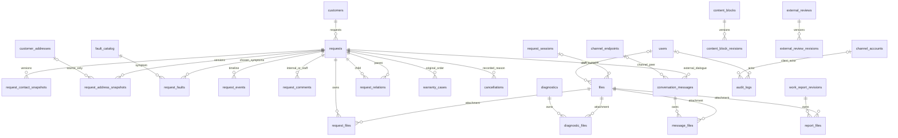
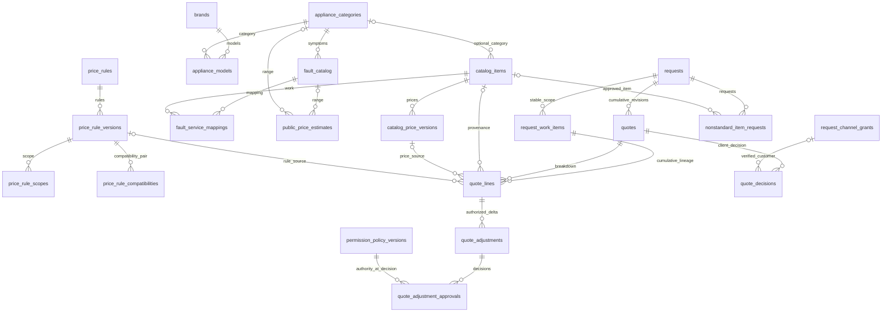
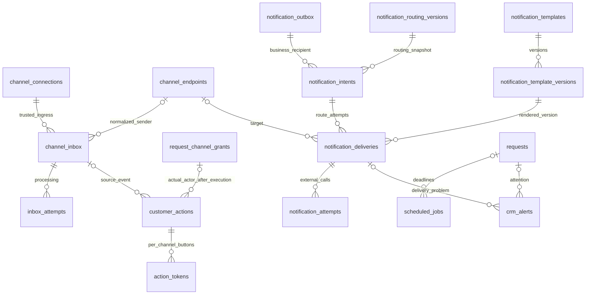

# Предварительная модель PostgreSQL

**Актуализация P02-01:** owner access decisions и статус предлагаемых identity/channel contracts — [DECISIONS §21](DECISIONS.md#21-p02-01--модель-доступа-и-контракт-каналов). Ниже — историческая проектная доменная модель, не актуальная Prisma schema: в P01 созданы только технические foundation-модели/миграции. P02-01 не меняет schema и не создаёт доменные миграции; web credential не создаётся мастеру автоматически.

**Ревизия R3.2, 19.11.2026. Этап 0: только проектирование.** Подтверждены направление нескольких городов одной компании, v1 один активный город, равноправные TG/VK/MAX и принятое допущение MAX; предыдущие ревизии/аудиты сохраняются как история. Модель географии §3.8 должна войти до первых доменных миграций, но P01 не реализует её бизнес-функции. Решения владельца и допущение AS-MAX-01 перечислены в DECISIONS §18; другие инженерные детали — предложения. SQL/Prisma схемы и миграции не созданы. Ниже — согласованный между документами **проект**, не утверждённые владельцем бизнес-правила. Источники: [ТЗ](../info/ТЗ.md), новое требование трёх клиентских мессенджеров и аудит Claude A-01–L-03. История изменений и решения — [DECISIONS](DECISIONS.md), [архитектура](ARCHITECTURE.md), [API](API.md), [план](ROADMAP.md).

## 1. Общие принципы и область

Одна компания/мастерская и одна PostgreSQL; v1 один активный город, **по принятому направлению владельца модель уже допускает несколько городов этой компании**. Независимые компании/tenancy не проектируются. UUID — PK, отдельный уникальный публичный номер заявки — не credential. Все времена событий/визитов — `timestamptz` UTC; смены — local weekday/time + local dates + `end_day_offset` + snapshot IANA timezone **города смены/визита** (§3.8), не глобальный timezone компании. Ночные/DST границы определяются scheduling policy; неоднозначный local instant без offset не принимается.

Деньги — `bigint` в целых копейках, в API decimal strings; количество `numeric`, единицы/точность/округление утверждаются Q06. Нельзя использовать floating point для итогов. Идентификаторы Telegram/VK/MAX — внешние непрозрачные строки в provider-neutral таблицах (из numeric API преобразуются без потери точности). Staff Telegram numeric ID допускается `bigint`; не JavaScript Number.

У изменяемых агрегатов `row_version`; у снимков/планов/денежных правил — immutable версии. Архивирование каталога не меняет стоимость старого заказа. Физическое удаление заявок/денег обычным пользователям запрещено; retention и обезличивание ПД — отдельный контролируемый процесс, не бессрочное хранение «потому что FK RESTRICT».

Пустая цена и утверждённая нулевая цена различаются. Ноль не создаётся техническим default; бесплатная диагностика/гарантия возможна только по утверждённой price version/основанию. Телефон индексируется для поиска возможных совпадений, но не unique identity и не доказательство права на историю. Не объединять людей автоматически по телефону.

## 2. ER-диаграммы

Это логическая ER всех областей; повтор узла означает ту же таблицу. Детали обязательности/составных FK уточняются реестром и §4. Дополнительные технические ключи при миграциях допускаются без исключения инвариантов.

### 2.1. Сотрудники, клиент и клиентские каналы

```mermaid
erDiagram
  users ||--o{ user_permissions : capabilities
  users ||--o{ auth_sessions : sessions
  users ||--o| technicians : employee
  users ||--o{ staff_telegram_links : verified_link_history
  users ||--o{ staff_invitations : invite
  customers ||--o{ customer_addresses : addresses
  customers ||--o{ requests : submits
  customer_channel_options ||--o{ customer_channel_option_versions : admin_policy
  channel_offer_catalog_versions ||--o{ channel_offer_catalog_entries : published_set
  customer_channel_option_versions ||--o{ channel_offer_catalog_entries : frozen_entry
  channel_connections o|--o{ customer_channel_option_versions : future_connection_nullable
  channel_connections ||--o{ channel_check_runs : scheduled_checks
  channel_check_runs ||--o{ channel_readiness_checks : trusted_results
  channel_connections ||--o{ channel_live_acceptance_runs : authorized_staging_runs
  channel_live_acceptance_runs ||--o{ channel_live_acceptances : trusted_live_results
  customer_channel_option_versions o|--o{ request_channel_preferences : selected_policy_snapshot
  channel_offer_catalog_versions o|--o{ request_channel_preferences : intake_catalog_snapshot
  channel_connections ||--o{ channel_capability_evidence : purpose_permission
  channel_connections ||--o{ channel_endpoints : bot_or_community
  channel_accounts ||--o{ channel_endpoints : private_peer
  customers ||--o{ customer_channel_links : verified_relationship
  channel_accounts ||--o{ customer_channel_links : account
  requests ||--o{ request_channel_grants : request_scope
  channel_endpoints ||--o{ request_channel_grants : principal
  requests ||--o{ request_channel_preferences : policy_versions
  request_channel_preferences ||--o{ request_channel_routes : ordered_routes
  request_channel_grants ||--o{ request_channel_routes : authorized_endpoint
  channel_endpoints ||--o{ channel_permission_events : platform_and_app_evidence
  requests ||--o{ phone_permission_events : explicit_call_mode
  request_sessions ||--o{ channel_link_challenges : originating_browser
  requests ||--o{ channel_link_challenges : request
  channel_connections ||--o{ channel_link_challenges : selected_provider
  channel_link_challenges ||--o{ channel_link_claims : candidates
  channel_endpoints ||--o{ channel_link_claims : verified_sender
  channel_link_claims o|--o| request_channel_grants : confirmed_claim
  requests o|--o{ request_sessions : form_or_request
  customers o|--o{ consent_records : attached_subject
  request_sessions o|--o{ consent_records : before_submit
  legal_document_versions ||--o{ consent_records : text_version
  customers o|--o{ privacy_cases : subject_request
  privacy_cases o|--o{ privacy_jobs : controlled_execution
```

### 2.2. Заявка, сообщения, контент и файлы

### 2.3. Каталоги, цены и согласование

### 2.4. Визиты, отчёты и финансы

```mermaid
erDiagram
  technicians ||--o{ technician_categories : specialties
  appliance_categories ||--o{ technician_categories : category
  technicians ||--o{ technician_skills : skills
  skills ||--o{ technician_skills : skill
  technicians ||--o{ technician_service_areas : areas
  service_areas ||--o{ technician_service_areas : area
  technicians ||--o{ work_schedules : shifts
  technicians ||--o{ availability_exceptions : exceptions
  technicians ||--o{ availability_change_requests : requests
  technicians ||--o{ technician_presence_events : actual_state
  requests ||--o{ appointments : visits
  appointments ||--|{ appointment_versions : immutable_plans
  technicians ||--o{ appointment_versions : assigned_to
  request_address_snapshots ||--o{ appointment_versions : agreed_address
  appointment_versions ||--o| appointment_reservations : occupied_time
  appointment_versions ||--o{ appointment_confirmations : customer_response
  appointment_versions ||--o{ appointment_events : acknowledgement_and_actuals
  appointment_versions ||--o{ appointment_change_requests : reschedule_or_cancel
  appointments o|--o{ appointments : followup_after_started_visit
  requests ||--o{ diagnostics : findings
  appointments o|--o{ diagnostics : actual_visit
  requests ||--o{ work_reports : reports
  work_reports ||--|{ work_report_revisions : versions
  quotes o|--o{ work_report_revisions : one_quote_version
  work_report_revisions ||--o{ work_report_lines : actual_lines
  quote_lines o|--o{ work_report_lines : approved_origin
  requests ||--o| payment_accounts : balance
  payment_accounts ||--o{ payment_events : immutable_events
  payment_events o|--o{ payment_events : original_receipt
  payment_events ||--o{ payment_event_allocations : negative_event
  payment_events ||--o{ payment_event_allocations : source_receipt
  requests ||--o| closure_records : single_closure
  closure_records ||--o{ closure_amendments : correction_without_reopen
  work_report_revisions ||--o{ closure_records : reviewed_report
  quotes o|--o{ closure_records : final_agreement
```

### 2.5. Доставка и фоновые задачи

### 2.6. География одной компании R3.2

```mermaid
erDiagram
  service_cities ||--|{ service_city_versions : local_settings_history
  service_cities ||--o{ service_areas : company_service_zones
  service_areas ||--|{ service_area_versions : coverage_history
  service_cities ||--o{ administrative_districts : administrative_only
  service_area_versions ||--o{ service_area_district_coverage : manual_mapping
  administrative_districts ||--o{ service_area_district_coverage : many_to_many
  technicians ||--o{ technician_city_memberships : permitted_cities
  service_cities ||--o{ technician_city_memberships : city_permissions
  technicians ||--o{ technician_service_areas : permitted_zones
  service_areas ||--o{ technician_service_areas : zone_permissions
  service_cities ||--o{ work_schedules : city_shifts
  service_cities ||--o{ request_sessions : trusted_intake_context
  service_cities ||--o{ requests : mandatory_city
  requests ||--o{ request_address_snapshots : city_zone_snapshots
  service_city_versions ||--o{ request_address_snapshots : historical_city
  service_area_versions o|--o{ request_address_snapshots : assessed_zone
  service_cities ||--o{ appointments : request_same_city
  service_city_versions ||--o{ appointment_versions : visit_timezone_context
  service_cities ||--o{ catalog_price_versions : distinct_city_prices
  service_cities ||--o{ price_rule_versions : distinct_city_tariffs
  service_cities ||--o{ public_price_estimates : city_estimates
  service_cities ||--o{ quotes : immutable_city_money
  service_cities o|--o{ content_blocks : optional_city_scope
```

Нет отдельной company/tenant таблицы и duplicate zones/customer каталога; подробные fields/composite FK/границы первой версии — §3.8.

## 3. Реестр сущностей

### 3.1. Identity, разрешения, каналы, согласия

| Таблица | Поля и инварианты проекта |
|---|---|
| `users`, `technicians` | Сотрудник UUID, login/password_hash nullable для Telegram-only, role, employment state, auth_version; профиль мастера: employee_code, buffers, capacity, readiness evening/night/express. Увольнение блокирует sessions, не стирает историю |
| `user_permissions`, `permission_policy_versions` | Capability+scope+period, версионированные лимиты менеджера. Baseline и моменты проверки — DECISIONS §13 |
| `auth_sessions` | user, channel CRM/STAFF_TELEGRAM, token_hash, expires/revoked, auth_version, initData exchange digest nullable; Mini App token только в памяти |
| `staff_telegram_links`, `staff_invitations` | Только сотрудники: user↔Telegram subject/chat в рамках staff connection; active unique subject/user, invitation hash/TTL/expected principal/evidence, revocation history. Принятие не выдаёт customer grants и наоборот |
| `customers`, `customer_addresses` | Клиент+нормализованный телефон (не unique), имя; адресная книга отдельно от snapshots заявки. Customer создаётся после submit, не от каждого незавершённого шага |
| `channel_connections`, `channel_capability_evidence` | Connection: provider TELEGRAM/VK/MAX, external bot/community ID, API version/config ref, technical access_state UNVERIFIED/PENDING/AVAILABLE/SUSPENDED/REJECTED, moderation time, secret refs/key version без raw secrets. Evidence: connection+purpose SERVICE/AUTH/INTERACTIVE, status/contract reference/reviewer/validity/version. AVAILABLE не доказывает договорного права на все цели. Отдельные staging/prod connections |
| `channel_accounts` | provider+external_subject_id unique; никаких совпадений TG/VK/MAX ID между провайдерами. Это identity, не разрешение писать и не customer ownership |
| `channel_endpoints` | account_id+connection_id+private_peer_id unique, platform_permission projection+epoch, blocked_at, last_verified_at; direct/private dialogues only. Групповой чат не principal клиента |
| `customer_channel_links` | customer_id, account_id, evidence/claim ID, linked/revoked_at; M:N нужна для подтверждённых исправлений дублей, но **не** даёт all-requests ACL. Аккаунт не присоединяет чужого customer автоматически |
| `request_channel_grants` | request_id, endpoint_id, customer_channel_link_id, evidence, granted/revoked, permission_epoch; partial unique active(request,endpoint). Composite consistency customer/request/account проверяется под lock. Каждый новый endpoint доказывает доступ к конкретной заявке |
| `request_channel_preferences`, `request_channel_routes` | Immutable version per request, mode MESSENGER_NO_CALL/PHONE; messenger: **ровно один selected_provider**, selected_option_version_id+offer_catalog_version_id+purpose+selection_source/time/evidence. Первичная версия сохраняется при submit **до grant**, primary_grant_id nullable только до proof, затем новая revision связывает тот же выбранный способ с grant. Ordered fallback grants появляются отдельно по explicit consent, не auto-select при intake; fallback_allowed/scope/current FK. Composite route(grant,request), provider/option/catalog согласованы; старые версии не переписывает admin toggle |
| `channel_permission_events` | Append-only endpoint + source PLATFORM/APP_OPT_IN, scope GLOBAL_ENDPOINT либо REQUEST с request_id FK для app consent конкретного заказа, purpose SERVICE/MARKETING, ALLOWED/DENIED/UNKNOWN, provider event/evidence/legal-document ref, occurrence/receipt time. Request scope обязан совпадать с grant/preference; platform allow остаётся connection/endpoint-level. Платформенная разрешённость, правовое основание и настройка клиента — три отдельные проверки |
| `phone_permission_events` | request_id, explicit allow/revoke, actor/evidence, scope, occurred_at; receipt телефона не consent to calls. PHONE task только при текущем allow |
| `request_sessions` | secret_hash/CSRF context, **intake_city_id/intake_city_version_id** из trusted server context+snapshot, request_id nullable до submit, version, TTL, purpose, revoked; session isolation по форме (несколько вкладок не перезаписывают одну заявку) |
| `channel_link_challenges`, `channel_link_claims` | request/F-session/connection FK, random token_hash unique, expiry/claim state; verified endpoint claims, pairing challenge, original-session confirmation. Одноразовый token только CLAIM, grant лишь после второй стороны; повторный link отзывает неиспользованный challenge |
| `legal_document_versions`, `consent_records` | Immutable текст/checksum/kind; append-only purpose/legal_basis/GIVEN/REVOKED/time/source/evidence. До submit subject=F-session, после submit связь через request/session; не перезаписывать proof при «привязке к customer». Marketing отдельно |
| `privacy_cases`, `privacy_jobs` | Идентификация субъекта, основание/hold/deadline, approved scope, assignee, retention-policy version, execution checkpoints, status/attempts/errors, evidence summary без ПД; job не удаляет необходимые финансовые факты |

**Двухсторонняя привязка:** исходная F-сессия создаёт provider-scoped challenge → личный verified webhook лишь заявляет candidate → F показывает минимальную candidate identity и pairing challenge, клиент подтверждает → atomic consume + grant + preferences + consent evidence. Кандидату до этого не показываются номер/адрес/смета. Переславший deep link не передаёт F-cookie; один webhook Start/allow не даёт прав. Если пользователь сам подтвердил чужой candidate, технически отличить социальную инженерию нельзя: предупреждение в UX, TTL/квоты, recovery с доказательством, revoke всех действий старого epoch. Нет подтверждения из F — нет автоматического доступа; отдельная ручная проверка владельцем заявки. Потеря браузера и перенос связи — Q17.

Несколько мессенджеров одного клиента/заказа допустимы после независимого proof. При переключении primary сохраняются semantic intent ID (unique event+recipient+purpose) и SENT history; у OPEN intent увеличивается routing_generation, старые PENDING routes получают invalidated_at/reason, создаются новые deliveries этой generation. Intent не создаётся повторно с тем же unique key. Все старые action tokens проверяют grants/epoch/версию предмета и не дают повторного эффекта. В реальном окружении bind/send требует B/C-tech/C-live и нужную фазу E (§3.6); MAX purpose D проектируется/разрабатывается по принятому AS-MAX-01 без нового legal inquiry. Источник OWNER_ASSUMPTION отличается от platform evidence и **не материализуется в фактически подключённый** B/C-tech/C-live/token. Контрактные fixtures изолированы от сети/публичного каталога. Любые реальные MAX challenge/send закрыты до фактических platform/live gates; запреты не обходятся ручным кодом/сменой transport.

### 3.2. Заявка, контент, файлы

| Таблица | Поля и правила |
|---|---|
| `requests` | public_number, customer_id, **city_id/intake_city_version_id NOT NULL** даже CALLBACK (trusted F/staff context), type CALLBACK/REPAIR, source_id, category/brand/model nullable, model_text/age/description/error_code, preferred slot/manual preference, urgency, status, workflow_version, row_version; current_contact_snapshot_id/current_address_snapshot_id/current_channel_preference_id/current_quote_id/approved_quote_id/current_appointment_id. Составные FK предотвращают ссылки на чужую заявку |
| `request_contact_snapshots`, `request_address_snapshots` | Immutable unique(request_id,version), контакт/режим+evidence; адрес+source address+city_id/city_version/name/timezone+district nullable+service_area/area_version/labels+coverage assessment/version, same-city FK и immutable copied display strings (§3.8). Нет отдельного `fault_id` в requests: симптомы исключительно request_faults, description — свободный текст |
| `request_faults` | request+fault unique, fault.category соответствует request.category; «Другая» в справочнике, текст не подменяет утверждённый диагноз |
| `request_events`, `audit_logs` | Append-only sequence+actor STAFF/CHANNEL/SYSTEM, from/to, reason, safe diff, correlation_id. Business timeline и общий security audit различаются целью; raw PII/secret в diff запрещены |
| `request_comments`, `conversation_messages` | Comments INTERNAL (default)/TECHNICIAN. Client messages отдельно: request, endpoint, direction, source inbox/delivery, text, handled_by/at. Клиент не видит internal; staff-comment не рассылается всем автоматически |
| `request_relations`, `warranty_cases`, `cancellations` | parent/child unique/no self/cycle, REVISIT/WARRANTY/FOLLOWUP; claim/terms-version/decision без выдуманной бесплатности; отмена с reason/actor/result/debt handling |
| `files` | key unique (не имя), owner F/user, mime/signature/size/checksum, UPLOADING/QUARANTINED/READY/REJECTED/DELETED, scan/deletion lease and evidence, retention date; приватный bucket |
| `request_files`, `diagnostic_files`, `report_files`, `message_files` | **Вместо polymorphic file_links R1**: каждая таблица имеет настоящие FK к file и одному типу owner. request_id у child link проверяется составным FK (request,id). Unique owner+file. Один object может иметь несколько разрешённых links, это не расширяет права |
| `content_blocks`, `content_block_revisions` | Stable code/section, current published FK, typed FAQ/contact/fact/zone и immutable revisions. Отдельно от отзывов |
| `external_reviews`, `external_review_revisions` | Avito source URL/date/rating nullable/excerpt/display name permissible, publication evidence/verified_by/at, revisions и publish pointer. **Вместо polymorphic content_revisions R1**, два конкретных FK пути |
| `reference_entries`, `reference_entry_versions` | Типизированные справочники CALLBACK_INTERVAL (city-scoped с timezone от city version) и COMPANY-scoped PAYMENT_METHOD/CANCEL_REASON/DECLINE_REASON/REQUEST_SOURCE; nullable city_id определяется CHECK scope, fallback scope не неявный. Коды/версии stable UUID/code/type, период/архив/revision+label snapshot в событиях; category/price/zone остаются отдельными таблицами. FK+тип проверяется composite(type,id), не произвольный JSON |
| `business_settings_versions` | Company legal/security/upload/retention policies, launch mode/primary_city ref и history. **City timezone/contact/office hours — только service_city_versions (§3.8)**, не дублирующие editable поля global settings. Не секреты. Workflow and policy version у заявки фиксируются явно, новые настройки не переписывают принятые обязательства |

Удаление файлов: owner link авторизует только подходящий context; истёкшая F-сессия не даёт download. Scanner timeout/fail оставляет карантин+alert, а не READY. Для фото strip EXIF, проверка сигнатур/размера/количества; video quotas обязательны. Закрытые payloads/адрес/переписка шифруются at-rest; необходимость field-level encryption/blind index решается threat review до P05, не выдаётся за прямую норму закона.

Изменение адреса после бронирования — отдельная доменная команда под scheduling locks: новый snapshot и новый plan version, coverage/capacity recheck, отзыв старых confirmations/actions и повторное подтверждение. Обычный PATCH не может обойти эту команду. После начала поездки — stop/replan процесс; старые фактические времена/адрес выезда не переписываются.

### 3.3. Прайс и сметы

Каталоги `appliance_categories`, `brands`, `appliance_models`, `fault_catalog`; `catalog_items(kind WORK/PART/MATERIAL/TRAVEL/DIAGNOSTICS)`, `catalog_price_versions`, `fault_service_mappings`, `public_price_estimates`; `price_rules`, `price_rule_versions`, `price_rule_scopes`, `price_rule_compatibilities` сохраняются. Длительность обязательна только для планируемой работы/диагностики, не для детали. Отдельные CRM-представления/DTO исключают случайный выбор PART как WORK. Два физических каталога допустимы только после ADR пересмотра, без дублирования pricing.

| Таблица | Поля / инварианты |
|---|---|
| `quotes` | request city_id/city_version и same-city price/rule sources/plan timezone snapshot, unique(request,revision), monetary document immutable с момента send, workflow status DRAFT/REVIEW/READY/SENT/APPROVED/DECLINED/EXPIRED/SUPERSEDED; supersedes_id; currency, pricing_at, sent_at, expires_at nullable, timezone, tariff_context, appointment_version_id nullable, pricing/rounding/policy snapshots, calculation_hash. Это **полная накопительная смета**, не delta invoice |
| `quotes` breakdown | travel_minor + diagnostics_minor + works_minor + parts_minor + time_surcharge_minor + express_surcharge_minor + approved_surcharges_minor − approved_discounts_minor = total_minor. Компоненты ≥0, total≥0, сумма строк каждого kind = компонент; хранить единый rounding result/trace. Не clamp отрицательный total молча; отклонить несовместимую скидку |
| `request_work_items`, `quote_lines` | Stable request_work_item_id определяет объём работы/детали на всём заказе; quote_line: request/quote/work_item, position, catalog/rule/source version, item_kind/code/title/unit snapshots, cumulative quantity, price/base/delta/total, mandatory flag, rounding trace, supersedes_line_id nullable. Composite FK исключает чужой request/quote/work_item; adjustment строки с явным знаком. При новой quote тот же объём сохраняет work_item lineage, а не маскируется новым item ID |
| `quote_adjustments`, `quote_adjustment_approvals` | Замена R1 quote_line_overrides: draft adjustment с reason/requested amount/basis, author, policy version; append-only requested/approved/rejected decisions by admin при сверхлимите. И snapshot при send, и audit; applied сумма только после approval |
| `quote_decisions` | quote/request, APPROVE/DECLINE/QUESTION, actor grant или recording staff PHONE, inbox/action ref, current policy evidence, time; уникальное effective APPROVE, повторный QUESTION не обязан создавать новый договор. Транспортное callback acknowledgement не равно принятому решению по смете |
| `nonstandard_item_requests` | request+technician+kind+описание/количество, решение/approved item/price FK; мастер не вводит платную цену. Режим детали без постоянного каталога Q06 разрешается только явно утверждённой manager строкой с provenance, не произвольной мастерской суммой |

Новая версия создаёт **полную** детализацию, включая уже выполненные согласованные работы, не складывается с прежней сметой. `approved_quote_id` остаётся предыдущей принятой версией, пока новая SENT не APPROVED; новая работа запрещена, прежний долг не исчезает. Смена тарифа/количества после согласия требует нового согласия, в том числе при уменьшении объёма по Q07. Истечение касается SENT без APPROVE; accepted agreement не становится недействительным от истечения срока предложения. APPROVE под request/quote lock допустим лишь для текущей SENT и DB decision time < expires_at, если срок задан; просроченный offer отклоняется даже при отставшем expiry job. Job лишь материализует EXPIRED/alert и при уже APPROVED — no-op. Повтор SENT не меняет revision/срок, если содержание то же; DECLINED/EXPIRED → только новая revision. QUESTION оставляет SENT и открывает диалог, не потребляет отдельную кнопку APPROVE навсегда.

Статус документа и mutable draft не тождественны: monetary rows после send immutable, lifecycle меняется командами + append-only decisions/events. Ограничения БД на immutable columns проверяются отдельной runtime DB role; DBA не объявляется криптографически лишённым доступа.

### 3.4. Визиты, работа и деньги

`skills`, `technician_skills`, `technician_categories`, `technician_service_areas`, `service_areas` — нормализованные справочники/связи. `work_schedules`, `availability_exceptions`, `availability_change_requests`, `technician_presence_events` сохраняют план/утверждённые изменения/фактическую недоступность раздельно. Отрицательное исключение и фактическая недоступность имеют приоритет; мастер не расширяет смену без права. Вместимость настраивается как в ТЗ (обычно 1), не удаляется ради упрощения.

| Таблица | Точный выбранный вариант проекта R2 |
|---|---|
| `appointments` | Stable UUID визита, **city_id NOT NULL**+composite(request,city) FK, current_plan_version_id, predecessor_appointment_id для дополнительного визита после начатого, lifecycle state и row_version; unique current planned/en-route visit заявки по §4. Не новый UUID при каждом переносе до выезда |
| `appointment_versions` | unique(appointment_id,version), request/technician/address_snapshot+city composite FKs, immutable city/zone/address versions/labels+visit_timezone города, arrival_window, planned_start/end, buffers before/after, timezone/scheduling policy/context, created_by/reason, immutable. Supersedes version_id. Это единственный вариант изменения плановых данных; R1 «или заменить прежнее» удалён как неоднозначный |
| `appointment_reservations` | unique appointment_version_id, technician, occupied `[start-before,end+after)`, created/released/reason; одна строка на версию, прошлые строки сохраняются. Release/supersede+новая reservation атомарны |
| `appointment_confirmations` | plan_version_id, actor grant либо recorded PHONE staff+evidence, decision CONFIRM/DECLINE, occurred_at, customer_action ref; только current version, stale кнопка не подтверждает новую |
| `appointment_events` | plan_version, TECH_ACK/DECLINE/DEPART/ARRIVE/START/FINISH/STOP_ACK и actual times, actor/reason; ack мастера отделён от CONFIRM клиента. Актуальная доступность и версия проверяются при write |
| `appointment_change_requests` | request/appointment_version/grant, kind RESCHEDULE/CANCEL/STOP, preferred times или reason, PENDING/ACCEPTED/REJECTED/RESOLVED, reviewer/resulting version, no automatic rebooking |
| `diagnostics`, `work_reports`, `work_report_revisions` | Findings per visit; stable report+immutable revisions+review events/reason, request/appointment/technician, **quote_id для всей ревизии**, result REPAIRED/DIAGNOSTICS_ONLY/NO_REPAIR/STOPPED. Дата/результат/комментарий обязательны по результату |
| `work_report_lines` | report_revision, approved_quote_line, stable request_work_item_id, qty_actual/outcome/snapshots; платные строки одной quote_id/request. Выполненное считается по work_item lineage и только current effective submitted/accepted revision каждого отчёта (superseded revision не суммируется). Сумма across visits ≤ agreed cumulative quantity актуального work item без новой approval; old work не выполняется повторно |
| `payment_accounts` | unique request, approved/final_quote FK, amount_due, received_net, unpaid/overpaid, status projection, ledger_sequence; проекция перестраивается из immutable источников, не editable price |
| `payment_events` | account+sequence unique, RECEIPT(+)/REVERSAL(−)/REFUND(−), **generic CORRECTION R1 заменён reversal+новая receipt**, amount>0, payment method ref+snapshot, received/recorded time, actor/reason/idempotency. Для negative один original_receipt_id либо полный набор `payment_event_allocations` обязателен; обе формы нормализуются в allocations той же account/currency. При нескольких источниках original_receipt_id nullable, allocations сумма=event amount; receipt не ссылается сам на себя |
| `closure_records`, `closure_amendments` | unique closure per request; result/accepted report revision обязателен для CLOSED; final_quote nullable только при утверждённом бесплатном/no-charge результате с evidence. Ledger as_of+snapshot. Amendment с reason/actor создаёт новую ревизию коррекции без reopen; при денежном изменении отдельное согласование/связанный заказ Q07 |

Payment balance: при due>0 и net=0 — UNPAID; 0<net<due — PARTIALLY_PAID; net≥due — PAID + отдельная overpaid/net-due. При явно утверждённом due=0 — PAID с zero_due_basis, не «деньги получены»; неизвестный due остаётся незавершённым calculation, не ноль. Квитанции не генерируются, банковское подтверждение не заявляется. Совокупные refund/reversal allocations ≤ остатка исходных receipt; нельзя дважды сторнировать receipt или сторнировать уже возвращённую часть. Закрытие с долгом/предоплаты/выдача возвратов требуют Q08, техническая модель факты не отбрасывает. CANCELLED не удаляет долг; paid diagnostics имеют report/quote и результат, а не фиктивный ремонт.

### 3.5. Интеграции и эксплуатационные сущности

| Таблица | Поля / правила |
|---|---|
| `channel_inbox`, `inbox_attempts` | connection, event_type/event_key, dedupe_strength PROVIDER_ID/BEST_EFFORT + algorithm version, normalized sender/occurred/received, safe encrypted payload, status/fenced lease/attempts/errors. Unique verified provider ID; MAX lifecycle fingerprint best-effort не доказывает различимость легитимных одинаковых events и применим лишь к idempotent permission projection. TG update_id, VK outer event_id, MAX event-specific key — DECISIONS §14; no global update_id |
| `customer_actions`, `action_tokens` | Business action intent+request+entity/version, allowed endpoint/grant scopes+epochs, initially actor_grant nullable; при первом выполнении effective actor/result записываются, конкуренты той же смысловой операции видят current result/stale. Opaque token_hash per endpoint/action/TTL, consumed result. Source callback IDs дедуплицируются, разные платформы конкурируют под одним domain lock. В payload нет UUID с ПД/цены/адреса/телефона, только opaque token |
| `notification_templates`, `notification_template_versions` | Stable type/audience/purpose, immutable text/action schema/channel render variants/locale, allowlist field schema, review/active/revision; никакого произвольного скрипта в CRM. На старте seed реальных согласованных текстов, не demo; изменение в админке только по capability |
| `notification_outbox` | Domain event_id/type/request/aggregate+semantic version/occurred_at, минимальные references, PENDING/EXPANDED/FAILED, lease+error; не путать status fanout с delivery |
| `notification_intents` | event+business recipient+purpose unique, current routing_generation+preference/routing/template versions, due/expires, OPEN/SATISFIED/NEEDS_ATTENTION/OBSOLETE; один semantic intent допускает несколько routes по explicit fallback, reroute не создаёт duplicate intent |
| `notification_deliveries`, `notification_attempts` | Два partial UNIQUE: customer(intent,routing_generation,endpoint_id,route_index) WHERE target_type=CUSTOMER_ENDPOINT; staff(intent,routing_generation,staff_target_id,route_index) WHERE target_type=STAFF_TARGET; CHECK ровно одного соответствующего FK. Nullable endpoint не является общим unique ключом; template/policy versions, PENDING/SENT/FAILED (SENT=accepted provider, не read/CONFIRM), invalidated_at/reason для obsolete pending route (не транспортная FAILED), attempts/next_attempt/provider_message_id/errors, fenced lease. Rendered safe payload hash+encrypted bytes; attempts с code/latency/uncertainty. Перед send invalidated route никогда не выбирается |
| `staff_notification_targets` | user_id, staff Telegram connection/link FK, service opt-in/active period; role/capability routing только разрешённым сотрудникам. Staff delivery target не customer grant и не может открывать customer account через staff invitation |
| `notification_routing_versions` | Получатели менеджерских событий (дежурный/все подписанные), расписание/backup assignee/escalation/quiet-hours policy, customer route references; фактический список не выдуман, CRM alert сохраняется даже без онлайн-менеджера |
| `scheduled_jobs` | kind, concrete request/visit/quote/channel refs, semantic version, due, attempts/max policy/error/lease owner+generation, state PENDING/DONE/FAILED/OBSOLETE; expiry/reminder/ack/cleanup/retention обязательны |
| `crm_alerts` | request/delivery optional, type/severity, assignee/team queue, due/ack/resolved/reason/version/dedupe; без скрытых выбрасываний ошибок |
| `idempotency_records` | principal+operation+key unique, HMAC canonical body (не открытый хэш низкоэнтропийных ПД), PROCESSING/COMPLETED, result ref, expiry; долгосрочные финансовые command IDs/tombstones не удаляются как короткий HTTP cache |

### 3.6. Каталог способов подтверждения A–E

Бизнес-решение владельца: CRM «Настройки → Клиентские каналы и способы подтверждения», TG/VK/MAX равноправны. Ни одна таблица не хранит выдуманные данные профиля MAX: **самозанятый/резидент РФ — подтверждённый факт, платформенная регистрация и verification — ещё не выполнены**. AS-MAX-01 — принятое допущение нужных возможностей, при D projection provenance=OWNER_ASSUMPTION, а не фактическая platform verification или secret/B/C-live evidence. Точные названия таблиц — проект до миграций.

| Сущность / поля | Инвариант |
|---|---|
| `customer_channel_options` | Stable id, provider TELEGRAM/VK/MAX unique. Строка описывает способ, а не бот/endpoint. Все3 могут существовать без регистрации |
| `customer_channel_option_versions` | id, option_id, revision, lifecycle DRAFT/FINALIZED, offer_enabled (A), connection_id nullable FK (B), purpose_bundle REQUEST_CONFIRMATION, display_label, display_order, admin_reason, created_by/at, finalized_at, row_version draft. Unique(option,revision); после FINALIZED immutable; будущий DRAFT допускает null connection/credentials и offer_enabled=true как намерение |
| `channel_offer_catalog_versions` | id, revision unique, previous_id, created_by/at, reason, active_current projection/row_version в отдельной singleton settings pointer. Published immutable catalog; в БД не два current pointers |
| `channel_offer_catalog_entries` | catalog_id, option_version_id, provider snapshot, UNIQUE(catalog_id,provider) **и UNIQUE(catalog_id,option_version_id)**, composite FK option/provider/version. FK request preference(offer_catalog_version_id,selected_option_version_id)→entries(catalog_id,option_version_id) доказывает membership без cross-table CHECK. Активация каталога атомарна с audit+outbox cache-invalidate. Каждая новая/изменённая enabled версия при publish проходит B–D; unchanged FINALIZED entry можно переносить с runtime фильтрацией readiness (§3.6), disabled допустима при любом B–D |
| `channel_readiness_checks` | connection_id, configuration_revision, credential_key_version, check_kind CONFIG/CREDENTIAL/WEBHOOK/TLS/ADAPTER, result PASS/FAIL/UNKNOWN, checked_at/valid_until, safe reason_code/detail, checker_actor/evidence. C вычисляется по current config/keys; publish API не принимает ready=true |
| `channel_live_acceptances` | connection_id, environment, configuration/protocol/capability evidence versions, purpose_bundle, result, completed_at/valid_until/revoked_at, approved_by, report_ref. Фиксирует успешный **реальный** staging test; offline fixture не создает PASS. Production activation подтверждает свою конфигурацию/credentials, не использует unrelated staging token |
| `channel_capability_evidence` | D: purpose/capability, source_type PLATFORM_CONFIG/REVIEWED_SOURCE/OWNER_ASSUMPTION, status PENDING/VERIFIED/DENIED/REVOKED, effective/valid_until, protocol/version/evidence refs. R3.2 MAX purpose premise=AS-MAX-01 (owner-assumption source, не сообщение платформы), не требует renewed contract inquiry. Actual config/method/protocol compatibility проверяется позднее live отдельно; assumption **не создаёт** B/credentials/C-tech/C-live. Relevant technical changes invalidate applicable acceptance |
| `request_channel_preferences` selection snapshot | FK selected_option_version_id и offer_catalog_version_id, selected_provider/purpose, selection_at/source; primary_grant_id до bind может быть null. option version обязана входить в catalog и provider match; current preference FK(request,version). Новые general versions не UPDATE существующие request rows |

**Predicate единый в API/UI/worker:**

- Для анонимного нового выбора `OfferableForNewRequest(provider,purpose,environment,now)=A(current published offer_enabled) ∧ B(actual connection+active credentials) ∧ C-tech(current technical PASS) ∧ C-live(relevant actual acceptance) ∧ D(requiredCapabilities(purpose),with explicit provenance; MAX premise=AS-MAX-01 until live config check)`. REQUEST_CONFIRMATION требует SERVICE+INTERACTIVE+разрешённый BINDING/AUTH protocol, где применимо. Unknown/expired — false. E до клиента ещё не существует и не фальсифицируется ради списка.
- **C означает C-tech∧C-live только в public/release guards**. Для управляемого первого live staging acceptance нет требования уже иметь C-live PASS: достаточно реальных B+C-tech+D+необходимой фазы E тестового участника и отдельного operational разрешения в изолированной staging-среде. Тестовый запуск не использует public offer/A, не разрешает production и только по успеху создаёт `channel_live_acceptances`; fixture PASS/evidence всё равно запрещены.
- Для конкретных bind/send/action: нужная часть E = legal basis/opt-in/platform allow/request grant/epochs, плюс B–D на текущий момент; current request preference задаёт recipient. При первой привязке grant ещё создаётся dual-proof командой, не circular requirement. Маркетинг не выводится из service выбора.
- Общий **A-off affects new intake only**. Для сохранённой заявки используется её selection snapshot, поэтому она может продолжить bind/notifications при B–D и E после A-off. Existing request channel change — explicit command+evidence+новая preference revision, а не массовое admin update.
- Connection suspend/credentials revoke/D denial — независимая операционная остановка real operations для всех затронутых старых/новых заявок: alerts+no send, но snapshots/consents не переписываются, silent fallback/phone запрещён.

**Гонка GET→submit:** клиент присылает optionVersionId+catalogVersionId+purpose одного способа, backend под current catalog row lock/согласованной version проверкой перечитывает A и B–D. Если каталог уже другой — 409 CHANNEL_OPTIONS_CHANGED (показать обновлённый список, не создать новую заявку/не сменить канал); если техническая readiness устарела —409 CHANNEL_NOT_READY. При потере гонки after commit заявка остаётся с фактически принятым snapshot и attention; не переписывается задним числом. Change A и intake сериализованы по catalog pointer, внешние readiness events имеют проверяемый revision; абсолютно мгновенную доступность внешнего провайдера не обещать. Replay уже committed idempotent submit возвращает прежний result после auth, а не отказывает из-за нового A-off.

**Публикация/проверки:** draft save не регистрирует провайдера и не вызывает messages API. Finalize/publish enabled version требует connection B–D+live PASS в указанной среде, audit reason, If-Match catalog/draft version, Idempotency-Key; fail оставляет прежний published set. A-off publish разрешён и при failed connection. B–D повторно валидируются для **новых/изменённых enabled option versions**; неизменённые ранее FINALIZED entries можно сохранить в новом catalog без повторной публикации enabled, но public runtime фильтрует их текущую readiness. Отказ другого неизменённого подключения не блокирует выключение выбранного способа. Предварительный dry-run/readiness inspection без сети, если внешние действия не разрешены; реальные probes/live test только отдельным ops разрешением. Все publish/edit/disable/suspend отражаются в audit с old/new IDs/flags/scope, без credentials.

Zero-offer publication policy — Q24 OPEN: empty items безопасны для outage, но callback-only намеренный release не утверждён; админ last-off guard определяется до P07-ADM/P08B, emergency suspend никогда им не блокируется. P07-ADM DoD N03/N08 проверяет это отдельно от no-PII/no-auto-phone.

Права: `channels.options.read`, `channels.options.manage`, `channels.options.publish` отдельно от `channels.connections.manage`/evidence recording. Даже A не может через options PATCH принять consent или передать verified=true. Details API [§11.7](API.md#117-управление-способами-подтверждения), поведение [ARCH §10.4](ARCHITECTURE.md#104-настройки--клиентские-каналы-и-способы-подтверждения); тесты N01–N12 [ROADMAP §7](ROADMAP.md#7-сценарии-административного-управления-n01n12).

### 3.7. Требования P07-ADM к происхождению C-tech, C-live и D (S1)

Это **будущие требования**, не созданные таблицы/команды/проверки. `channel_check_runs` задаёт run_id, connection/environment, snapshot config/credential versions, requested_by, allowed check kinds, due/attempts/state и correlation_id. Scheduler создаёт CONFIG/CREDENTIAL/WEBHOOK/TLS/ADAPTER runs по опубликованной ops policy (периодичность/TTL утверждаются до P07-ADM), после релевантного изменения — invalidation предыдущего результата. Неизвестная/истёкшая проверка даёт C-tech=false.

- **RecordChannelReadinessCheck** пишет append-only `channel_readiness_checks`: run_id, kind, PASS/FAIL/UNKNOWN, actual checked_at/valid_until, configuration/credential version, safe reason, обязательный evidence_ref, checker/service identity и algorithm version. `channels.readiness.record` — только проверенному checker principal; администратор с options.publish не пишет PASS. CONFIG — локальная schema/env/refs; CREDENTIAL — provider-specific безопасная проверка прав/срока; WEBHOOK — ожидаемая configured subscription и ingress probe, где предусмотрено; TLS — цепочка/hostname/срок; ADAPTER — закреплённая API/schema/contract compatibility. Внешние probes только по отдельному operational permission, без client-message send. Allowlist provider hosts/target URLs, timeout/body limit и SSRF guard; случайные URL от admin не исполняются. Offline tests могут писать только TEST evidence, не actual C-tech/C-live для public среды.
- **RecordChannelCapabilityEvidence** пишет append-only D assertion с обязательными platform/method/purpose/protocol scope, документом/reference/checksum, датой/valid_until, reviewer, решением и reason. Для TG/VK может быть reviewed official terms+конкретная конфигурация/use case, а не несуществующий API «выдать договорное разрешение». Это человеческая аттестация допустимости, не заявление, что reviewer создаёт право платформы; при отсутствии/сомнении — PENDING/DENIED. Для MAX в проектировании/разработке применяется утверждённое AS-MAX-01 без нового запроса договоров; при реальном подключении P07-MAX-LIVE фиксируются фактическая конфигурация/доступные методы/допустимый binding и technical test evidence. AS-MAX-01 не подделывает подключение/token/C-live PASS. `channels.evidence.attest` отделён от options/connection CRUD.
- **RecordLiveAcceptance** сохраняет C-live evidence только из разрешённого фактического staging run (`channel_live_acceptance_runs`: connection/config/protocol/capability revisions, test participant authorization, run_id, полный report_ref/checksum, outcome, started/completed_at и recorder/reviewer). `channels.live.acceptance.run` инициирует, `channels.live.acceptance.record` у trusted recorder; ручной выбор PASS без report/run evidence запрещён. Initial run требует B+C-tech+D и phased E, но не предварительный C-live. Reviewer signature/record не подменяют реально выполненные E2E. Revocation/истечение/смена relevant versions инвалидируют публикуемость и PENDING sends согласно policy без изменения прежних request snapshots.

Все3 команды идемпотентны по run/evidence key, current-version guarded, пишут audit+safe outcome. Evidence immutable, correction — новая запись/revoke с reason, не UPDATE результата. Runtime DB role/обычные settings endpoints не обходят эти пути. До P07-ADM определить ops scheduler intervals, evidence owner/reviewer и retention; negative acceptance: любой options PATCH/general connection PATCH с verified/ready/PASS rejected, publish при missing/expired evidence=409; права проверки, аттестации и публикации независимы. Сценарии N01–N12 **не перенумеровываются/не расширяют число69**; эти assertions входят в DoD N03/N08/N11/N12 и P07-ADM.

### 3.8. География одной компании: основа будущих городов R3.2

**Утверждено владельцем:** одна компания/мастерская, v1 один активный город без ручного выбора; в будущем несколько городов этой же компании. Независимые компании/tenant isolation не проектируются, organization_id/tenants «на всякий случай» не добавляются. Раздел расширяет прежнее single-city ограничение по прямому решению, а не отменяет состав v1. Это проект будущих доменных миграций; сейчас DDL/данных нет.

#### Минимальные сущности и изменения существующих

| Сущность | R3.2 поля и связи | Зачем / когда |
|---|---|---|
| `service_cities` (новая) | id UUID, code unique, lifecycle DRAFT/ACTIVE/INACTIVE, current_version_id, row_version. Режим launch SINGLE_CITY и единственный primary_city_id в company settings | Город обслуживания, не tenant. V1 publish readiness требует ровно1 ACTIVE/primary; не DB constraint «всегда максимум1», который пришлось бы ломать при втором городе |
| `service_city_versions` (новая) | city_id+version unique, immutable name/address-display, IANA timezone, office hours, local contact/display details, effective/published_at, reviewer, approved scheduling-policy refs. Company legal identity отдельно | Версии локальных настроек, не второй набор business_settings с дублирующей timezone. Фактические значения задаёт владелец; нет default Moscow/browser zone |
| `service_areas` (существующая) | **city_id NOT NULL**, code unique(city,code), current_version_id; unique(city_id,id) | Зона выезда компании в одном городе; не переименовывается в district и не дублируется таблицей zones |
| `service_area_versions` (новая история существующей зоны) | area_id+city_id+version unique, immutable name/coverage_description/manual street/building criteria, effective dates, author. FK(city,area) и current pointer | Изменение покрытия/имени не меняет назначенный адрес/visit. GIS/polygons/PostGIS не нужны |
| `administrative_districts` (новая, заполнение по необходимости) | id, city_id NOT NULL, code/name, archived_at; unique(city,code), unique(city,id) | Реальный административный район нужен для существующей формы/фильтров ТЗ. Если район не указан — nullable FK; не создавать «Район1» или псевдозону ради required field |
| `service_area_district_coverage` (новая join) | city_id, area_version_id, district_id, relation FULL/PARTIAL, description; unique(area_version,district), composite same-city FKs | M:N: зона может покрывать несколько районов, один район — несколько зон. FULL/PARTIAL — справочные candidates, **ни один** не авторизует IN_ZONE по недоказанному districtId клиента. Для адреса нужен отдельный coverage assessment; неизвестно→REVIEW, отсутствие district не OUTSIDE. Mapping immutable вместе с area version; district label snapshotted в адресе |
| `technician_city_memberships` (новая join) | technician_id, city_id, valid_from/to, active/approved_by; периоды и история. unique active tech+city | Разрешение работать в городе. Один tech может иметь несколько разрешений, но не становится одновременно свободным в каждом городе |
| `technician_service_areas` (существующая join) | technician_id+city_id+service_area_id, valid period/evidence; composite FK(city,area). Zone grant требует city membership на время назначения | Сохраняем прежнюю сущность, не заводим duplicate technician_zones. Нет неявного «все зоны любого города» |
| `customer_addresses` (существующая) | city_id, district_id nullable, street/building/etc; same-city FK district | Адресная книга клиента может иметь адреса разных городов без копий customer; совпадение телефона по-прежнему не merge identity |
| `requests` (существующая) | **city_id NOT NULL, intake_city_version_id NOT NULL** даже CALLBACK, неизменяемый city context; current_address_snapshot_id same-city | Город определён trusted site/F context или явным staff scope до submit; callback address не требуется, но город однозначен |
| `request_address_snapshots` (существующая) | city_id, city_version_id + **скопированные** city_name/timezone, district_id/name nullable, resolved service_area_id/area_version_id/name nullable, manual assessment/coverage-state/reason/version, все адресные строки | Для OUTSIDE/REVIEW зона может отсутствовать, город нет. История не вычисляется из сегодняшних районов/покрытия/контактов. New snapshot по явной re-coverage команде, не фоновое переписывание |
| `appointments`, `appointment_versions` (существующие) | appointment.city_id NOT NULL и FK(request_id,city_id); plan: city_id/city_version_id, immutable **visit_timezone** и city/zone/address snapshots из выбранного request_address_snapshot, policy/version, actuals UTC | Город визита = город заявки. Plan новой версии хранит актуально согласованные local settings/timezone, старые планы не меняются; timezone не глобальная ENV. Новый выезд другой city — новая linked request, не silent city PATCH |
| `work_schedules` (существующая) | technician_id, city_id NOT NULL, city_version/timezone snapshot, weekday/local start/end/day offset, period; должен действовать city membership | Основа городских смен с первых schedule migrations; UI второй city позже. Exceptions CITY(city_id) либо GLOBAL(NULL) явно по scope с CHECK; actual presence/employment обычно GLOBAL |
| `catalog_price_versions`, `price_rule_versions`, `public_price_estimates` (существующие) | **city_id NOT NULL**, periods/approval/calculation policy; uniqueness/EXCLUDE включает city. Catalog items/price_rules — глобальные стабильные идентичности компании, денежные версии city-scoped | Разные цены/тарифы городов без второго каталога/двух pricing engines. В v1 только одна city price set. **Нет молчаливого global/city fallback:** отсутствие цены этого city→PRICE_NOT_CONFIGURED; массовое копирование позже создаёт новые approved city versions |
| `quotes`, `quote_lines` (существующие) | quote.city_id = request.city_id, city_version_id/visit_timezone/tariff context+line price/rule versions данного city, immutable snapshot | Согласованная цена/округление/надбавки не меняются из-за новых городских настроек/прайса; R2 cumulative quote и lineage сохраняются |
| `content_blocks` и revisions (существующие) | scope COMPANY либо CITY с city_id nullable по CHECK; unique(scope,city,code) с partial index для COMPANY. Effective view: explicit city value, иначе разрешённый company block; provenance в DTO | Городские контакты/FAQ/зона/SEO из city context. Legal operator/requisites — company source; local contact/display fields могут ссылаться на тот же legal identity, не новый юрсубъект |
| `business_settings_versions` (существующая) | Company legal/global security/upload/retention/channel policies+launch mode/primary_city ref; **городские timezone/контакты/часы перенесены в service_city_versions**, не две editable копии | Один источник каждого значения. Local overrides только на whitelisted city keys, retention/legal grants не копируются по городам автоматически |

`reference_entries` CALLBACK_INTERVAL получает explicit CITY scope и city_id, другие небольшие справочники COMPANY scope; office/callback/reminder times используют request intake/visit city timezone, ops/global deadlines — UTC или явно заданную operational zone, не скрытый глобальный default. Городов несколько у одной компании — не повод копировать customer, employee, identity, template или channel connection. TG/VK/MAX bots по умолчанию общие; city берётся из request/action mapping. A–E каталог каналов остаётся company-wide в R3.2, не появляется второй неутверждённый city channel catalog; в будущем city-specific offering можно добавить явным ADR, не нужно сейчас.

#### Обязательные инварианты и FK

1. **Каждая request/appointment имеет ровно один city.** Unique(request.id,city_id), appointment FK(request_id,city_id)→requests; unique(appointment.id,city_id), plan FK(appointment_id,city_id) и address FK(request,city,snapshot) запрещают cross-city parent/plan/address. Callback получает city без полного адреса. Current pointers проверяют own request/city/version.
2. `service_area_id`/`district_id` не raw строки клиента: composite(city,id) refs. Zone-to-district M:N принадлежит одному city; PARTIAL не proof. Менеджер при overlap выбирает одну service zone для конкретного визита с evidence; автоматический выбор по произвольному первому совпадению запрещён. Outside-zone exception не отменяет city/zone qualification мастера; при необходимости manager утверждает новую actual service zone/coverage, а не bypass прав.
3. Request city lifetime immutable после commit. Ошибка города → отмена/связанный новый request с audit/contact grants/consent заново по policy; не перенос старого визита с сохранением прежней сметы. Адрес в том же городе можно изменить отдельной versioned командой/availability recheck, обе confirmations reset по прежним правилам.
4. **Change city/area settings не backfill истории.** Никаких UPDATE snapshots уже созданных заявок/plan/approved quotes. FK на immutable city/area versions + copied display strings защищает от rename/archive и позволяет объяснить историческую зону. Новое решение по текущей заявке — отдельный snapshot+audit+reconfirm/requote по guards.
5. Назначение/перенос и повторная проверка перед departure требуют city membership **и** соответствующего zone grant мастера на нужное время, specialization/shift/readiness. Membership grant expire/revoke использует тот же resource lock, исключает новые назначения; существующие не исчезают молча — conflict/attention и явный manager replan. Runtime role не пишет membership без capability.
6. **Tech lock/capacity глобальны across all cities**, key не `(tech,city)`: два city графика не дают двойную бронь. Перед назначением учитываются UTC reservations всех городов и глобальные presence/exceptions. Межгородской travel feasibility до запуска2 города — ручной scheduling block/manager decision, не выдуманные минуты/автомаршрутизация; пересечение поездок **в разных городах** физически недопустимо даже при capacity>1, оно проверяется отдельным same-tech city-feasibility guard; capacity>1 внутри допустимого city/workflow сохраняется и не заменяется молчаливым max1.
7. `appointment_version.visit_timezone` — snapshot IANA города **визита**; никакой global/browser override. Повторяющиеся shifts содержат city/timezone и действующий interval, преобразуются UTC с утверждённым DST policy. Смена IANA у города не silent reinterpret будущих plan: policy review/replan, старый actual instant immutable. Report/notifications показывают local time с явной zone, scheduler due_at UTC.
8. Ценовые exclusion keys: `(city_id,item_id,valid_range)`/`(city_id,rule_id,valid_range)`; periods в разных city допустимы. Composite source(city,price_version)/quote(request,city) и guards требуют совпадения; approved quote содержит применённые денежные строки/rounding snapshot, не текущий lookup. No global default city price. Общий company discount authorization может ограничиваться city scope, сам алгоритм один.
9. F city/version фиксируется server-side при создании сессии; если до **первого** submit этот город выключен/перестал разрешать intake, вернуть CITY_CONTEXT_STALE и предложить заново открыть форму, не переключать уже введённый адрес на новый primary. Replay committed submit всегда возвращает прежнюю заявку после auth. Published city setting revision может измениться: новая заявка хранит исходный intake snapshot и текущую reviewed coverage version по явной policy; старые requests/visits не переписываются.
10. V1 `SINGLE_CITY` readiness: ровно один configured ACTIVE+primary city, заполнены его timezone/contact/zone/price requirements; это config gate, **не hardcoded city ID/name и не фундаментальный max1 SQL CHECK**. GET/submit F-context фиксирует city server-side; если active0/несколько при SINGLE_CITY — CONFIGURATION_INCOMPLETE, не выбрать «первый».

#### До миграций, первая версия и второй город

- **Сейчас/P01:** утвердить эту модель документально, добавить city/FK/snapshot инварианты в технические synthetic proof fixtures будущего P01; не создавать geography domain tables/города/CRM/реальные цены на P01. Контракт city context в application ports должен быть явным, а не скрытым singleton.
- **P03:** первые domain geography/settings migrations создают cities/versions, zones/versions, optional districts/M:N mapping и membership структуры; первые city-scoped адреса/контент/office settings уже имеют FK. Реальный единственный город заполняется владельцем позже через approved settings, не fictitious seed. P02 реализует GLOBAL grants и типизированный scope contract; конкретные CITY grants/composite FK включаются после создания service_cities в P03, без dangling city references или преждевременной geography migration в P02. Membership admin UI может окончательно завершаться P09B; multi-tenant IAM не добавляется.
- **P04:** каталог/ценовые и тарифные версии city-scoped с одной active city; не откладывать city_id в денежных migrations до второго города.
- **P05:** request city/intake context/snapshots non-null+same-city guards с создания каждой заявки, даже callback; нет public city selector. P09A/B вводят city schedules/visit snapshot/глобальную capacity с первой миграции scheduling.
- **Перед реальным вторым городом:** activate-ready процедура с реальными контактами/timezone/zones/prices/memberships, public route/context/selector по отдельному UX, CRM city filters/права/календарные views, report city attribution, cross-city travel blocks. Новые строки/настройки/экраны — **без добавления фундаментального city_id задним числом, split zones или переписывания старого прайса**. Полноценные tenants, GIS и online routing вне scope.

Приёмка без перенумерации69: G01–G07 — дополнительные geography assertions в DoD P03/P04/P05/P09/X02/X05/X06/X08: (G01) callback/request/visit non-null same-city; (G02) rename/rezone сохраняет старые snapshots; (G03) другой city price rejected и accepted quote stable; (G04) no city/zone membership→assign denied; (G05) visit timezone из city и same-tech cross-city UTC conflict; (G06) one-city UI без выбора; (G07) добавить второй синтетический city с иным timezone/районами/ценами существующими командами без ALTER фундаментальной схемы. Это вложенные assertions, не новые top-level IDs вместо исходных25/M/X/N.

### 3.9. P03-03: настройки компании, справочники, контент, документы и согласия

**Статус:** миграция `013` реализована и проверена на PostgreSQL — 13 миграций и 121 CHECK, fresh/`012`→`013`/replay/drift; SHA-256 итогового SQL `54fda83b0eff7055a0b1dbac46d9df64910666eb984bd5df316a30c9d81cfbf9`; полный Vitest принятого среза — 622/622 в 48 файлах, 39 configuration + 36 legal случаев. Подэтап **принят владельцем 21.11.2026 в 21:34** в synthetic внутреннем scope после адресной доработки трёх замечаний независимого ревью; принятый срез коммитится отдельным локальным коммитом (SHA не заявлен), миграция не развёрнута в рабочей БД. Контракт интерфейсов — [P03-03-CONTRACT](P03-03-CONTRACT.md), решение — [DECISIONS §24](DECISIONS.md#24-p03-03--внутренние-порты-настроек-справочников-и-согласий). Это уточнение §3.1/§3.2 для случая одной компании, а не новая модель.

- **`business_settings_versions` дополняется nullable полями.** `operator_name`, `operator_registration_id`, `operator_address`, `legal_review_ref`, `security_policy_ref`, `retention_policy_ref`, `upload_policy_ref`. `NULL` означает «неизвестно», не «по умолчанию». **Ссылки на политику — reviewed provenance, а не сама политика:** таблица не хранит сроки хранения, правила security/upload или текст юридического заключения, поэтому отсутствие значения не превращается в выдуманный срок. Новая ревизия публикуется только при полностью заданных полях; новая географическая ревизия primary переносит поля последней ревизии, иначе активация города обнулила бы настройки компании. Городские timezone/контакты/часы остаются только в `service_city_versions` (§3.8), их копий здесь нет.
- **`reference_entries` / `reference_entry_versions`** — реализация §3.2/§3.8: `CALLBACK_INTERVAL` строго CITY-scoped, `PAYMENT_METHOD`/`CANCEL_REASON`/`DECLINE_REASON`/`REQUEST_SOURCE` строго COMPANY-scoped; scope проверяется ограничением БД, неявного company fallback нет. Ревизия неизменяема, архивирование не меняет прошлый снимок, current pointer — того же entry/type. Для `CALLBACK_INTERVAL` хранится интервал `[start, end)` в минутах и ссылка на версию города; timezone для расчёта берётся из intake/visit снимка города, а не подставляется из настроек компании.
- **`content_blocks` / `content_block_revisions`** — COMPANY (`city_id IS NULL`) либо CITY (`city_id NOT NULL`) по ограничению, стабильный `code`, явный publish через смену указателя, provenance (scope/city/block/revision/source) в выдаче. Локальные контакты/часы/timezone не дублируются: это ссылка на версию города. Контент не переопределяет legal/retention/security.
- **`legal_documents` / `legal_document_versions` / `consent_records`** — реализация §3.1: документы company-wide, версия неизменяема (текст/checksum/основание/kind/source/reviewer), цель и основание — отдельные поля, `GIVEN`/`REVOKED` — append-only события с привязкой к конкретной версии документа. Текст хранится в самой версии, а не как ссылка; synthetic-тесты создают документы со своим текстом, реальные тексты утверждает владелец. Маркетинг отдельно и необязателен. Устаревшая версия текста не принимается молча; отзыв не переписывает прежнее доказательство.
- **`request_sessions`** — минимальный pre-submit anchor: хеш секрета, город и версия города из серверного контекста, `created_at`/`expires_at`, однократный отзыв. **Ни имени, ни телефона, ни адреса, ни `request_id`/`customer_id`**: привязка к заявке появляется в P05. Срок задаёт вызывающая доверенная политика; TTL по умолчанию не задаётся, потому что Q02 открыт. Это не публичная аутентификация F и не замена будущей модели F-сессии.
- **`ADDRESS_COVERAGE`** присутствует только как зарезервированное слово словаря целей без live-включения: реального документа, seed, маршрута и публикации под ним нет до решения владельца по Q02. Synthetic-вставка документа этой цели допустима только для проверки раздельности целей.
- **Права и интерфейсы:** миграция не добавляет capability/ролей и не выдаёт грантов; порты внутренние, вызываются в уже открытой транзакции доверенного кода. Защищённое управление через CRM/API — P03-05, intake — P05, файлы — P03-04.

### 3.10. P03-04A: резервирование до байтов (принят)

**Статус:** срез A **принят владельцем 21.11.2026** (no-byte, только RESERVED→CANCELLED); миграция `014` не развёрнута в рабочей dev БД. Итог: **14 миграций и 138 CHECK** (fresh/013→014/replay/drift/ACL), SQL014 SHA-256 `2ec24c3365b4681859cd11d4fc7dd031fc487d410ff695692f4a2ec650bb4377`, полный Vitest **679/679 в 50 файлах** (40 unit + 17 PostgreSQL); предыдущий gate 670/670 — исторический. Schema во время адресных исправлений не менялась. Принятый срез зафиксирован в `7d92122`; это результаты A, а не всего P03-04.

Migration `014` (`20261121000500_file_upload_reservations`) создаёт `file_upload_intents`, не `files`. Владелец — XOR реальных FK `request_sessions`/`staff`; runtime INSERT staff-owner не выдан, internal порт реализует только F raw proof. Композитный FK связывает exact `GIVEN` с тем же session/document-version/purpose; отдельный уникальный индекс на consent history — единственное изменение существующих сущностей.

Policy snapshot обязателен: version/source/hash, закрытый MIME-набор, maxFileBytes/maxOwnerBytes/maxOwnerFiles и expiry; нет production defaults или policy registry approval. Квоты под session→document locks считают RESERVED с будущим DB expiry, pending включён. DB trigger требует RC, current unrevoked GIVEN и post-lock clock; intent не переживает anchor/policy. Owner/basis/policy/declared bytes/MIME/idempotency/expiry immutable. Только RESERVED→CANCELLED (DB-stamped rowVersion/time), DELETE/TRUNCATE запрещены. Audit/outbox application writes в одной транзакции. Ни object key, ни IO/READY/access в схеме нет.

Request/diagnostic/report/message file links появятся с реальными parent tables; fake parents и полиморфных прав нет. На дату приёмки A работа над B была приостановлена до нового решения; B1+B2 впоследствии были приняты и опубликованы (`e44fae8`).

### 3.11. P03-04 B/C/D: durable lifecycle, hold и copy-only restore

- `015` добавляет `file_upload_attempts` и `file_quarantine_objects`: exact owner/intent FK, immutable target/key, monotonic state/fenced lease и один binding на intent. `QUARANTINED` не означает READY; 404/expiry не снимают UNKNOWN debt.
- `016` добавляет `file_runtime_epochs` без seed, `file_privacy_controls`, `file_sanitized_attempts` и `file_publications` с exact raw/served tuple FKs и неизменяемым scan provenance. READY — только авторизованная проекция для подтверждённых JPEG/PNG/WebP без анимации; PDF остаётся в карантине, видео и анимация не допускаются. `017` расширяет control полями hold/delete и добавляет `file_delete_items` с exact target/key и fenced checkpoints. Ledger и независимый monotonic floor — вне основного snapshot и Prisma-цепочки.
- Runtime lock берётся перед session/document/intent, а privacy control после intent. D freeze закрывает A read/exact replay и B/C выдачу результата; CDE меняет guards приложения, не SQL014. B probe выбирает только подходящие freeze/target/slot-кандидаты до `LIMIT` через общее owner-accounting для raw/sanitized и read/processing claims, не освобождая долг автоматически. Новые B/C записи допускаются только при authoritative ACTIVE epoch 1; legacy B допускает отсутствие singleton на полной схеме. После handoff epoch 2+ read/DELETE разрешены лишь для скопированных объектов под текущей проверенной властью.
- `014`–`017` не менялись при межсрезовой доработке; прежний migration proof — 17 миграций и 181 CHECK. Рабочая dev БД не мигрировалась. C/D/E технически завершены (полный Astra A→E — PASS), приняты владельцем и зафиксированы в `dd87cb4`; см. [актуальный статус P03-04 и evidence](P03-04CDE-CONTRACT.md#6-current-status-and-evidence). Только internal F и technical operator paths: HTTP/DI, signed URL, staff grants, customer intake, реальные ПД и production не открыты; Q02/Q12/Q13/Q16 остаются открытыми.

## 4. Ограничения и доказательство связей (B-04)

Решение R2: неоднозначные polymorphic owners файлов и content revisions разделены на конкретные таблицы (§3.2). Полиморфная безопасная audit metadata допустима как **журнал**, не замена FK. Для file child связи owner содержит unique(request_id,id), join FK(request_id,owner_id) → соответствующий owner, FK(file_id) → files; same-row CHECK размера/типа/квот где применим. Для `report_lines` FK(request,quote,line) исключает строку чужой сметы; для reservations FK(appointment,version,request) исключает чужой план. Это реализуемые PostgreSQL FK/UNIQUE/CHECK, не CHECK с подзапросом. No SQL/DDL создаётся сейчас; P01/P05/P09/P11 проверят negative inserts на реальной БД.

Остальные ограничения:

1. Unique request number, snapshots(request,version), quote(request,revision), report(report,version), appointment(visit,version), connection+inbox key, tokens, receipt command_id, delivery route, current active grants. Customer phone **не unique**. Link/account endpoints не смешивают provider namespaces.
2. Start<end, valid period nonempty, qty>0, компоненты денег≥0, discounts отдельно со знаком в формуле; total равен breakdown и line sums. Cross-row sums проверяются application tx плюс deferred trigger при необходимости; не обещать невозможный cross-table CHECK.
3. Effective price periods и версии одного правила не пересекаются **внутри одного city**: keys(city_id,item_id/rule_id,valid_range), cross-city periods допустимы; `btree_gist`+range exclusion через reviewed SQL migration. Public estimate ровно один scope(category/fault), min≤max и непересекающиеся active periods. Scope правила one-of, compatibility canonical pair/no self.
4. Scheduling writes сериализуются по мастеру: READ COMMITTED, транзакционная advisory lock по упорядоченным technician keys **до** request/appointment/payment row locks. Изменение перечня target resources после snapshot → rollback/retry, не добирать locks в ином порядке. Смена/exception/capacity/presence/deactivate берёт тот же lock, request rows при необходимости в UUID order. Нельзя один путь request→technician, другой technician→request. Deadlock/serialization retry bounded и идемпотентен.
5. После lock перечитать график/зоны/навыки/буферы/активность/reservations, capacity sweep учитывает baseline интервалы до окна, end перед start для `[)`. Count(overlaps) недостаточен. При capacity=1 возможно дополнительное exclusion; универсальное exclusion по мастеру запрещает capacity>1, потому не объявлено обязательным. P09A доказывает обе конфигурации. Другие writers не обходят resource service, runtime DB grants исключают ручной write извне API/worker.
6. В проекте по одной заявке **один текущий выездной визит**, но неограниченная история последовательных visits; Q05 должен утвердить эту границу. Partial unique active visit(request), current version FK; planned reschedule сохраняет stable id, новую immutable version+reservation, старую release. После DEPART plan не редактируется: новый appointment с predecessor для повторного выезда. Parallel technicians/мультиприборная заявка — отдельное изменение scope.
7. Active grant у результата callback проверяется заново; current entity version и permission epoch обязательны. Повтор transport update не создаёт второй action/result; одинаковая операция через два мессенджера также сериализуется доменом. Не пытаться считать message timestamp глобальным порядком всех каналов.
8. Runtime DB role не owner; INSERT-only audit/payment events/immutable submitted monetary content. Отдельные права на lifecycle projections и backfill, migrations роль отдельная. File owner/request FK и archive restrictions проверяются на БД, B-04 тест не откладывается до UI.
9. Indexes: request status/date/id/customer/category/urgency/source/contact; current address area; appointments request/current version/technician+planned_start; events request+seq; normalized phone или blind index; inbox processing queue; deliveries status+next_attempt/lease; jobs due+state; quote request/revision; payment account/seq/received_at; granted endpoint+request; template/type/version. CRM использует pagination, dashboards единый DB snapshot/asOf.

## 5. Транзакционные протоколы

**План визита:** advisory resource locks → request/current appointment version row locks → repeat availability/If-Match → новая immutable plan version и reservation → release old → invalidation action tokens/confirmations → events+audit+outbox → commit. При конфликте 409 и прежняя бронь сохраняется. Новое предложение клиенту и уведомление мастеру после commit. `confirmed_at` клиента и `tech_ack_at` принадлежат новой версии; не переносятся с прежней. Все действия мастера используют current version и актуальный grant назначения; после переназначения старый мастер не пишет отчёт/оплату.

**Смета:** request lock → current quote/approved quote → server calculation по действующим ценам → immutable send snapshot/trace → revoke old pending buttons → outbox. При изменении уже согласованного объёма оплачиваемое выполнение paused через WAITING_ESTIMATE_APPROVAL; previous approved_quote остаётся финансовым основанием до нового APPROVE. Decisions проверяют identity/grant/permission/quote version. Нет ремонта по отказу, вопросу, expired SENT или superseded версии.

**Деньги:** request→payment_account lock (либо resource locks раньше, если пишет мастер) → idempotent receipt/reversal/refund→allocation checks→новая ledger sequence/balance→audit/outbox. Due меняется только от accepted quote/result evidence; receipt не правит цену. Close берёт request/account/report versions, сохраняет единственную closure и immutable as_of. После close correction не переписывает старый snapshot.

**Входящее событие:** проверить connection/подлинность/схему → durable inbox+dedupe commit → provider ACK; worker lease нормализует command → проверяет актуальные grants/version/permission → домен+audit+outbox+inbox result в одной транзакции. Callback UX answer по короткому deadline отдельным приоритетным каналом: «принято к обработке» не «запись изменена». Crash после внешней отправки и до SENT допускает повтор сообщения, но не повтор бизнес-эффекта. Outbox expansion с dedupe переживает повтор.

**Отзыв разрешения:** lock endpoint/grants/preference epoch → append permission/revoke → инвалидировать pending actions → PENDING delivery перед send повторно проверяет endpoint/grant epoch, current preference+routing_generation, отсутствие invalidated_at, current entity/version, approved template allowlist и purpose-specific channel_capability_evidence (особенно MAX SERVICE/AUTH). Уже принятые платформой сообщения нельзя гарантированно отозвать; попытка delete/edit best effort с audit. Send/revoke race минимизируется короткой authorization claim, но абсолютного отзыва внешнего in-flight запроса нет; это остаточный риск, не обещание exactly-once.

## 6. Независимые машины состояний

### Визит

`SCHEDULED → EN_ROUTE → ARRIVED → FINISHED`; tech acknowledgement/customer confirmation — отдельные records текущей plan version, не десятки комбинаций status. Terminal `CANCELLED`, `DECLINED`, `SUPERSEDED` только для завершённой версии/визита по command; stable planned visit не становится SUPERSEDED при in-place current pointer change, superseded **plan version** выводится по new version reference. `STOP_REQUESTED` — состояние начатого визита до безопасного подтверждения мастером; затем FINISHED с outcome STOPPED. Actuals append-only event history. Выехать можно после manager assignment+tech ack+customer confirmation текущего плана (для PHONE — реальное evidence с allow).

### Смета и отчёт

Quote `DRAFT→REVIEW→READY→SENT→APPROVED/DECLINED/EXPIRED`; review return→DRAFT только до SENT. New revision supersedes pending offer; prior approved remains historical agreement until replacement approved. Expired/declined не resend как «то же согласие», только новая version. Question — event+dialogue, SENT сохраняется. Report `DRAFT→SUBMITTED→ACCEPTED/RETURNED`; correction создаёт новую ревизию и требует повторного review; исторический accepted не затирается. Nonstandard item `PENDING→APPROVED/REJECTED`. Delivery `PENDING→SENT/FAILED`, transient failures остаются PENDING с attempt log, manual retry FAILED создаёт новую попытку, не новый доменный event.

## 7. State machine заявки

**Версия WF-R2 — полное предложение для Q04/Q05/Q07–Q09/Q19. Не утверждённое изменение ТЗ.** Статусы ТЗ сохранены; новым каналам нужен `WAITING_CHANNEL_LINK`, для Telegram сохранён исходный `WAITING_TELEGRAM_LINK` (чтобы сценарий №3 остался точным). Проект требует единую read-only DB view/projection `is_waiting_link = status IN (WAITING_TELEGRAM_LINK, WAITING_CHANNEL_LINK)` (не отдельный изменяемый boolean). P05 определяет reviewed SQL/view или immutable generated expression, отражает в ORM/read ports; все очереди/фильтры/jobs используют одно определение, а не выборочный LIKE/проверку одного TG-кода. Сейчас view/колонка не создаётся. Код `REVISIT_REQUIRED` получает конкретный проектный смысл: исходный заказ требует связанного повторного заказа до окончательного закрытия; CLOSED не переоткрывается. Альтернатива «только relation/event» R1 сохранена как отвергнутая для R2 ради явного сохранения кода ТЗ, но выбор ещё утверждает владелец.

Все разрешённые **переходы request stage** и важные cross-aggregate команды перечислены ниже; любые иные переходы запрещены. Read, draft pricing/report edits, price calculations, сообщения, append-only payment events, policy/consent updates и технические delivery/permission события сохраняют request status и отдельно проходят ownership/state/version guards из API; они не становятся запрещёнными только из-за отсутствия строки в этой stage-таблице. `M/A` — роль+capability, `T` — назначенный активный мастер текущего визита, `C` — verified request grant. Системные jobs выполняют только versioned policy, не произвольный setStatus.

| Команда / actor | Из → в | Визит / смета / отчёт / деньги / guard |
|---|---|---|
| CreateCallback F/M | ∅→CALLBACK_REQUIRED | Согласие+контакт; техника/адрес/visit не требуются; явный phone allow; outbox manager |
| CreateRepair F | ∅→WAITING_TELEGRAM_LINK (TG) / WAITING_CHANNEL_LINK (VK/MAX) | Полная заявка+согласие; нет обычного dispatch до двухстороннего bind; не обещать свободное время |
| CreateManualRequest M/A | ∅→NEW | PHONE требует evidence/allow; messenger без grant создаётся в соответствующий waiting_link, не bypass |
| StartReview M/A | NEW/CALLBACK_REQUIRED→MANAGER_REVIEW | Callback conversion сохраняет номер/customer; заполнение optional данных без повторного клиента |
| CompleteChannelLink F+CLAIMANT/system | waiting_link→MANAGER_REVIEW | CLAIMANT=проверенный private endpoint candidate без request ACL; F-confirm+claim+platform permission+app opt-in атомарно создают первый grant. Не требовать уже существующий C grant для его создания |
| BindAdditionalRequestEndpoint F+CLAIMANT | Любой нетерминальный status→тот же status; CLOSED/CANCELLED только explicit recovery/read scope | Тот же двухсторонний proof, без rollback workflow в waiting_link и без автоматического расширения доступа customer. Связь не отменяет restrictions целей/retention/финансов |
| ChooseCallback F/C | waiting_link→CALLBACK_REQUIRED | Отдельное решение клиента, append phone allow+mode version; исходные подробные данные сохранены |
| RequireChannelLink M/A | MANAGER_REVIEW→waiting_link | Только до визита и при выборе messenger без grant; ни одна недоставка в ходе ремонта не откатывает process в waiting_link |
| ReadyForDispatch M/A | MANAGER_REVIEW→WAITING_ASSIGNMENT | Category/address+coverage allowed+contact policy; вне зоны manual approval доказано |
| Assign M/A | WAITING_ASSIGNMENT→ASSIGNED | Atomic plan+reservation; customer confirmation PENDING, tech ACK PENDING; outbox обоим |
| Acknowledge T | ASSIGNED→TECHNICIAN_ACCEPTED | Current plan only; customer confirmation независимо, не approval сметы |
| ConfirmAppointment C/PHONE M | ASSIGNED/TECHNICIAN_ACCEPTED→тот же статус | Record CONFIRM текущей версии; stale/чужая кнопка rejected, оплата не меняется |
| RequestReschedule C | ASSIGNED/TECHNICIAN_ACCEPTED/ON_THE_WAY/ARRIVED/DIAGNOSTICS/WAITING_ESTIMATE_APPROVAL/IN_PROGRESS/WAITING_PARTS/PAUSED→тот же статус | Change request PENDING, без новой брони; после начала только manager stop/replan; ответ клиенту «запрос принят», не «перенесено» |
| Reschedule/Reassign M/A до departure | ASSIGNED/TECHNICIAN_ACCEPTED→ASSIGNED | Новая plan version+recheck+reservation, прежняя release, обе confirmation/ack сброшены, смета revalidation если tariff context изменён |
| Revoke/Decline T/M | ASSIGNED/TECHNICIAN_ACCEPTED→WAITING_ASSIGNMENT | Reason required, cancel/release visit, старый мастер loses write, outbox manager/client; ack timeout только alert (auto revoke OFF до отдельной policy) |
| Depart T | TECHNICIAN_ACCEPTED→ON_THE_WAY | Current tech ack + customer CONFIRM (или PHONE evidence/allow), actual depart, нет self-assign |
| Arrive T | ON_THE_WAY→ARRIVED | Actual event; не менять цену |
| StartDiagnostics T | ARRIVED/TECHNICIAN_ACCEPTED→DIAGNOSTICS | Direct от ACCEPTED только factual on-site+current confirm, diagnosis действия не разрешают платный repair |
| SendQuote M/A | DIAGNOSTICS→WAITING_ESTIMATE_APPROVAL | REVIEW+READY, frozen amount/trace, client outbox/PHONE task; не ждать внешней сети внутри tx |
| ReplacePendingQuote M/A | WAITING_ESTIMATE_APPROVAL→тот же статус | DECLINED/EXPIRED/new content → новая cumulative revision→REVIEW/READY/SENT; старый pending SUPERSEDED, prior accepted due сохранён. Same-content resend SENT idempotent без нового срока/цены. Draft editing/state review не меняют request stage |
| QuoteDecision C/PHONE M | WAITING_ESTIMATE_APPROVAL/WAITING_PARTS/PAUSED→тот же статус | Current SENT, для APPROVE DB decision time<expires_at если задан; accepted revision не pending expiry. DECLINE/QUESTION/EXPIRED не CANCELLED/IN_PROGRESS; job materializes expiry+alert, не источник проверки срока |
| StartRepair T | WAITING_ESTIMATE_APPROVAL→IN_PROGRESS | Current approved_quote=current offer, work not paused, current on-site visit, actual client approval |
| Requote M/A | IN_PROGRESS→WAITING_ESTIMATE_APPROVAL | Остановить новые оплачиваемые работы, полная новая смета; старый approved due сохранён до замены; performed history immutable |
| WaitParts T/M | DIAGNOSTICS/WAITING_ESTIMATE_APPROVAL/IN_PROGRESS→WAITING_PARTS | Comment required; завершить текущий визит фактическим outcome WAITING_PARTS+release остатка, не держать interval неделями |
| PlanPartsReturn M/A | WAITING_PARTS→тот же статус | Новый appointment после предыдущего начатого, recheck+customer confirm+tech ack; request не возвращается ASSIGNED, чтобы не потерять стадию работы |
| ResumeParts T | WAITING_PARTS→DIAGNOSTICS/IN_PROGRESS | Current confirmed return visit+on-site actuals; IN_PROGRESS только approved_quote_id=current_quote_id с действующим согласием, нет новой pending/unapproved revision и STOP, согласован весь состав/цена. Иначе DIAGNOSTICS→SendQuote/WAITING_ESTIMATE_APPROVAL; прежнее совпадение состава не разрешает работу по новой несогласованной цене |
| ReturnVisit Acknowledge/Confirm T/C/PHONE M | WAITING_PARTS/PAUSED→тот же статус | Current SCHEDULED return plan: tech ACK и customer CONFIRM отдельно, те же proof/phone guards |
| ReturnVisit Depart/Arrive T | WAITING_PARTS/PAUSED→тот же статус | SCHEDULED→EN_ROUTE→ARRIVED с обеими текущими confirmations, STOP запрещает; затем ResumeParts/ResumePaused |
| ReturnVisit Reschedule/Reassign M/A | WAITING_PARTS/PAUSED→тот же статус | Только SCHEDULED до departure; новая version/reservation, сброс ACK/CONFIRM, repeat resource check |
| ReturnVisit Revoke/Decline T/M | WAITING_PARTS/PAUSED→тот же статус | Только не начатый SCHEDULED; cancel/release, attention, старый мастер теряет write; начатый только RequestStop |
| PublishPausedQuote M/A | WAITING_PARTS/PAUSED→тот же статус | Draft/review/READY→SENT новой полной версии, отмена старых pending buttons, work paused, прежний approved due сохраняется. QuoteDecision допустим в этой stage, без auto Resume |
| SubmitReport T | IN_PROGRESS→TECHNICIAN_COMPLETED | SUBMITTED revision linked approved quote/current visit+work lineage, quantities valid; атомарно FINISH visit+actual end/release остатка reservation, events/notify manager. Не оставлять current-active ARRIVED после завершения |
| SubmitNoRepairReport T/M | DIAGNOSTICS/WAITING_ESTIMATE_APPROVAL/WAITING_PARTS/PAUSED→TECHNICIAN_COMPLETED | Outcome DIAGNOSTICS_ONLY/NO_REPAIR/STOPPED; платные диагностика/выезд только если заранее утверждены/приняты, иначе no-charge basis. Нельзя придумать fee; завершить/release visit |
| ReturnReport M/A | TECHNICIAN_COMPLETED→тот же статус (только document correction) / PAUSED (physical или monetary rework) | Причина+review event. Finished визит не переоткрывается. Document correction→новая report revision+review; monetary delta→PAUSED+PublishPausedQuote+новая approval, без цены из отчёта; physical rework→PlanPausedReturn→confirmed on-site Resume. Если мастер ещё на месте, continuation visit оформляется явным новым appointment с on-site evidence, не resurrection terminal |
| ResubmitReconciledReport T/M | PAUSED→TECHNICIAN_COMPLETED | Только document/monetary reconciliation без новых физических работ и **без активного return visit**: SCHEDULED сначала явный cancel/release под scheduling locks; EN_ROUTE/ARRIVED/started сначала safe-stop/STOP_ACK. Затем current approved cumulative quote+валидная исправленная report revision, прежний result evidence+новый review. Нельзя завершить PAUSED с едущим мастером/reservation; физические работы только Resume с confirmed/on-site visit |
| MarkRevisit M/A | TECHNICIAN_COMPLETED→REVISIT_REQUIRED | Reason, immutable parent report, linked child request (starts MANAGER_REVIEW) с новым visit; нет автоматического переноса долга/согласия. Клиент получает объяснение |
| ResolveRevisit M/A | REVISIT_REQUIRED→TECHNICIAN_COMPLETED | Linked child resolved/cancelled с обоснованием, consolidated review не двойной счёт; закрытие родителя отдельно |
| Close M/A | TECHNICIAN_COMPLETED→CLOSED | Accepted report revision+final quote или no-charge basis, payment reconciliation; debt exception только по Q08, единственная closure snapshot |
| CreateFollowup M/A | CLOSED→CLOSED | Новый linked child request с новым номером/status; CLOSED не reopen |
| CancelRequest F/C/M | NEW/waiting_link/CALLBACK_REQUIRED/MANAGER_REVIEW/WAITING_ASSIGNMENT/ASSIGNED/TECHNICIAN_ACCEPTED→CANCELLED | Только явная отмена **заявки** (не одной записи), reason+scope; будущий visit release/cancel, quote actions revoke, money history сохраняется, no automatic fee |
| CancelAppointment C/M до departure | ASSIGNED/TECHNICIAN_ACCEPTED→WAITING_ASSIGNMENT | Отмена **записи/визита**, future reservation release; заявка остаётся для ручного решения, не silently cancel order; второе подтверждение кнопкой с scope=appointment |
| RequestStop C/M после departure | ON_THE_WAY/ARRIVED/DIAGNOSTICS/WAITING_ESTIMATE_APPROVAL/IN_PROGRESS/WAITING_PARTS/PAUSED→тот же статус + STOP_REQUESTED flag | Маршрутизация по lifecycle current visit: EN_ROUTE/ARRIVED/started всегда safe-stop, включая возвращаемый визит при PAUSED/WAITING_PARTS. Durable request+PENDING receipt+master event, новые paid actions запрещены; не обещать мгновенную остановку |
| ConfirmStop T/M | те же активные→CANCELLED (не было платной работы/долга) либо TECHNICIAN_COMPLETED (есть диагностический/фактический результат) | Reason+actual stop/master ack или documented manager exception. Release visit, report/result+debt reconcile. Cancelled balance не стирается; отмена с уже approved due требует Q09 policy, при неопределённой policy оставить attention, не начислить новый fee |
| PauseForReschedule M/A | ON_THE_WAY/ARRIVED/DIAGNOSTICS/WAITING_ESTIMATE_APPROVAL/IN_PROGRESS→PAUSED | После durable change request, безопасного STOP_ACK и записи фактического результата; unpaid/approved quote не стираются, visit FINISHED/release. Новый явный PAUSED — предложение Q19, не скрытое использование WAITING_PARTS для иных причин |
| PlanPausedReturn M/A | PAUSED→PAUSED | Создать новый linked appointment, recheck + обе confirmations; не автоназначение, прежние actuals неизменны |
| ResumePaused T/M | PAUSED→DIAGNOSTICS / WAITING_ESTIMATE_APPROVAL / IN_PROGRESS | Current confirmed on-site return visit: DIAGNOSTICS для перепроверки, WAITING_ESTIMATE_APPROVAL при уже SENT через PublishPausedQuote/ожидаемой клиентской approval, IN_PROGRESS только current approved_quote=current offer и покрывает весь состав. Если новая смета ещё не создана — Resume→DIAGNOSTICS→SendQuote. Нельзя скрыто создать SENT внутри Resume |
| CancelPaused C/M | PAUSED→CANCELLED / TECHNICIAN_COMPLETED | Только нет начатого current visit (или он уже safely stopped); EN_ROUTE/ARRIVED сначала RequestStop. Без платного результата/долга cancel, иначе STOPPED report и reconciliation |
| CancelWaitingParts C/M | WAITING_PARTS→CANCELLED / TECHNICIAN_COMPLETED | Те же lifecycle guards: начатый return visit только через RequestStop/STOP_ACK. Без платных результатов/долга cancel, иначе no-repair report/reconciliation; отсутствие receipts не обнуляет approved due |
| Terminal corrections M/A | CANCELLED/CLOSED→тот же статус | Только ledger correction/closure amendment/privacy workflow с reason; новые бизнес-работы — linked request. Никакого произвольного возврата terminal в NEW |

Команды Confirm/Reschedule/Cancel относятся также к текущему возвращаемому визиту при WAITING_PARTS/PAUSED: подтверждение/принятие/изменение плана не меняет request stage, все plan version guards сохраняются. Cancel future return visit оставляет WAITING_PARTS/PAUSED и создаёт attention, не WAITING_ASSIGNMENT; отдельная отмена всей заявки использует CancelWaitingParts/CancelPaused. Пока STOP_REQUESTED, разрешены только read/reconcile/STOP_ACK, новые start/quote execution commands запрещены. Истечение непривязанной заявки — системный CancelRequest с reason LINK_EXPIRED только по утверждённой retention-policy и после уведомления в F-session, без попытки писать незапущенному боту.

`PAUSED` добавлен в проект как явная пауза по переносу/организационной причине; `WAITING_PARTS` применяется только к запчастям. Это расширение кодов ТЗ с обоснованием D-01/Q19, не утверждённый владельцем workflow. До утверждения WF-R2 реализация Requests/Scheduling блокируется целиком, а не получает «временные» обходы. Возобновление PAUSED/WAITING_PARTS через выезд/прибытие нового визита сохраняет текущий request status до Resume command; это различает логистику визита и стадию ремонта. Для полного WF-R2 CI покрывает тотальную таблицу разрешённых/запрещённых команд.

Платёжные статусы независимы от всех перечисленных переходов. Ошибка мессенджера не отменяет доменную транзакцию; блокировка primary создаёт channel-attention и fallback только по явной policy, не звонок и не cancellation записи. Появление одного нового клиента/endpoint не открывает все customer orders.

## 8. Миграции, тесты и эксплуатация

В историческом плане R3.2 порядок миграций был таким: technical foundation P01, затем identity/capabilities → form/legal/**география cities/zones/settings P03** → **city-scoped** catalog/pricing P04 → **обязательный city** requests/snapshots/files P05 → channels core → scheduling/visits → quotes/reports/payments/read models. Это не требование делать все таблицы сразу: schema меняется маленькими миграциями в подэтапе владельца. Prisma + ручной SQL допустимы при review, fresh/upgrade/drift тестах; production db push запрещён.

B-01/B-02/B-04 acceptance: перенос создаёт новую version, old address/window/reservation доступны истории; negative insert чужого report/quote/file owner отклонён БД; нулевые/неотрицательные итоги и breakdown проверены; нет mutable submitted snapshot, ambiguous CORRECTION или polymorphic FK вместо доменной связи. Референсы и действующие права/quotes проверяются также на replay.

Retention jobs: F/session/orphan uploads; submitted waiting_link заявки и customers без других законных оснований; encrypted inbox payload → dedupe tombstones; idempotency cache → domain command tombstones; messages/address/contact snapshots по legal hold; file deletion; re-anonymize restored backups перед открытием сервиса. Время/основание/retention versions утверждает Q13, но исполнитель — конкретные privacy_jobs с assignee, fenced lease и отчётом. Backup с ПД также имеет срок/доступ/процедуру удаления; восстановление не должно воскресить ранее удалённые ПД без применения deletion ledger.

Тесты: вся WF-R2 positive/negative матрица и interleavings; два менеджера/shift vs assign/deactivate vs depart; old appointment callback; cross-provider APPROVE vs CANCEL/RESCHEDULE; permission revoke vs queued send; hash claim replay/forwarded link/чужая F; interrupted worker before/after provider send и lease fencing; DB-role no update/delete audit; all foreign FK negative; refund allocation/no negative net; quote expiry race vs approval; accepted zero quote; new price не меняет report; dashboard snapshot/filter consistency; privacy hold/delete/restore.

## 9. Сохранение модели R1 и требований ТЗ

Все логические сущности ТЗ §12 сохранены по смыслу. R2 заменяет customer telegram_* на provider-neutral accounts/endpoints/links/grants/inbox; staff Telegram остаётся отдельным. file_links/content_revisions заменены конкретными FK таблицами; appointment supersede ambiguity — stable visit + immutable plan versions; quote_line_overrides — adjustment+approval; CORRECTION — reversal/new receipt. Это документированная эволюция проекта до миграций, **не** удаление данных/готовых функций. Исходные 25 acceptance IDs сохранены в ROADMAP, дополнительные M01–M20 и X01–X12 сохранены, N01–N12 административных проверок R2.1 добавлены отдельно. Новые owner decisions — Q17–Q23, включая критерии доступа к платформам и спорные бизнес-переходы.
