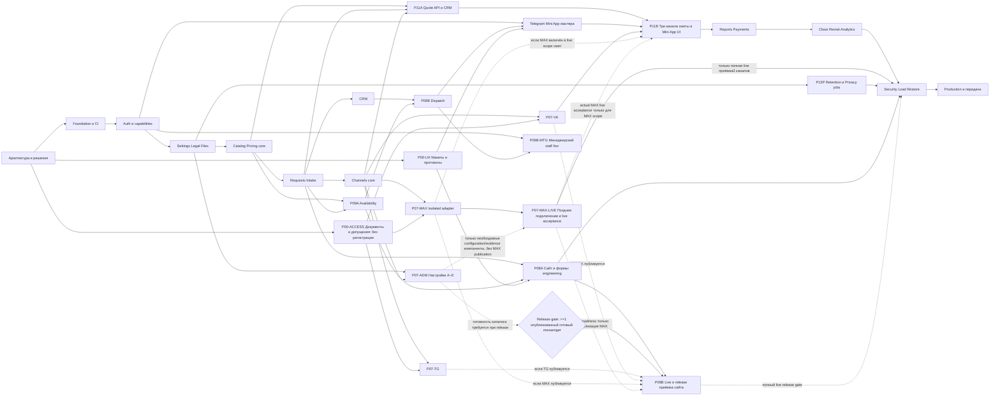

# Дорожная карта реализации и критерии приёмки

**Статус на 22.11.2026; бизнес-дорожная карта R3.2 от 19.11.2026 сохранена.** Локальный closeout P01 зафиксирован в `0ffc7c28d257ee9a4ee57c747efd8d354556639f`; владелец принял P01 как технический closeout с ограничениями. F01–F05 и F07 — PASS; F06 — PARTIAL с открытыми release gates до коммерческого распространения и production; synthetic разработку они не блокируют. [GitHub Actions run 44815347477](https://github.com/Good-Eli/fixlevelup/actions/runs/44815347477) на commit `8f0b204333395dcee1a1808b703a4dfbdce9efa9` — success; предыдущий подтверждённый run `44677729359` относился к `1165f0d`. Прогон подтверждает только свой SHA и не является готовностью к production; промежуточные прогоны 12–14 падали на secret scan из-за информационных patch-файлов в `info/`, которые затем удалены. Контур сотрудников P02 (P02-01—P02-06) реализован, закоммичен и принят владельцем в согласованных границах. P03 открыт отдельным поручением владельца 21.11.2026: **P03-01** (`3677960`), **P03-02** (`56d3545`) и **P03-03** (`9116812`) приняты. В P03-04 приняты **A** (`7d92122`) и **B1+B2** (`e44fae8`, опубликован; [GitHub Actions 44960486563](https://github.com/Good-Eli/fixlevelup/actions/runs/44960486563) — success). P03-04 технически завершён в synthetic scope: полный Astra A→E — PASS (22.11.2026); владелец принял весь P03-04; C/D/E зафиксированы в `dd87cb4`; [актуальный статус P03-04 и evidence](P03-04CDE-CONTRACT.md#6-current-status-and-evidence). Прогресс P03 — 80% (4 из 5 приняты); P03-05 не начат. Production/live остаются отдельными gates. Критерии P01 — [Preflight P01](PREFLIGHT_P01.md); текущие решения доступа и канальный контракт — [DECISIONS §21](DECISIONS.md#21-p02-01--модель-доступа-и-контракт-каналов), ранее принятые решения/AS-MAX-01 — [DECISIONS §20](DECISIONS.md#20-решения-владельца-r32). Источники: [ТЗ](../info/ТЗ.md), расширение владельца Telegram/VK/MAX, аудит Claude; см. [архитектуру](ARCHITECTURE.md), [модель БД](DATABASE.md), [API](API.md), [решения](DECISIONS.md).

## 0. Реальный статус приёмки P01, P02 и P03 на 22.11.2026

| Этап | Реализация | Приёмка владельцем | Что означает статус |
|---|---|---|---|
| P01 | Технический scope реализован; F01–F05 и F07 — PASS, F06 — PARTIAL | **Принят владельцем с ограничениями** как технический closeout | Можно продолжать отдельно разрешённую разработку на synthetic data. F06 остаётся обязательным gate до коммерческого распространения/production |
| P02 | P02-01—P02-06 реализованы и закоммичены; кодовый snapshot P02 — 8f0b204 | **Принят владельцем в согласованных границах** | Готов scoped staff-auth/RBAC implementation; не готов к реальному Telegram-входу и production эксплуатации до закрытия перечисленных gates |
| P03 | P03-01 (город и версии), P03-02 (зоны, покрытие, членство) и P03-03 (настройки, справочники, согласия) реализованы и зафиксированы (`3677960`, `56d3545`, `9116812`); в P03-04 приняты срезы A (`7d92122`) и B1+B2 (`e44fae8`), P03-04 технически завершён (полный Astra A→E — PASS), C/D/E приняты и зафиксированы в `dd87cb4`; P03-05 не начат | **P03-01…P03-04 приняты владельцем**, P03-04 — во внутреннем synthetic scope. Прогресс — 80% (4 из 5) | Готова административная география и внутренние порты настроек/согласий на synthetic data — [контракт](P03-03-CONTRACT.md); по файлам приняты резервирование и карантин; C/D/E реализуют внутренние READY, выдачу потоком, hold/delete и copy-only restore в synthetic scope. Публичные файлы, CRM-управление настройками, согласия в intake и публичный выбор города отсутствуют |

**Три разных статуса нельзя смешивать:** (1) подэтап реализован и закоммичен; (2) этап принят владельцем в согласованном scope; (3) production/live readiness. P01 и P02 приняты в своих ограниченных границах, P03 принят частично. Успешный CI доказывает только состояние конкретного SHA. Приёмка этапа не закрывает перечисленные ниже operational/legal gates и сама по себе не открывает следующий подэтап.

### Обязательные оговорки P01

- F06 остаётся **PARTIAL**: точная инспекция архива @visx/vendor@4.0.0-alpha.0; архивная проверка Lightning CSS platform variants; artifact-level SBOM/notices для Sharp/libvips; legal/distribution review. Закрыть до коммерческого распространения и production release.
- Synthetic backup/restore — локальный drill на синтетических данных, не production backup, off-host durability, PITR, encryption policy или измерение RPO/RTO.
- F07 — **PASS** по решению владельца: ID-based noreply для будущих коммитов; прежняя публичная Author/Committer metadata осознанно сохраняется, история не переписывается.
- Remote CI run 44815347477 относится к 8f0b204, не к последующему docs commit 5c8205f; он не является production certification. P01-specific evidence run 44677729359 относится к 1165f0d.

### Обязательные оговорки P02

- P02-05 реализует только проверку Telegram initData и обмен на сессию по **заранее существующей активной** staff_telegram_links; первичная привязка (invitation/challenge/intended-employee proof) отсутствует. До её появления реальный Telegram-вход не использовать.
- Нет штатного инструмента выпуска web credential новому сотруднику. Мастер не получает web-пароль — это правило модели, не дефект.
- В P02 `CITY` был зарезервирован, но не выдавался. В P03-02 он выдаётся только для пяти географических операций и только вместе с административным назначением сотрудника в город ресурса — см. оговорки P03 ниже.
- Bootstrap/recovery не прошли ручную проверку в настоящем TTY; она обязательна до первого реального использования CLI.
- Cutover migration 009 не имеет безопасного rollback к старому бинарнику: до применения остановить старые writers и проверить backup/restore plan.
- Нет live Telegram E2E, доверенной HTTPS reverse-proxy конфигурации и согласованной обработки реальных ПД. Это отдельные live/production gates, не доказанные синтетическими тестами.
- Нет cursor pagination; customer request grants не входят в P02 и остаются за P05/P07-core.

### Обязательные оговорки P03

- P03-01 и P03-02 дают административную географию, а не приём заявок: нет формы CRM для городов и зон, нет публичного выбора города, нет настроек, согласий и загрузки файлов. P03-03 добавляет только внутренние порты и данные настроек/справочников/контента/документов/согласий — без маршрутов, capability и CRM-форм.
- Реальные значения города (название, IANA timezone, публичные контакты, часы, покрытие Q25) вводятся владельцем отдельно через будущие согласованные настройки; резервного города из браузера, ENV или первой строки нет.
- `CITY` выдаётся только вместе с административным назначением сотрудника в город ресурса; рабочие допуски мастера не заменяют это назначение.
- Миграции `010`–`012` не разворачивались в рабочей БД; внешний CI и production не проверялись на этих коммитах.
- Владелец принял только P03-02 и выбрал остановку до P03-03; автоматического перехода нет. Позже P03-03 открыт отдельным прямым поручением 21.11.2026 и принят владельцем 21.11.2026 в 21:34 в synthetic внутреннем scope — внутренние порты и данные без HTTP/capability ([контракт](P03-03-CONTRACT.md)); принятый срез коммитится отдельным локальным коммитом, SHA не заявлен.

---

## 1. Состояние, границы и Definition of Done

К закрытию контура сотрудников P02 в репозитории существовали pnpm workspace и lockfile, технические API/worker/Web/Mini App foundations, зависимости, девять миграций (технический foundation audit/outbox и контур сотрудников P02) и dev PostgreSQL/Garage. Подтверждены локальные proofs, synthetic backup/restore и remote Linux CI; это не доменные миграции и не клиентский продукт. Четыре исходных материала сохранены в [info/](../info/). Подтверждены: самозанятость/резидентство РФ, 3 равноправных канала и управление ими через admin, defer всех MAX registration/verification/moderation/token, AS-MAX-01 для project+development **без повторного договорного исследования/вопросов**. Будущие несколько городов одной компании — v1 active1 без ручного selector, no tenants. WF-R2 и точные доменные DB/API/права остаются предложениями; эти решения не разрешают реализацию следующих этапов. Для каждого нового scope требуется разрешение владельца; вопрос только о MAX или Pricing не блокирует отдельно разрешённый Auth на синтетических данных. Полный выпуск всех трёх клиентских каналов без их live acceptance невозможен, partial pilot только по отдельному Q23.

Общий DoD любого подэтапа после разрешения: reviewed diff + Git commit с согласованным author, нет секретов/реальных ПД; schema changes только миграции с fresh/upgrade/drift tests; lint/typecheck/unit/integration/build/contract проверки фактически выполнены; read-only либо write поведение через реальный backend/БД (не mock в production); права/ownership/version/idempotency/PII redaction негативно проверены; event+audit+outbox транзакционны; API client/OpenAPI/README/CHANGELOG обновлены; evidence тестов/ограничений и ручной приёмки предъявлены. Синтетические fixtures и fakes разрешены в tests; доступ к реальным платформам никогда не имитируется отчётом «готово».

Глобальный gate только owner approval scope/стек/ответственность; модульные Q перечислены ниже; production — legal/platform/retention/операционные gates. Сроки и бюджет не придумываются, platform moderation/contract ожидание учитывается отдельно от engineering critical path.

## 2. Исправленные зависимости

Edges отражают engineering dependencies; MLIVE→P14 относится **только к полной live приёмке всех3**, не к началу P14 offline/security checks. P07-MAX-LIVE не зависимость core/TG/VK/MAX isolated/P08A UI/P11B offline или P12/P13: их можно разработать и проверить изолированно после отдельного разрешения, не выдавая это за live MAX. P08A — engineering, P08B — отдельная live/release приёмка; QB(P11B) также различает engineering и опубликованный provider scope. Пунктир MAX→P08B/QB означает условную зависимость **лишь если MAX публикуется**, не блокировку сайта/TG/VK. `P07-ADM` не engineering prerequisite P08A: во время интеграции контракт каталога тестируется синтетическими fixtures, но в production только реальный core (no mocks). Для P08B no-call release требуется каталог и хотя бы один A-enabled∧B∧C-tech∧C-live∧D messenger; если нет ни одного — только честное unavailable поведение, не приёмка no-call. Q24 отдельно регулирует намеренный callback-only release. Регистрация/moderation/token MAX в P00 не требуется и сейчас явно отложена. P11A не ждёт Mini App; его UI интегрируется P11B. P09A выделен **в этап1** целиком (выдача честных окон до живого сайта), P09B — этап2/ранний согласованный подэтап. R1 смешение P08/P09 устранено. Audit/outbox/backup строятся с foundations, этап4 их проверяет, не добавляет впервые.

| Этап ТЗ | R3.2: ориентировочная группировка, учёт/приёмка по P-элементам |
|---|---|
| 0 | P00/UX/ACCESS: документы, решения/прототипы/evidence; **без миграций**, как прямо ограничил пользователь |
| 1 | P01–P08A/B, P07-ADM/P09A: engineering3 каналов и admin selector без обязательного MAX token. Public/new intake только A-enabled∧actual B–D; полная live приёмкаMAX переносится в P07-MAX-LIVE, отдельно согласованный partial pilot не удаляет MAX из scope |
| 2 | P09B/P10: реальное назначение/жизненный цикл и staff Telegram Mini App, не VK/MAX приложение мастера |
| 3 | P11A/B/P12/P13: смета→согласие→отчёт→отметки оплаты→закрытие/повторы. P11A может начаться раньше параллельно |
| 4 | P13P/P14/P15: privacy исполнение, нагрузка/security/restore, platform live acceptance, production handover |

Ничего из ТЗ не вырезано. Этапы0–4 — только ориентировочная группировка; учёт/приёмка по конкретным P-элементам, у каждого engineering/live/release outcome отдельно (m12), не один гигантский gate «этап1». Перенос по зависимостям и новые каналы явно требуют согласования. ВыборMAX недоступен в публичной форме до access gate, но это **не** завершение трёхканального требования.

## 3. Малые подэтапы с приёмкой

### P00 — утвердить архитектурный вариант

- **Результат/модули:** ADR13–19 и WF-R2, canonical ER/API, audit disposition46 строк, перечень открытых Q; только docs.
- **Зависимости:** Q01/Q04/Q05/Q17/Q19/Q23 в части базового scope; юридический ответственный Q13. Business prices не требуются для isolated CI approval.
- **Проверки:** walkthrough обычного/callback/no-call/двухстороннего bind, future cancel/late STOP, wait-parts return/PAUSED, decline/expire quote, closing debt/revisit; все transitions имеют actor/target/side effects.
- **Критерий:** owner принял/изменил каждый блокирующий вариант и явно разрешил конкретный следующий P; нет default price/contact/status, «обратно в работу» не остаётся кодом.
- **Риски:** принять подробную таблицу за утверждение; partial approval не означает release всех модулей.

### P00-UX — согласовать ключевые интерфейсы (до соответствующего UI)

- **Результат/модули:** прототипы7-step формы/раннего consent, 3 channel pairing+recovery/fallback, предложения окна/подтверждение/отмена/pending STOP, CRM dashboard/card/calendar, staff today/quote/report/availability.
- **Зависимости:** P00, реальный визуальный просмотр исходного референса доступным инструментом; не выдавать наличие изображений за UX-анализ.
- **Тесты:** mobile/keyboard/error walkthrough, разделение booking vs request cancellation, «не подтверждено» vs «запрос принят».
- **Критерий:** сохранён согласованный артефакт+дата/owner decision, UI не требует выдуманной информации/неизвестного SLA; P08A/P10 UI не стартуют без него; foundation P01 не требует макетов.
- **Риски:** pairing теряет браузер на переходе в мессенджер, клиент принимает чужой candidate, отмена непонятного scope.

### P00-ACCESS — технические контракты и принятое MAX допущение, без регистрации

- **Результат/модули:** технические API/ports, принятое AS-MAX-01, подтверждённые owner facts и отдельная поздняя connection checklist. Повторное исследование/запросы правовых разрешений MAX не выполняются и не ставятся prerequisite; только docs, не live connection.
- **Зависимости:** доступные официальные тексты/owner decisions. **Не требует** MAX profile/token/moderation/договора; все эти действия отложены на P07-MAX-LIVE. TG/VK live gates относятся к своим подключениям, не готовности общего ядра.
- **Проверки:** fact/assumption/external condition раздельно; requirements по binding/цели не обходятся форматом payload; current docs recheck до adapter contract implementation.
- **Критерий:** документированы constraints и deferred gates, isolated core/MAX adapter не ждут token; MAX real/send/public запрещены до actual conditions. Не называть допущение разрешением платформы.
- **Риски:** AS-MAX-01 не подтвердится или protocol изменится: изменить adapter/ADR, не снижать security/не обходить MAX.

### P01 — foundation, Git, CI, proof ограничений

- **Статус:** P01 принят владельцем как технический closeout с ограничениями; исторический [Preflight P01](PREFLIGHT_P01.md) сохраняет первоначальную рекомендацию на дату составления, а дополнение от 21.11.2026 фиксирует последующую приёмку. F01–F05 и F07 — PASS, F06 — PARTIAL. Его release gates не блокируют отдельно разрешённую работу на synthetic data, но должны быть закрыты до коммерческого распространения и production. Подробные статусы, evidence и оставшиеся действия — в preflight.
- **Результат/модули:** monorepo/pnpm12 workspace/TS6+ESLint10, API и worker entrypoints/health, dev PostgreSQL 18.7 и Garage 2.5.0 S3, технические migrations/audit/outbox и CI. Vitest/Supertest — основной тестовый контур, Playwright — отдельный browser smoke. Geo contract подтверждён documentary/synthetic FK proof **до domain migrations**; city CRM/settings/prices и реальные заявки не реализованы.
- **Фактические проверки:** frozen/offline install, lint/typecheck/build, real PostgreSQL fresh/upgrade/replay/drift, constraints/privileges, транзакционный audit/outbox и worker fencing; отдельно local synthetic DB+objects backup/restore и Linux signals/browser smoke. Актуальный remote [run 44677729359](https://github.com/Good-Eli/fixlevelup/actions/runs/44677729359) на `1165f0d950984c2555e61aceef681640ff0e075d`: четыре jobs success и опубликованы artifacts. CI подтверждает проверенный SHA, а не будущие изменения; synthetic drill не является production backup.
- **Оставшиеся release gates F06:** корневой [README](../README.md) подготовлен; технический license inventory и review 29 записей не являются юридическим одобрением. До коммерческого распространения и production необходимы инспекция точного архива `@visx/vendor@4.0.0-alpha.0` и архивов всех platform variants Lightning CSS, artifact-level SBOM/notices, включая native Sharp/libvips, и legal/distribution review фактических release artifacts и обязательств. См. [license review](THIRD_PARTY_LICENSE_REVIEW.md). Эти gates не блокируют отдельно разрешённую работу на synthetic data.
- **F07 и границы:** владелец подтвердил ID-based GitHub noreply и соответствующие настройки для будущих commits; исторический privacy residual осознанно принят, опубликованная история не переписывается, прежняя экспозиция сохраняется. Локальные commits после принятия подэтапа регулируются [AGENTS.md](../AGENTS.md); push, изменение identity/settings и истории — только по отдельному разрешению.
- **Риски:** успешный CI не доказывает production security, image vulnerability assessment, production restore/RPO/RTO или полную visual/a11y приёмку. При проблемах Engine, расширений или Prisma/SQL drift не ослаблять доказательства и не менять ORM молча.

### P02 — сотрудники, Auth и capabilities

**Контур сотрудников P02 реализован и принят владельцем в согласованных границах.** После web authentication, server authorization и Telegram exchange добавлен управляемый [RBAC сотрудников](RBAC.md) вместе с lifecycle и исправлением гонки последнего администратора: каталог permissions, роли, назначения, их API и раздел CRM `/crm/access`; миграция `009` выполняет cutover и отзывает прежние runtime-привилегии на `user_permissions`. Спецификация задаёт матрицу только для уже реализованных staff-операций; проектные доменные права §13 остаются открытыми. Решения о каналах и границы — [DECISIONS §21](DECISIONS.md#21-p02-01--модель-доступа-и-контракт-каналов). Для web-сессии владелец согласовал idle TTL 30 минут, абсолютный TTL 12 часов и атомарный renew с ротацией токена без продления абсолютного TTL; logout отзывает текущую сессию, смена пароля — остальные, recovery через auth_version — все. Принята защита от пяти неудач по идентификатору за 15 минут с дополнительным лимитом источника. Остальные части Q03/Q12 и proof привязки не закрыты. Контур **принят владельцем в согласованных границах**; приёмка не равна production readiness и сама по себе следующий этап не открывала — P03 открыт отдельным поручением.

| Подэтап | Граница и критерий приёмки | Зависимости и открытые решения |
|---|---|---|
| P02-01 — Contracts & Minimal Access Model | Только документы: принципы principal/authn/authz, разделение staff/customer, общий контракт и граница адаптеров, уровни проверок, план; owner facts отдельно от предложений. Нет кода/DDL/deps/подключений. | P01 foundation; Q03/Q12/Q17 фиксируются открытыми, а не решаются молчаливо. |
| P02-02 — учётные записи и bootstrap | Минимальная identity-модель и защищённый bootstrap A без default password и открытой регистрации; fresh/upgrade и ограничения на реальной test PostgreSQL. Мастеру автоматически не создаётся web credential. | Принят с отложенным gate: ручная проверка bootstrap/recovery в доступной человеку интерактивной консоли не выполнена и обязательна перед первым реальным использованием этих CLI в рабочей среде. Автоматизированные pseudo-TTY проверки её не заменяют. |
| P02-03 — веб-аутентификация M/A | Login/logout/renew/password/revoke для менеджера и администратора; тесты неверных credentials, brute force, cookie/CSRF, expiry/revoke и безопасных ошибок. | P02-02; web session TTL/rotation/recovery согласованы владельцем выше, прочие части Q12 остаются открыты. |
| P02-04 — общая серверная авторизация | Единый типизированный staff principal и проверки staff capability, scope/state/ownership, default deny; deny самоэскалации, 401/403/404/no IDOR, recheck при replay/write. Customer request grants в `P02` не входят. | P02-01/02; P02-03 даёт web principal. Матрица §13/делегирование требуют согласования; конкретные CITY grants/FK — после P03; customer grants — P05/P07-core с Q03/Q17. |
| P02-05 — Telegram-аутентификация мастера | Проверить raw initData и действующую заранее созданную staff link; выдать отзывную staff session. Unknown/inactive/forged/expired и запрещённый replay denied. Без автоматического web login. Первичная привязка Telegram к нужному сотруднику — вне этого объёма; один пересланный invite недостаточен, и без безопасного intended-employee proof реальный Telegram-вход не используется. | P02-02/04; текущие TTL обмена и политика exchange реализованы в P02, а согласованный staff proof относится к gate первого реального входа, а не к предварительному условию обмена по существующей связи; официальный алгоритм перепроверить. Offline tests без токена; реальный Mini App staging отдельно после доступов. Не клиентский TG-бот. |
| P02-06 — жизненный цикл/security-регрессия | Deactivate/revoke и смена прав действуют на доступные staff-входы и связи; history сохраняется, audit безопасен, matrix role×capability×scope×state и stale session/IDOR/CSRF проходят. Конкурентный revoke/write проверяет порядок фиксации и отсутствие write после уже зафиксированного revoke; in-flight внешняя отправка имеет отдельное ограничение. При добавлении manager bot в P09B-MTG повторить эти проверки для него. | P02-03/04/05; точные разрешения и Q12 на затрагиваемый scope. **Реализовано (`8f0b204`):** каталог permissions, роли, назначения и защищённые права; один порядок `pg_advisory_xact_lock` до строк субъекта/цели; защита последнего ADMIN и в API, и в БД; CRM `/crm/access`. Cutover `009` требует остановки писателей старой версии и проверяемого backup, `CITY` не выдаётся. |

**Состояние подэтапов P02 на 21.11.2026.** Все шесть закоммичены локально: `P02-01` — `a50bb04` (только документы), `P02-02` — `02766f6` (TTY gate открыт), `P02-03` — `7c56302`, `P02-04` — `0041698` и fail-fast `24944dc`, `P02-05` — `f1045e6` с hotfix-ами `6946a1b` и `d05b664`, `P02-06` — `8f0b204`. Контур в целом **принят владельцем в согласованных границах**: приёмка подэтапов не равна production readiness, живой Telegram E2E, доверенному HTTPS reverse proxy и согласованию обработки ПД.

**Границы, утверждённые владельцем 20.11.2026:** `P02-04` ограничен staff-авторизацией — типизированный staff principal, capability/scope/state/ownership и default deny для staff-операций; customer request grants в `P02` не входят и остаются за `P05`/`P07-core` вместе с Q03/Q17, где модель grant, его выдача и отзыв реализуются **до** первого защищённого клиентского действия. `P02-05` ограничен обменом проверенного `initData` по **заранее существующей** активной связи `staff_telegram_links`; поток первичной привязки Telegram к нужному сотруднику (invitation/challenge/intended-employee proof) отложен, но обязателен до первого реального использования Telegram-входа. Это уточнение границ не является live-приёмкой, security approval или разрешением `P03`.

Проверки на synthetic fixtures не являются live-подключением. Единственный серверный authorization mechanism различает staff capabilities и клиентские request grants, не превращая один вид прав в другой; в `P02` реализована только staff-часть. Пределы unit/contract, stub, real API и staging — DEC§21.

### P03 — settings/legal/files и типизированные справочники

**Историческая запись P03-01—03, 21.11.2026:** отдельным поручением владельца P03-01 реализован и принят на синтетической географии без реальных ПД; P03-02 также принят владельцем в рамках [согласованной матрицы доступа](P03-02-ACCESS.md). После этого владелец остановился на P03-02; затем прямым поручением 21.11.2026 начат P03-03 — внутренние типизированные порты и данные настроек компании, справочников, контента, юридических документов и событий согласия. Реализация и проверки P03-03 выполнены; после адресной доработки трёх замечаний независимого ревью владелец **принял** подэтап 21.11.2026 в 21:34 в synthetic внутреннем scope. Актуальное evidence — 13 миграций/121 CHECK, полный Vitest 622/622 в 48 файлах, 39 configuration + 36 legal случаев, typecheck/source-lint/build PASS; предыдущий прогон 610/610 в 48 файлах и 39 configuration + 24 legal случаев сохранён как исторический; Playwright не запускался — frontend не менялся. Принятый срез коммитится отдельным локальным коммитом, SHA не заявлен. P03 — 60% (3 из 5). Границы и интерфейсы — [P03-03-CONTRACT](P03-03-CONTRACT.md), решение — [DECISIONS §24](DECISIONS.md#24-p03-03--внутренние-порты-настроек-справочников-и-согласий). [План P03-01…P03-05 и критерии приёмки](SUBTASKS.md#p03--настройки-география-согласия-и-приватные-файлы). Это не приёмка P02 целиком, не разрешение на production и не закрытие перечисленных ниже gates.

**Историческая запись P03-04 A/B (21–22.11.2026):** приняты срезы A (`7d92122`) и B1+B2 (`e44fae8`), причём Astra PASS по B1 предшествовал B2, а отдельный Astra PASS по B2 последовал после трёх адресных исправлений. Эти результаты относятся только к резервированию и карантину; [план](P03-04-PLAN.md) задаёт последующие границы.

**Границы P03-03, которые нельзя расширять молча:** подэтап не добавляет HTTP-маршрутов, capability, ролей и CRM-форм (это P03-05), не открывает intake/submit и выпуск F-сессии (P05) и не реализует файлы (P03-04). Q02 и Q13 остаются открытыми: TTL формы задаёт вызывающая политика без значения по умолчанию; сроки хранения не выдумываются — в настройках компании хранятся только `security/retention/upload/legal_review` policy refs как reviewed provenance, а не сами правила. Юридические документы, наоборот, хранят неизменяемый текст/body: synthetic-тесты создают документы со своим текстом для проверки версий и раздельных целей, реальные тексты утверждает владелец. `ADDRESS_COVERAGE` — зарезервированное слово словаря целей без live-включения: нет реального документа, seed и маршрута; synthetic-тест может вставить документ этой цели только для проверки раздельности целей.

**Текущий P03-04 C/D/E:** реализованы миграции `016`/`017`, внутренние F processing и READY access (только JPEG/PNG/WebP без анимации; PDF — карантин, видео не допускается), retention/hold, независимый ledger и copy-only restore; [актуальный статус P03-04 и evidence](P03-04CDE-CONTRACT.md#6-current-status-and-evidence). Полный Astra A→E — PASS (22.11.2026), E — 876/876 без пропусков; P03-04 принят владельцем в synthetic scope; C/D/E-коммит `dd87cb4`. Рабочая dev БД не мигрировалась. HTTP/DI, signed URL, staff grants, customer intake, production и реальные ПД вне scope; Q02/Q12/Q13/Q16 открыты.

- **Результат/модули:** Settings/Geography: service_cities/versions, existing service_areas+versions с city FK, optional administrative_districts+M:N FULL/PARTIAL coverage, technician city/zone membership структуры; одна реальная ACTIVE/primary city конфигурация v1. City local timezone/contacts/hours/content отделены от company legal/security. Также consent/ref entries/files/privacy как ранее. Без публичного city selector/мультигородской CRM.
- **Зависимости:** P02, Q02/Q12/Q13/Q16; stage synthetic only до legal gate.
- **Тесты:** consent version stale/purpose separate, unknown config blocks publish, wrong reference type, archived reference historical snapshot intact, MIME spoof/size/count/EXIF/scan timeout/unowned file, no public bucket, signed URL expiry/stream revoke.
- **Критерий:** отсутствие scanner ответа не делает READY; загрузка ПД только после consent/основания; DB+object backup documented; field-level encryption/blind index risk decision принят до P05.
- **Риски:** data в signed URL/log/EXIF, manual SQL settings, lost consent anchor до submit, retention key management.

### P04 — catalog, pricing core, CRM completeness

- **Результат/модули:** shared catalog kinds+**city_id NOT NULL** в price/rule versions/public estimates, exclusion(city,item/rule,period), без неявного global fallback; money trace/header breakdown/rounding policy; Catalog/Pricing/Settings/CRM справочники.
- **Зависимости:** P03, Q06/Q09/Q10, реальный прайс нормализован владельцем (дубликат/диапазоны не автоматический fixed каталог).
- **Тесты:** integer property tests, percent bases/stack/night vs evening/express/min-max, unknown price≠zero, total/component/line consistency, effective period overlap, invalid kind fields/PART duration, archived prices/history.
- **Критерий:** все14 групп §9.6 (техника, симптомы, бренды, работы/цены, детали/цены, duration, ranges, travel/diagnostics, вечер/ночь, express, discounts/limits, зоны, FAQ/контакты, Avito) имеют конкретного CRM-владельца и edit/archive/publish contract; итог неотрицателен, rounding воспроизводим. Ни цены мастера, ни SQL-only управление.
- **Риски:** считать ranges exact, неверный тарифный момент/налоги, uniform item lifecycle. Неизвестные business values пустые, не demo defaults.

### P05 — Requests/Customers/Intake и утверждённый workflow

- **Результат/модули:** callback/full submit с обязательным city_id из trusted F/staff intake context (даже callback без адреса), city lifetime stable; historical city/zone/address/timezone snapshots+same-city current FKs, request_faults single source, idempotency receipts, F sessions per form, no-call3 provider waiting states, manual entry/coverage/policy; Requests/Customers/Legal/Files.
- **Зависимости:** P02–P04, approved WF-R2/Q02/Q03/Q04/Q16/Q17/Q19. Scheduling effects can be contract-tested before adapter.
- **Тесты:** callback без адреса/техники, ручной PHONE→NEW и messenger→waiting, repeat create after lost response, чужой form/file/snapshot denied, no merge по phone, consent ранний адрес/финальный submit, out-of-zone honest/manual.
- **Критерий:** свой TG waiting exact WAITING_TELEGRAM_LINK (test3), VK/MAX WAITING_CHANNEL_LINK, no dispatch без proof. m4: единственная read-only DB view/generated expression is_waiting_link объединяет оба кода; тесты очередей/filters/reminder/cleanup показывают одинаковую обработку, нет mutable boolean и отдельных TG-only predicates. Полная command×status matrix allow/deny; process states не зависят от delivery error.
- **Риски:** вечные customers от abandoned submit, source enum mismatch, raw PII в URL/search, неразрешённые status changes.

### P06 — CRM реестр, карточка и dashboard

- **Результат/модули:** protected registry/card/history/internal/staff comments/customer conversation, dashboard server DTO/asOf/definitionsVersion/filter links, search POST PII-safe; Web CRM/Requests/Analytics queries.
- **Зависимости:** P05, UX; scheduling-derived live availability до P09A возвращает честное unknown/not_ready, не нулевую выдуманную свободу; полная dashboard приёмка после P09A.
- **Тесты:** каждый счётчик dashboard равен соответствующему фильтру registry на одном snapshot, нормальный/empty/large synthetic dataset, cursor stability, internal comment isolation, pii capability redaction, no-call call task denied.
- **Критерий:** ТЗ§9.1 все server-derived groups, «свободен» имеет explicit asOf/service context из Scheduling, не client counts; все действия проходят backend rights.
- **Риски:** Next SSR cache между пользователями, N+1 counts, inconsistent snapshots.

### P07 — Channels core, templates, inbox/outbox и routing

**P02-01 уточнение:** P07-core и каждый из P07-TG/VK/MAX — конкретные engineering-подэтапы целевого scope, а не неопределённое будущее. Их разработка и synthetic mock/stub tests не требуют реальных аккаунтов/токенов; каждый real API test и live/staging acceptance проводится отдельно после получения доступов и разрешения. Детали общего контракта и границы тестов — [DECISIONS §21](DECISIONS.md#21-p02-01--модель-доступа-и-контракт-каналов). P07-core зависит от необходимых моделей P02/P03/P05 и решений Q17/Q18/Q20; адаптеры после стабильного core могут разрабатываться независимо. Полная проверка confirm/reschedule/cancel записи зависит от P09B, а не заменяется synthetic command fixtures.

- **Результат/модули:** accounts/endpoints/links/grants/preferences/permission epochs/challenges/action tokens, shared commands, inbox/fanout/deliveries/attempts/fenced jobs, versioned template allowlists DEC§16, routing/manager alerts; CustomerMessaging/Notifications/Legal.
- **Зависимости:** P05/P02/P03, Q17/Q18/Q20, platform-independent domain contracts; реальные providers подключаются отдельно ниже. TG/VK/MAX/регистрации не blocker foundationP01, не dependencies technical build proof.
- **Тесты:** dual proof/no forwarded-link auth, no duplicate account/endpoint grant, cross-channel competing actions one domain result, revoke vs pending send, re-route generation, wrong role/internal message, arbitrary payload denied; crash after external accepted before SENT допускает message duplicate но не booking/payment duplicate; stale worker lease fencing.
- **Критерий:** каждый §11 event→approved template/audience/allowlist, unknown variable rejected; manager routing works с2 recipients и без duty assignee (CRM queue), cleanup raw inbox retains dedupe/domain IDs, fallback только explicit scoped grant, PHONE не включается от failure.
- **Риски:** technical allow ошибочно равен consent, max best-effort dedupe объявлен exact, message accepted выдан за customer CONFIRM. No real functionality ready до adapter tests.

### P07-TG — клиентский Telegram adapter

- **Результат/модули:** BotFather config+verified webhook/start/help/callback renderer/permission updates для клиентского сценария; Telegram adapter вызывает те же application commands. Служебная manager identity и bot flow выделены в P09B-MTG, а не являются клиентским grant; мастерский Mini App — P02-05/P10.
- **Зависимости:** P07/P00-ACCESS-TG и актуальный Bot API contract для offline реализации; approved bot account/token secrets/HTTPS требуются только для реального подключения и live. Staff initData относится к P02-05, Mini App UI — P10.
- **Тесты:** synthetic wrong/missing secret, update_id duplicate/reorder, token reissue/expiry, start required, callback query answer vs domain outcome, rate limits/403/429/timeouts. Real API и staging отдельно.
- **Критерий offline:** adapter и общие команды проходят contract/stub tests без сети и PII в deep links/payload. **Критерий live:** после доступа и отдельного разрешения — staging customer bind/notifications и реальные confirm/reschedule/cancel после P09B, quote sample после готовности смет; исходные Telegram tests2/3/21 сохранены, secret rotation после cutoff rejects old.
- **Риски:** индекс docs не security specification, stolen initData, stop не замечен, wrong bot namespace.

### P07-VK — сообщество VK

- **Результат/модули:** community token rights/events, Callback confirmation+secret/group/version, message_new/event/allow/deny normalization, keyboard/render/send/eventAnswer, stable random_id retry; только VK adapter.
- **Зависимости:** P07/P00-ACCESS-VK и доступный актуальный API contract для offline реализации; Q22, реальный admin доступ/разрешения и фактические quotas/client_info — для проверки реального подключения, не для synthetic разработки.
- **Тесты:** confirmation response не ordinary ok, wrong group/secret/schema, top-level event_id duplicates, object.event_id timely answer, ref не permission, allow/deny reorder fail-closed, send denied/privacy/rate limits/random_id same retry, no community join prerequisite.
- **Критерий offline:** общие команды и VK adapter проходят fixtures/stub tests, без отдельных VK pricing/state rules. **Критерий live:** после доступа и отдельного разрешения — staging binding, сообщения и применимые client actions/updates; полные сценарии записи после P09B. Access/applicability evidence stored без secrets.
- **Риски:** monthly limits/token model неопределённы, ref limit не найден, callback version меняется, bot policy блокирует канал.

### P07-MAX — изолированный MAX adapter по официальному API

- **Результат/модули:** schema/render/normalize/auth-header validation/permission/stop adapters к общим ports и contract tests. Работа по **AS-MAX-01**, без real connections/регистрации/токенов; не отдельная business logic.
- **Зависимости:** P07/P00-ACCESS documentary API contract, отдельное разрешение владельца начать код в будущем. **Нет зависимости от реального token, профиля/verification/moderation/договора MAX.** Это не разрешение разработки сейчас.
- **Тесты:** isolated synthetic fixtures/stub transport с запретом network egress: HTTPS/TLS config validation, secret missing/wrong, durable inbox/30s protocol design, retry/unsubscribe/error200 parse, mid/callback/fingerprint strength, stopped events, peer rate-limit behavior. Fake только в tests, не в production adapter ветке.
- **Критерий:** common commands/expected errors идентичны TG/VK, offline tests воспроизводимы; AS-MAX-01 не записан VERIFIED и MAX не опубликован/не отправляет. Report «adapter isolated-ready», не «MAX live-ready».
- **Риски:** фактическая technical/API/config compatibility при позднем подключении может отличаться от fixtures; подмена test-ready real-ready недопустима. Это не повод заранее блокировать core/MAX adapter или повторять договорное исследование.

### P07-ADM — CRM управление клиентскими способами A–E

- **Результат/модули:** «Настройки → Клиентские каналы и способы подтверждения»,3 равноправных option cards, draft/publish catalog/history/audit, future config без connection, computed readiness/blockers, public filtered list+single intake snapshot; Settings/Channels/Requests/CRM.
- **Зависимости:** P03/P05/P07 + UX admin. Моделирование/isolated UI tests не требуют реальных токенов; public publication требует actual B–D/live per option.
- **Тесты:** N01–N12, permissions/manage vs publish vs connections, concurrent publications/ETag, disabled/no credentials/expired readiness отсутствуют public; A-off сохраняет старые requests/consents, real suspend отдельно.
- **Критерий:** enabled draft будущего MAX сохраняется без registration, publish enabled fail-closed; public только A∧B∧C∧D, а actual bind/send требует E. Intake принимает один channelSelection и snapshot versions; ни toggle, ни direct API не делает ready/verified/consent override.
- **Точные требования S1 (не реализация сейчас):** создать scheduled CONFIG/CREDENTIAL/WEBHOOK/TLS/ADAPTER check runs; `RecordChannelReadinessCheck` принимает run/evidence только trusted checker (`channels.readiness.record`), запуск — `channels.readiness.run`; `RecordLiveAcceptance` принимает actual authorized run/report только trusted recorder (`channels.live.acceptance.record`), запуск — `.run`; D вручную аттестует reviewer (`channels.evidence.attest`) с mandatory evidence_ref/purpose/protocol/validity. Для TG/VK reviewed terms+конкретный use case, не выдуманная platform справка; MAX purpose/binding в архитектуре и разработке принят AS-MAX-01 без повторного договорного inquiry; позднее actual connection/method/protocol compatibility+live proof не подменяются этим допущением. Согласовать интервалы/TTL/evidence owner, SSRF/egress guards и invalidation при version change. P01 это не реализует.
- **Приёмка S1/m1–m3/m5/m6/m10–m11:** N03/N08/N11/N12 расширены assertions без новых IDs: no evidence→publish409; replay/stale config results не создают current PASS; options.publish не даёт run/record/attest; FK(catalog,option_version) rejects чужой entry; C-tech отдельно от C-live; validation POST read+CSRF/idempotent/no side effects; DTO только public supportedActions; Q24 утверждён до намеренного zero-channel live release, outage все равно fail-closed. Все69 сценариев остаются в общем evidence.
- **Риски:** слияние A со suspend, требование E у anonymous visitor, stale GET→submit, скрытое включение телефона/массовое переписывание старых prefs, ручные ready flags без доказательства.

### P07-MAX-LIVE — отложенные регистрация, подключение и live acceptance

- **Результат/модули:** фактические MAX профиль/verification owner, бот/moderation, действующие secret refs, actual purpose/protocol permission evidence, connection config/checks+live test. **Сейчас не выполняется.**
- **Зависимости:** отдельное позднее разрешение на реальные connection операции; P07-MAX и deferred operational checklist Q21 (не новый MAX business/legal approval вопрос). Для записи readiness/live evidence нужны соответствующие компоненты P07-ADM, но не завершение его полной приёмки и не публикация MAX. Публикация enabled MAX следует только после live acceptance; это устраняет цикл. Owner self-employed/RF residency уже факт, не open business status.
- **Проверки:** реальный HTTPS443/trusted chain/Authorization/current official host, hooks/secrets/retry, зарегистрированные цели SERVICE+needed actions/binding и lawful customer opt-in, permitted staging E2E. Полные confirm/reschedule/cancel требуют P09B; ранняя transport/binding/notification проверка не объявляется полной booking-приёмкой. Фактическая среда/credential version отражены в acceptance evidence.
- **Критерий:** все реальные prerequisites выполнены до live sends; успешный live staging test перед public offer/production. После него admin вправе publish A-enabled option, но не обязан. Принять AS-MAX-01 за evidence/перескочить блокирующее условие нельзя.
- **Риски:** отказ/задержка/лимит bot квоты, изменение terms/допустимого protocol, поэтому MAX остаётся unavailable для реальных отправок; core/TG/VK/isolated adapter при этом не блокируются.

### P09A — окна, смены и доступность (этап1)

- **Результат/модули:** city schedules+membership scopes и timezone snapshot **города визита**, глобальный technician lock/UTC capacity across cities, scheduling policies (duration/grid/buffers/timezone/DST/capacity), shifts/exceptions/presence, possible slots/express/no-candidate reasons, calendar read projections; Scheduling/API/CRM/public.
- **Зависимости:** P04/P05, Q05/Q10/Q12, реальные policy inputs утверждены, ни геокодер ни GPS не добавляются без решения.
- **Тесты:** overnight/DST/edge buffers/[), capacity sweep baseline/end-before-start, absence vs holiday, no windows→manual preference, no capacity guarantee; типовые filters/map zone.
- **Критерий:** public availability учитывает все8 факторов §7.2, не возвращает PII/roster/гарантию; duration может быть category estimate только configured. P08A availability gate в этой же ориентировочной группе этап1.
- **Риски:** смешать arrival window с временем занятости, count overlaps, universal EXCLUDE ломает capacity>1.

### P09B — назначения, версии визитов и customer confirmation

- **Результат/модули:** city-scoped stable visits/immutable plans с city/area/address versions+visit timezone, current city+zone eligibility техников, reservations/history, manager candidates/manual assign/reschedule/reassign, customer confirm/change/cancel/STOP pending, tech acknowledgement, CRM calendar drag-drop/technician summary/workload.
- **Зависимости:** P09A/P06/P07 и Q04/Q05/Q12/Q19 для доменной реализации. Адаптеры и реальные platform connections нужны только для соответствующей live all-channel acceptance; они не prerequisite изолированной реализации P09B. Напротив, полная live-проверка подтверждения/переноса/отмены через канал требует готового P09B, поэтому ранний transport/binding smoke не объявляется полной приёмкой записи.
- **Тесты:**2 managers race, shift/absence/deactivate vs assign, failed reschedule old remains, same UUID/new version/old ack invalid, after departure immutable actuals/new linked visit, changing address new rechecked plan, cancellation guard по lifecycle включая PAUSED/WAITING_PARTS returns, confirmation vs cancel cross-channels.
- **Критерий:** максимум разрешённой capacity, no autoassign, один current visit per request по принятому Q05; confirmed/tech ACK обе текущие до depart; future cancel releases booking не теряя order, поздний STOP не заявляется выполненным до outcome. Technician summary совпадает с calendar/query definitions.
- **Риски:** versioned actions без epoch, клиентская отмена обходит safe-stop, passive indefinite reservation.

### P09B-MTG — оперативный Telegram-интерфейс менеджера и mobile web

- **Место и границы:** отдельный согласуемый staff transport после P09B, не клиентский P07-TG и не Mini App мастера P10. Рекомендуется обычный служебный бот с inline-кнопками и адаптивная страница заявки существующей CRM; отдельный manager Mini App/мобильное приложение и мобильная аналитика вне scope. Проверить достаточность бота, не считать её доказанной. Общий контракт — [DECISIONS §21](DECISIONS.md#мобильное-распределение-менеджером-предложение-p02-01).
- **Зависимости:** P02-02/03/04 и правила staff identity, P05/P06, P09A/P09B candidates/assign и утверждённые Q04/Q05/Q12/Q19; UX и согласованная процедура привязки. Не требуется реализация P10, клиентского P07-TG или подключение VK/MAX. Engineering без Telegram credentials допускается на synthetic fixtures/stub; для реального подключения и отправки — отдельное разрешение и staff bot access.
- **Offline-критерий:** активный менеджер безопасно связывает Telegram с web-учётной записью через proposal с подтверждением обеих сторон; ID/пересланная ссылка/чужой subject не дают link. Сценарий уведомление → заявка → подходящие мастера → выбор → подтверждение вызывает ту же P09B операцию, что mobile web; список не резервирует мастера. Тесты проверяют scope/active/capability, eligibility, время/coverage/capacity, version/expiry/revoke, duplicate callbacks, одновременное назначение двумя менеджерами, audit/history, idempotency и отсутствие ПД в кнопках/логах. Deep link требует web login и проверки доступа; клиентские и staff identities изолированы. Блокировка/ошибка доставки сохраняют заявку и дают CRM/ops alert; uncertain send не считается точно недоставленным.
- **Отдельная live-приёмка:** с реальным staff bot и тестовыми участниками проверить авторизованную привязку, защиту от пересланного challenge, сообщение, кнопки/ответы, назначение, конфликт и заблокированного бота, а также web-переход/авторизацию. Статус live ставится только после фактического результата; stub tests его не заменяют. Решения о TTL, допустимых данных уведомления и escalation без получателей согласуются до реализации соответствующих частей.

### P08A — сайт и формы: инженерная готовность

- **Результат/модули:**10 блоков §4.2/mobile-first/7-step form, callback/detailed no-call, dynamic public channel catalog client и receipt/binding UI, coverage/slots, SEO из published content; никаких provider-specific бизнес-правил.
- **Зависимости:** P03/P05/P09A/UX+стабильный catalog/binding API contract. Ни MAX adapter/token/live, ни P07-ADM как live stage не блокируют UI/изолированные integration tests. Test fixtures только в тестах; production использует реальный endpoint/core и текущую A–E политику.
- **Тесты:**mobile/accessibility/валидация/сохранение шагов/network retry/no false success; все1/2/3/0 доступных способов каталога, ровно один выбор, whitelist public supportedActions, отсутствие ready/secret fields; callback только после самостоятельного выбора и phone allow; items:[] честно блокирует messenger submit без silent fallback.
- **Критерий:** сборка+компонентные/контрактные tests пройдены, динамический каталог работает без жёсткой зависимости от существования MAX; это **не** live acceptance no-call и не публикация клиентам. Счётчик без legal основания отсутствует.
- **Риски:** fake transport попал в production, design пустого списка ошибочно выдан за выполненный no-call requirement, hardcoded TG default.

### P08B — live и release-приёмка клиентских путей

- **Результат/модули:** реальный callback→CRM и detailed no-call→verified request grant→queue для каждого публикуемого provider; published catalog/admin controls, real content/legal/consents/Avito/контакты.
- **Зависимости:** P08A/P07 core и release-gate **не менее одного опубликованного готового messenger** (A∧B∧C-tech∧C-live∧D), фактические channel adapters и E. TG/VK/MAX requirements только для включённых способов, MAX→P08B **условно**, если он публикуется; all3 scope ready нельзя заявить без P07-MAX-LIVE. Частичный пилот/Q24 callback-only — отдельное явное business/release approval.
- **Тесты:** original25/M/X/N применимые к сайту; live linking/confirm/notification, old snapshot after admin-off, screenshot+manual UX approval; нет индексации staging/CRM и ПД в аналитике.
- **Критерий:** каждый предлагаемый клиенту путь фактически работает, не3 фиктивные кнопки; если approved no-call release нет готового канала — gate не пройден. Общая матрица всех69 остаётся полной, непройденный MAX marked deferred/blocked, не PASS/удалённый scope.
- **Риски:** admin toggle принимается за live permission; релиз с формально готовой UI, но ни одним usable каналом; ошибочная публикация незавершённого MAX.

### P10 — Telegram Mini App мастера

- **Результат/модули:** verified initData exchange, Сегодня/Заказы/Расписание/Доступность/История/Профиль, ack/decline/depart/arrive/diagnostics/parts pause, private files; staff Telegram только.
- **Зависимости:** P02/P03/P09B/UX/Q12 и проверенный официальный алгоритм staff initData; отдельный staff transport при необходимости, не клиентский P07-TG. Этот интерфейс не зависит от VK/MAX Mini Apps или менеджерского бота.
- **Тесты:**forged/expired/future/replayed initData/session limit/revoke, unauthorized user не auto-register, чужие/current old assignments, PII temporal redaction, offline/loading/empty/retry, explicit customer confirm guard.
- **Критерий:** активный назначенный мастер работает с реальным backend, не видит чужое/исторический полный адрес, не создаёт смену вне утверждения; expiry/exchange retries не создают бесконечные sessions.
- **Риски:** initDataUnsafe, cookie/bearer cross-surface confusion, staff invitation только по украденному link, UI обещает ещё не готовую смету.

### P11A — API/CRM смет (параллельно P10)

- **Результат/модули:** cumulative quote revisions/lineage, header money breakdown+rounding trace, manager review/admin overlimit decisions, nonstandard work/parts, send/approve/decline/question/expire/new-version; Pricing/WorkOrders/CRM/common Channel command contracts.
- **Зависимости:** P04/P05/P07/P09B contract, Q04/Q06–Q11; **не** весь Mini App.
- **Тесты:** master price spoof, обязательные строки, overlimit/request decisions/current policy at send, old amount snapshot, expiry vs approval (deadline проверяется в command не job timing), accepted survives deadline, stale quote/cross-channel buttons, new revision pauses new work without erasing old debt.
- **Критерий:** current approved quote и offered quote различаются явно, declined/question не repair/cancel автоматически; report work lineage даёт одну согласованную cumulative quantity across revisions; все monetary components воспроизводимы.
- **Риски:** складывать totals ревизий, перенос approval на изменённую цену, silent diagnostics fee, stale deadline.

### P11B — сметы в трёх каналах и Mini App

- **Результат/модули:** mobile quote UI+manager review, одинаковая детализация/action semantics TG/VK/MAX с versioned rendering и permission-aware delivery.
- **Зависимости:** P11A/P10/3 isolated adapter contracts/P07-ADM/UX для engineering; actual adapter access нужен только live приёмке каждого provider, MAX в P07-MAX-LIVE позднее.
- **Тесты:** engineering: isolated одинаковая детализация/actions3 providers, quote chunking/version/question/duplicates/allowlist. Live acceptance каждого provider — реальные permitted staging sends/decisions после actual prerequisites, отдельно от offline pass.
- **Критерий:** одна application-команда/результат независимо от provider, callback UX pending не выдаётся за business completion; неполученный MAX доступ не заменяется fake.
- **Риски:** разные суммы/состояния ботов, rate limits кнопок, template version drift.

### P12 — фактические отчёты и платёжные отметки

- **Результат/модули:** immutable report revisions/one quote per revision/work lineage, no-repair outcomes, manager review/correction; ledger receipts/reversal/refund allocations/balance; WorkOrders/Payments/CRM/Mini App.
- **Зависимости:** P11A/B engineering acceptance, Q07/Q08/Q09, approved payment methods. Deferred MAX live acceptance не блокирует разработку/изолированную проверку Reports/Payments; полный channel release gate остаётся P14/P15.
- **Тесты:** mixed-request/quote lines DB rejection, cumulative qty across revisions/visits, finish visit releases reservation, document-only correction vs физическая доработка, receipt повтор/overpay/multiple payment/refund duplicate/cross account/net constraints, no due override.
- **Критерий:** submit→TECHNICIAN_COMPLETED+visit FINISH+release+outbox атомарно; исправление не стирает accepted revision; payment записывает фактическую сумму не меняя quote; manager visible discrepancy.
- **Риски:** report reopens finished visit, смешать версии cumulative works, ошибочный отрицательный баланс, выдавать mark за банковское подтверждение.

### P13 — закрытие, revisits, аналитика

- **Результат/модули:** unique closure+amendments/as_of balance, REVISIT_REQUIRED parent/child workflow/guarantee policy, no master reopen, все KPI§9.7/definitions/cohorts/technician attribution/sources; Requests/WorkOrders/Payments/Analytics/CRM.
- **Зависимости:** P09B–P12,Q05/Q07–Q09/Q14/Q15/Q19.
- **Тесты:**concurrent close one record, unpaid closed debt retained, zero/no-charge evidence, linked revisit не наследует finance/grants автоматически/не двойной count, cancellation reasons, counts/average/cohorts/timezone/refund corrections, no divide zero.
- **Критерий:** full order cycle работает; «сумма оплат, отмеченных в системе» не «банковская выручка»; warranty text/стоимость только approved; source/criteria consistent with dashboard.
- **Риски:** дважды считать visits/order/money, бесплатность гарантий без решения, parent завис навечно.

### P13P — исполнение retention/обезличивания и восстановление ПД

- **Результат/модули:**privacy jobs+assignee/approval/hold/checkpoint, field/file deletion matrix, abandoned submits/session/orphan cleanup, encrypted inbox/messages/payload TTL+tombstones, backup deletion ledger/reapply after restore; Legal/Files/Notifications/Operations.
- **Зависимости:** P03/P05/P07 schema, Q13/Q20 concrete retention/incident owner, before real-data production.
- **Тесты:**held record not erased, unheld scopes anonymized across snapshots/comments/files/queue, financial references remain, same-phone other customer safe, retry job idempotent, restored backup rescrub before opening service.
- **Критерий:** ни ручного SQL как единственного удаления, ни «RESTRICT значит хранить вечно»; отчёт доказательств без ПД, секреты/keys/backup доступы отделены.
- **Риски:** revocation mistaken erasure everything, восстановление воскресило PД, DSAR requester не verified.

### P14 — сквозная приёмка/security/load/restore

- **Результат/модули:**evidence по всем69 сценариям (25 исходных+20 M+12 X+12 N), threat review/remediation, нагрузочный/UX/a11y отчёт, BД+objects restore/off-host backup/alerts/outbox outage exercises; tests/all apps/infra.
- **Зависимости:** P08A/P13/P13P engineering acceptance и agreed data/device/network/concurrency/observability/RPO/RTO для independent checks. Все actual platform gates/P07-MAX-LIVE — только prerequisite полной live части25/M и final production acceptance, не начало isolated security/load tests.
- **Тесты:**таблицы ниже, api p95≤500мс без внешних/тяжёлых uploads, LCP≤2.5с при согласованном профиле; no PII telemetry, secret/dependency/license scans, stale callback/lease,3 provider outages/rate limits/uncertainty.
- **Критерий:** actual reproducible evidence, нет critical/high security defect, restore БД+file versions+deleted-data ledger проверен, residual risks accepted владельцем; поддержка/MAX approval не маскируются passing unit tests.
- **Риски:** SQLite, фальшивая нагрузка, внешний provider SLA не наш p95, backup без объектов.

### P15 — production и передача

- **Результат/модули:**РФ host/DB/S3/backups, TLS/domain/реальные bots/communities/secrets, migration release/rollback compatible app, readiness/pilot/handover.
- **Зависимости:** P14,Q13/Q15/Q18/Q20–Q23, legal/fiscal decisions, assigned ops/privacy owner, bot contracts/access, полноценный scope все3 либо отдельный explicit partial release.
- **Тесты:**safe smoke без персональных fixtures в Git, hook/key rotation cutoff, employee revoke, backup/ingress unsubscribe/independent alert, rollback supported schemas, incident drill.
- **Критерий:**переданы исходники/Git/lock/миграции, OpenAPI, local/deploy/users/bots3+MiniApp/backup-restore/privacy/incident instructions, env.example без secrets, tests evidence/known limitations/license inventory; secrets отдельным protected каналом.
- **Риски:** production с неуказанным оператором/городом/ценой/terms, реальные ПД в staging, отказ платформы после запуска, отсутствие поддержки.

### GEO-R3.2 — порядок географии без расширения P01 в бизнес

| Когда | Что обязательно закладывается / результат | Проверяемое завершение |
|---|---|---|
| Этап0/P01 до первых domain migrations | Canonical city/zone/district/version модель DB§3.8 и city-aware application ports. P01 только documentary review+synthetic FK/timezone/price-scope proof в изолированном test schema | Не создана public city CRM/доменные geography tables на foundation; proof показывает cross-city references rejected, same-tech lock глобальный, поле city не зашито global constant |
| P03 | Cities+immutable settings versions; existing service_areas gains city+coverage versions; optional administrative districts/M:N FULL/PARTIAL; membership структуры, one active city server-context, company/local settings split | Не менее2 synthetic cities можно вне production fixtures связать существующими fields без ALTER; district≠service area; PARTIAL/FULL не доказательство конкретного адреса; реальные данные только владельца |
| P04 | City price/rule versions/public estimates с первой migration; common catalog и pricing engine, нет global fallback | Один item имеет разные concurrent periods/amounts в2 synthetic cities без overlap false-positive; чужой city source denied, accepted snapshot не меняется |
| P05 | Request/F city non-null даже callback, address snapshots city/area/district/version, lifetime request city | V1 клиент не выбирает город; raw forged city rejected; настройки поменялись→committed snapshot/replay неизменны |
| P09A/B | City shifts/timezone snapshots+valid tech city/zone permissions; visit city same request; UTC capacity всех cities | G01–G07 assertions +X02/X05/X06/X08 пройдены, same tech не назначен одновременно в разных городах |
| Перед launch2 | Actual city settings/зоны/прайс/memberships/контакты и readiness, public route/selector UX, CRM filters/scopes/report periods, межгородские manual travel blocks | Новый city активируется данными/настройками/экранами поверх тех же FK, а не переделкой request/appointment/price keys. Нет tenants/GIS/route optimizer |

**G01–G07 — вложенные geography assertions**, подробно DB§3.8; верхняя матрица69 IDs/46 audit rows не меняется. География city-aware заранее согласуется до business migrations, но факт будущих городов одной компании **уже утверждён**, не новый вопрос владельцу. Остаются только реальные названия/контакты/часовые пояса/правила покрытия/прайс и UX второго запуска.

## 4. Исходные 25 сценариев ТЗ (номера сохранены)

| № ТЗ | Сценарий / обязательный результат | Подэтапы / evidence |
|---:|---|---|
| 1 | Callback → CALLBACK_REQUIRED, менеджер notified | P05/P06/P07; API/tx/outbox E2E |
| 2 | Подробная заявка + **Telegram** → привязана, manager queue | P05/P07-TG/P08A/P08B; real TG E2E, multi-channel extension не заменяет этот сценарий |
| 3 | Без Start → **WAITING_TELEGRAM_LINK**, нет unsolicited TG | P05/P07-TG/P08A/P08B; exact legacy code; VK/MAX аналоги M02 |
| 4 | Фото checked/private/authorized | P03/P08A/P08B/P10; MIME/quota/IDOR |
| 5 | Вне зоны → честный warning/manual review | P05/P08A/P08B/P09A; ранний consent либо explicit manual district policy |
| 6 | Занятое окно не подтверждается | P09A/B/P08A/P08B; availability/assignment race |
| 7 | Manager assign проверяет skills/shift/overlap | P09B; PostgreSQL integration |
| 8 | Два менеджера на одно время → только допустимая операция | P09B; concurrent tx, capacity1 test |
| 9 | Mini App validates initData/rights | P10; official vectors+real TG |
| 10 | Unknown Telegram user denied | P02/P10; negative auth |
| 11 | Work price из каталога, T не меняет | P04/P11/P12; mass assignment reject |
| 12 | Arbitrary work не в total, approval request | P11A/B; DTO+policy |
| 13 | Allowed discount detail+audit | P04/P11; authority/snapshot tests |
| 14 | Overlimit → A approval or rejection | P02/P11A; separate decision evidence |
| 15 | Quote decline не IN_PROGRESS, decision retained | P11A/B; TG + M provider matrix |
| 16 | Changed quote → new revision+reapproval | P11A/P12; stale callbacks/current approval |
| 17 | Report→TECHNICIAN_COMPLETED+manager event | P12; visit finish/release+tx |
| 18 | Payment amount/method/status, price unchanged | P12; immutable ledger |
| 19 | Amount discrepancy visible | P12/P13; under/overpay retained |
| 20 | Manager CLOSED, history/money preserved | P13; unique closure/as_of/permissions |
| 21 | **Telegram outage** не теряет request, notification retry | P07-TG/P14; original TG scenario сохранён, других providers M14 |
| 22 | Price change не меняет closed sum | P04/P11–P13; snapshot regression |
| 23 | Manager reschedule rechecks/history/notifies both | P09B/P10; current plan version+both recipients |
| 24 | Deactivated employee blocked/history stays | P02/P10/P13; revoke race |
| 25 | Чужой request denied, no disclosure | Все protected APIs, endpoints/actions/files/quotes IDOR |

## 5. Дополнительные сценарии трёх клиентских каналов

**Не заменяют и не перенумеровывают §4.** M01–M20 выполняются как общие тесты и provider matrix TG/VK/MAX, если применимо; недоступный законно MAX означает blocked live acceptance, не passed.

| ID | Сценарий / точный ожидаемый результат | Подэтап |
|---|---|---|
| M01 | Один клиент связывает3 аккаунта с одной заявкой; каждый dual proof, никакого all-customer access | P07/adapters |
| M02 | VK не allow / MAX не start / TG не Start → нет message/dispatch, current provider waiting state, honest recovery | P05/P07/P08A/P08B |
| M03 | Пересланный deep link в чужом аккаунте без исходной F-сессии → только CLAIM, нет request PII/grant | P07 |
| M04 | Challenge expired/reissued/used, чужая connection/provider/F → reject, повтор не открывает новое право | P07 |
| M05 | Confirm предложенного окна current version через каждый messenger → один confirmation, не цена/не autoassign | P09B |
| M06 | Reschedule request → PENDING change request, прежнее время не меняется до manager transaction | P09B |
| M07 | Manager меняет план → new immutable version, старые CONFIRM/ACK/buttons недействительны, повторное уведомление | P09B |
| M08 | Client future booking cancel → release только visit, request WAITING_ASSIGNMENT либо прежняя return stage; scope показан | P09B |
| M09 | Cancel когда мастер en-route/return PAUSED/WAITING_PARTS → STOP_PENDING, safe ack/reconcile до terminal | P09B/P12 |
| M10 | Cross-channel confirm/cancel/quote decisions concurrently → один последовательный domain outcome, stale ответ объяснён | P07/P09/P11 |
| M11 | Отзыв service opt-in/платформенный deny/stop → queued sends invalidated, нет автоматического re-opt-in от старого event | P07/adapters |
| M12 | Primary недоступен + explicit fallback разрешён → только scoped verified endpoint/purpose, актуальная version, history сохранена | P07 |
| M13 | Fallback не разрешён/все каналы blocked → CRM alert, **нет звонка**; явный PHONE allow открывает только соответствующий task | P07/P06 |
| M14 | TG/VK/MAX timeout/429/5xx/200error/uncertain send → backoff/lease/attempt log, no business rollback/duplicate effect | P07/P14 |
| M15 | Wrong webhook secret/connection/group/schema/replayed event → reject/dedupe; provider ACK только после durable receipt | Adapters |
| M16 | MAX no global update_id: message/callback/lifecycle type keys+strength; duplicate не повторяет action, no false monetary command from fingerprint | P07-MAX |
| M17 | Template v1 отправлен, v2 опубликован: history content/allowlist version воспроизводимы, forbidden phone/address variable rejected | P07 |
| M18 | Смена primary preference при pending send → same intent/new route generation, old pending invalidated; SENT history неизменна | P07 |
| M19 | Пользователь3 каналов не получает staff Mini App права через customer grant; staff unknown denied | P02/P10 |
| M20 | MAX owner premise AS-MAX-01 принята, но actual connection/technical readiness/live acceptance ещё нет → public/send не ready; отсутствующие B/C не подменяются assumption/token одним полем. **R3.2 уточняет старый contract-gate test**: повторного договорного запроса нет, core/adapter продолжают разработку | P07-MAX isolated negative test / P07-MAX-LIVE / P15 |

## 6. Дополнительные технические сценарии аудита

| ID | Expected invariant | Подэтап |
|---|---|---|
| X01 | Full command×WF states allow/deny, включая return visit logistics и PAUSED | P05/P09/P11 |
| X02 | Appointment reschedule same stable ID/new version, rollback old booking, address snapshot recheck | P09B |
| X03 | Quote expiry job delayed: deadline всё равно blocks APPROVE; accepted agreement не истекает | P11A |
| X04 | Cumulative work lineage across quote/report revisions: old performed qty не считается дважды | P11A/P12 |
| X05 | Money breakdown/rounding/version/zero price invariants, negative/mixed component rejected | P04/P11 |
| X06 | Concrete/composite FK: orphan/wrong request/quote/report/file owner insertion denied DB | P01/P05/P12 |
| X07 | Receipt retry/double reverse/refund over source/cross account rejected; overpaid facts preserved | P12 |
| X08 | Dashboard snapshot equals filtered registry, technician summary equals calendar/definitions | P06/P09/P13 |
| X09 | Privacy hold+erase+orphan cleanup+backup rescrub, audit/money references remain | P13P/P14 |
| X10 | Missing/old rotated secret/session/role permissions reject; audit UPDATE/DELETE denied runtime role | P02/P07/P10 |
| X11 | Crash after provider accepted before SENT, lease generation stale writer, outbox fanout replay, no duplicate domain effect | P07/P14 |
| X12 | Idempotency cache cleanup retains domain tombstone, contract backward compatibility/cached Mini App upgrade safety | P01/P07/P10 |

## 7. Сценарии административного управления N01–N12

Новые проверки **дополняют**, не меняют IDs/содержание original25, M01–M20, X01–X12. Синтетические B–E fixtures проверяют ядро/adapter изолированно, но не создают actual live evidence.

| ID | Сценарий / критерий | Подэтап |
|---|---|---|
| N01 | CRM показывает все3 равноправных providers и отдельные A/B/C/D/E context; future MAX без connection доступен для draft, не для публичного выбора | P07-ADM |
| N02 | Enabled draft без credentials сохраняется как намерение, public list неизменен; никаких вызовов регистрации/send | P07-ADM |
| N03 | Publish enabled при B missing/C failed/D pending/no live acceptance →409 blockers, прежний catalog неизменен; readiness=true/verified=true из PATCH rejected | P07-ADM |
| N04 | Public purpose REQUEST_CONFIRMATION возвращает только A-enabled∧B∧C∧D, без disabled/unready/unavailable rows/причин/secret IDs; unsupported purpose не ослабляет guards | P07-ADM/P08A/P08B |
| N05 | A-off при healthy connection убирает способ для новых заявок, не меняет snapshot/primary/grants/consents старой; существующий waiting bind продолжим при B–D/E | P05/P07-ADM |
| N06 | Клиент submit выбирает ровно один provider/optionVersion/catalogVersion; неизвестная/чужая/двойная selection отклонена, принятый выбор неизменяемо сохранён до binding | P05/P08A/P08B |
| N07 | Catalog changed/off или readiness expired между GET и submit →409, обновить список без silent switch/лишней заявки; idempotent replay committed submit возвращает прежний результат | P05/P07-ADM |
| N08 | M/T без capabilities не меняют A/publish; два A concurrent publish дают один current catalog и audited conflict, история old/new/reason/scope без secrets | P02/P07-ADM |
| N09 | После публикации connection revoke/suspend/D denial исключает новые offers и blocks old real sends с alerts, но старые consent/preference snapshots не переписаны, phone не включён | P07/P07-ADM |
| N10 | A/B/C/D ready ещё не E: до customer proof/opt-in/platform allow нет unsolicited message/request grant; admin toggle не создаёт consent за клиента | P07/P07-ADM |
| N11 | MAX AS-MAX-01/owner RF self-employed/offline tests → не VERIFIED/live_ready; isolated adapter работает без token в tests, public MAX отсутствует до actual prerequisites/live PASS | P07-MAX/P07-ADM |
| N12 | Меняется connection reference/provider catalog revision: старый request endpoint не подменяется; только explicit existing-request change создаёт новую preference/evidence. Credential/protocol relevant version change инвалидирует соответствующий acceptance и fail-closed offer | P07/P07-ADM/P07-MAX-LIVE |

## 8. Launch checklist и остановка

Реальные город/название/контакты/IANA zone/office+staff hours/зоны/прайс+детали/diagnostics/travel/надбавки/лимиты/express/warranty/Avito и legal документы заполнены владельцем; не hardcoded fake values. Platform evidence current, staging/prod separate, TLS/secrets outside Git, service/auth permissions и message opt-in каждой площадки подтверждены. Полная приёмка всех3 либо explicit partial pilot decision Q23. Все **69 сценариев:25 исходных+20 M+12 X+12 N** и вложенные G01–G07 географии учтены в release evidence (PASS либо явный применимый BLOCKED/отдельно принятый partial-scope outcome; BLOCKED не означает PASS), RPO/RTO и нагрузочный профиль приняты. Назначены ops/privacy/incident owners, independent alerts, DB+objects backup/restore/deletion ledger tested. Applicable legal/fiscal/incident notification duties подтвердил юрист, no overclaimed legal audit.

**Контур P02 (P02-01—P02-06) реализован и закоммичен.** Владелец принял P03-01 и отдельно выбрал переход к P03-02. Матрица прав и реализация P03-02 приняты. После этого владелец выбрал остановку; затем прямым поручением 21.11.2026 начат P03-03 — он реализован, проверен и **принят** владельцем 21.11.2026 в 21:34 в synthetic внутреннем scope (внутренние порты и данные, без HTTP/capability; [контракт](P03-03-CONTRACT.md)), срез зафиксирован в `9116812`. В P03-04 приняты срез A (`7d92122`) и срезы B1+B2 (`e44fae8`, 22.11.2026). **Реализация C/D/E находится в рабочем дереве поверх `e44fae8` и не закоммичена**: миграции `016`/`017`, каталоги `file-processing`/`file-lifecycle`/`file-access`/`file-privacy`/`file-restore`/`file-ledger`, `infra/file-processing`/`file-ledger`/`file-restore`, одиннадцать тестовых файлов и прямая зависимость `sharp@0.35.5`. После первого полного Astra A→E исправлены три MUST; повторный полный Astra A→E — PASS (22.11.2026); [актуальный статус P03-04 и evidence](P03-04CDE-CONTRACT.md#6-current-status-and-evidence). Владелец разрешил commit/push после полного Astra A→E и поручил не начинать P03-05. Технический прогресс P03 — 80% (4 из 5). P03 в целом не закрыт. Для зависимых модулей сохраняются их gates. Исторические документы R2/R3.2 сами по себе не разрешают регистрацию bots/сообществ, production-операции или новое расширение scope.
